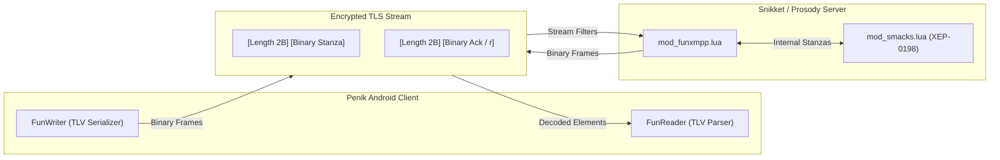

<p align="center">
  
</p>

# Penik (XMPP)

**Penik** (`ru.penik.xmpp`) is a next-generation Android messenger powered by the high-performance **PXMPP** binary protocol and a modern, fluid Jetpack Compose user interface.

It combines the decentralized power and security of open standards with the polish, speed, and efficiency expected of contemporary consumer messengers.

---

## Key Features

- **PXMPP Binary Protocol (FunXMPP)**
  - Replaces verbose XML wire streams with an ultra-compact Type-Length-Value (TLV) binary protocol (`penik:protocol:funxmpp`).
  - Reduces mobile cellular data consumption by **40% to 70%**.
  - Eliminates XML parsing overhead on low-power mobile CPU cores, extending battery life and eliminating GC churn.
  - Transparent stream negotiation with FNV-1a dictionary checksum verification.
- **Modern Jetpack Compose UI**
  - Clean Material 3 design with custom Penik palette (`Theme.Penik`, circular avatars, unified chat bubble geometry).
  - Real-time message status indicators (single/double delivery and read receipts), live reactions, and chat state indication.
  - Streamlined navigation: Chats, Calls, Saved Messages, and Profile tabs.
- **Privacy & Encryption**
  - Seamless end-to-end encryption (OMEMO) with zero configuration required.
  - Automatic key acceptance and chat upgrade when communicating with encrypted peers.
  - Strict TLS transport security and privacy by design.
- **High-Definition Voice & Video Calls**
  - Jingle / WebRTC peer-to-peer audio and video calling.
  - Telegram-style independent video upgrade: video streams toggle independently on each side without disrupting ongoing audio.
  - Full-screen incoming call activity for instant pickup.
- **Rock-Solid Connectivity**
  - Full XEP-0198 Stream Management support with optimized server piggybacking.
  - Instant stream resumption across Wi-Fi and mobile network switches with zero packet loss.

---

## The PXMPP Protocol

PXMPP is Penik's native binary framing protocol implemented in both the Android client and the server.



### Highlights:
1. **Static Tokenization:** 140+ core XMPP tags, attributes, namespaces, and local server domains are encoded into single-byte tokens (`0x00`..`0xEE`).
2. **JID Compression:** Addresses with known domains compress into a single token byte (`JID_BARE 0xFD`, `JID_FULL 0xFE`), eliminating domain repetition.
3. **Safe Two-Tier Framing:** Outer frame lengths (`u16` or `0xFFFF + u32`) strictly avoid the `<` (`0x3C`) byte, guaranteeing stream synchronization.
4. **mod_smacks Piggybacking:** Piggybacked acknowledgment requests are parsed and delivered as dual binary frames without raw XML string leaks.

Comprehensive specifications:
- [English Technical Specification](docs/PXMPP/README.md)
- [Русская спецификация протокола](docs/PXMPP/README_RU.md)

---

## Tech Stack

| Component | Technology |
| :--- | :--- |
| **UI Framework** | Jetpack Compose (Material 3, Navigation, Coil), Compose BOM 2026.09 |
| **Language & Toolchain** | Kotlin 2.4, Java 21, Android SDK (minSdk 26, compileSdk 37) |
| **XMPP & Crypto Core** | Penik XMPP Core (`im.conversations.android.xmpp`), Conscrypt TLS, OMEMO |
| **Binary Protocol** | PXMPP / FunXMPP (`eu.siacs.conversations.xmpp.fun.*`) |
| **Media & Calls** | Jingle WebRTC RTP engine, Exoplayer |
| **Server Plugin** | Prosody Lua module (`server/Modules/mod_funxmpp.lua`) |
| **Build System** | Gradle 9, AGP 9.2, R8 optimizer, DataBinding |

---

## Quick Start & Installation

### Automated Build & Install via ADB
An all-in-one automation script is provided in the repository root:

```bash
# Build, install on connected phone, and launch Penik
./install_phone.sh

# Reinstall existing build without rebuilding
./install_phone.sh -n

# Target specific device
./install_phone.sh -s <device_serial>
```

### Manual Gradle Build
```bash
# Build debug APK
bash ./gradlew assembleConversationsFreeDebug

# Run unit tests
bash ./gradlew testConversationsFreeDebugUnitTest
```
The resulting APK is generated in `build/outputs/apk/conversationsFree/debug/`.

---

## Repository Structure

```
├── docs/
│   └── PXMPP/              # PXMPP binary protocol specifications (EN / RU)
├── server/
│   ├── Modules/            # Prosody / Snikket Lua plugins
│   │   ├── mod_funxmpp.lua # Binary protocol plugin
│   │   └── test_mod_funxmpp.lua # Lua test suite
│   └── MicroServices/      # Standalone backend microservices (Rust)
├── src/
│   ├── main/
│   │   ├── AndroidManifest.xml
│   │   ├── java/eu/siacs/conversations/
│   │   │   ├── ui/compose/ # Penik Compose screens (Chats, Calls, Profile)
│   │   │   ├── xmpp/fun/   # FunWriter, FunReader, FunTokens (PXMPP engine)
│   │   │   └── ...         # Core XMPP connection, crypto, managers
│   │   └── res/            # Penik themes, vector drawables, colors
│   └── test/               # JUnit tests (FunProtocolTest, JidTest, etc.)
├── install_phone.sh        # Automated ADB build & install script
├── PROJECT_MAP.md          # Complete index of all codebase files
└── build.gradle            # Root Gradle project configuration
```

> [!TIP]
> Always consult [PROJECT_MAP.md](PROJECT_MAP.md) for precise file locations and module roles.

---

## Server Deployment Notes

- **Server Plugin Installation:** Copy `server/Modules/mod_funxmpp.lua` into your Prosody `modules/` directory and add `"funxmpp"` to your `modules_enabled` list. Run `lua server/Modules/test_mod_funxmpp.lua` to verify compatibility.

---

## Upstream & Heritage

Penik's core networking, cryptographic foundations, and XMPP compliance are built upon the robust, battle-tested open-source code of [Conversations](https://codeberg.org/iNPUTmice/Conversations) by Daniel Gultsch. Penik extends this base with the PXMPP binary protocol, a rewritten Jetpack Compose UI, and modern mobile UX enhancements.
