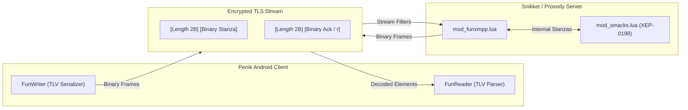

<p align="center">
  
</p>

<h1 align="center">Penik (XMPP)</h1>

<p align="center">
  <b>English</b> | <a href="README_RU.md">Русский</a>
</p>

**Penik** (`ru.penik.xmpp`) is a next-generation Android messenger powered by the high-performance **PXMPP** binary protocol and a modern, fluid Jetpack Compose user interface.

It combines the decentralized power and security of open standards with the polish, speed, and efficiency expected of contemporary consumer messengers.

---

## Key Features

- **PXMPP Binary Protocol (FunXMPP)**
  - Replaces verbose XML wire streams with an ultra-compact Type-Length-Value (TLV) binary protocol (`penik:protocol:funxmpp`).
  - Reduces mobile cellular data consumption by **40% to 70%**.
  - Eliminates XML parsing overhead on low-power mobile CPU cores, extending battery life and eliminating GC churn.
  - Transparent stream negotiation with FNV-1a dictionary checksum verification.
- **Modern Jetpack Compose UI**
  - Clean Material 3 design with custom Penik palette (`Theme.Penik`, circular avatars, unified chat bubble geometry).
  - Real-time message status indicators (single/double delivery and read receipts), live reactions, and chat state indication.
  - Streamlined navigation: Chats, Calls, Saved Messages, and Profile tabs.
  - Telegram-style attachment bottom sheet with multi-select and live media preview.
- **Telegram-Compatible Stickers**
  - Support for Telegram sticker packs: static WebP, Animated WebP, and vector `.tgs` animations.
  - High-performance Rust backend converts WebM VP9 with alpha transparency (`-c:v libvpx-vp9`) into smooth Animated WebP without heavy custom OpenGL shaders.
  - 4-column sticker keyboard with static 128x128 thumbnails for zero-stutter 60 FPS scrolling.
- **Private Contact Discovery ($k$-anonymity Contact Discovery)**
  - Safe address book synchronization without revealing user contacts to the server.
  - Client normalizes phone numbers to E.164 and computes their SHA-256 hashes.
  - Only short 3-hex-char prefixes are transmitted to the server (`POST /api/v1/phone-directory/lookup`), implementing a strict $k$-anonymity bucket model.
  - Server returns matching `{jid, phone_hash}` tuples; full hash comparison happens strictly on the local client device.
  - Plain phone numbers are never bulk-broadcasted: targeted `GET /api/v1/phone-directory/:jid` resolution is guarded by Bearer HMAC-SHA256 tokens and only fulfilled for mutual authorized contacts.
- **Privacy & Encryption**
  - End-to-end encryption (OMEMO) is **disabled by default**: messages and files are stored on the server unencrypted and can be read by the server operator.
  - OMEMO remains available as an optional per-chat setting, but it is not enabled out of the box.
  - TLS protects traffic in transit only. Privacy by design is not claimed for stored history.
- **High-Definition Voice & Video Calls**
  - Jingle / WebRTC peer-to-peer audio and video calling.
  - Telegram-style independent video upgrade: video streams toggle independently on each side without disrupting ongoing audio.
  - Full-screen incoming call activity for instant pickup.
- **Rock-Solid Connectivity & Push Notifications**
  - Full XEP-0198 Stream Management support with optimized server piggybacking.
  - Instant stream resumption across Wi-Fi and mobile network switches with zero packet loss.
  - Dual push notification backends: Google Play Services (FCM) and UnifiedPush.

---

## The PXMPP Protocol

PXMPP is Penik's native binary framing protocol implemented in both the Android client and the server.



### Highlights:
1. **Static Tokenization:** 140+ core XMPP tags, attributes, namespaces, and local server domains are encoded into single-byte tokens (`0x00`..`0xEE`).
2. **JID Compression:** Addresses with known domains compress into a single token byte (`JID_BARE 0xFD`, `JID_FULL 0xFE`), eliminating domain repetition.
3. **Safe Two-Tier Framing:** Outer frame lengths (`u16` or `0xFFFF + u32`) strictly avoid the `<` (`0x3C`) byte, guaranteeing stream synchronization.
4. **mod_smacks Piggybacking:** Piggybacked acknowledgment requests are parsed and delivered as dual binary frames without raw XML string leaks.

Comprehensive specifications:
- [English Technical Specification](docs/PXMPP/README.md)
- [Русская спецификация протокола](docs/PXMPP/README_RU.md)

---

## Tech Stack

| Component | Technology |
| :--- | :--- |
| **UI Framework** | Jetpack Compose (Material 3, Navigation, Coil, Lottie), Compose BOM 2026.09 |
| **Language & Toolchain** | Kotlin 2.4, Java 21, Android SDK (minSdk 26, compileSdk 37) |
| **XMPP & Crypto Core** | Penik XMPP Core (`im.conversations.android.xmpp`), Conscrypt TLS, OMEMO (optional, off by default) |
| **Binary Protocol** | PXMPP / FunXMPP (`eu.siacs.conversations.xmpp.fun.*`) |
| **Media & Calls** | Jingle WebRTC RTP engine, ExoPlayer |
| **Server Plugins** | Prosody Lua modules (`server/Modules/mod_funxmpp.lua`, `mod_stickers_auth.lua`) |
| **Microservices** | Rust Axum backend companion service (`server/MicroServices/penik-service-rs`): Telegram stickers converter/importer, $k$-anonymity private contact discovery, and phone directory with HMAC-SHA256 Bearer authentication |
| **Build System** | Gradle 9, AGP 9.2, R8 optimizer, DataBinding |

---

## Quick Start & Installation

### Automated Build & Install via ADB
An all-in-one automation script is provided in `scripts/`:

```bash
# Build and install Playstore flavor with FCM notifications (default)
./scripts/install_phone.sh

# Build and install Free flavor with UnifiedPush
./scripts/install_phone.sh --free

# Reinstall existing build without rebuilding
./scripts/install_phone.sh -n

# Target specific device
./scripts/install_phone.sh -s <device_serial>
```

### Manual Gradle Build
```bash
# Navigate to the Android client directory
cd android

# Build Playstore debug APK with FCM notifications
bash ./gradlew assembleConversationsPlaystoreDebug

# Build Free debug APK with UnifiedPush
bash ./gradlew assembleConversationsFreeDebug

# Run unit tests
bash ./gradlew testConversationsFreeDebugUnitTest
```
The resulting APKs are generated under `android/build/outputs/apk/`.

---

## Repository Structure

```
├── android/                # Android client application
│   ├── src/
│   │   ├── main/
│   │   │   ├── AndroidManifest.xml
│   │   │   ├── java/eu/siacs/conversations/
│   │   │   │   ├── ui/compose/ # Penik Compose screens (Chats, Calls, Picker, Stickers)
│   │   │   │   ├── stickers/   # StickerManager and pack caching
│   │   │   │   ├── xmpp/fun/   # FunWriter, FunReader, FunTokens (PXMPP engine)
│   │   │   │   └── ...         # Core XMPP connection, crypto, managers
│   │   │   └── res/            # Penik themes, vector drawables, colors
│   │   └── test/               # JUnit tests (FunProtocolTest, JidTest, etc.)
│   ├── libs/                   # Annotation and annotation processor modules
│   └── build.gradle            # Android Gradle project configuration
├── docs/
│   └── PXMPP/              # PXMPP binary protocol specifications (EN / RU)
├── scripts/
│   ├── install_phone.sh    # Automated ADB build & install script
│   └── deploy_server.sh    # Prosody & microservices deployment script
├── server/
│   ├── Modules/            # Prosody / Snikket Lua plugins
│   │   ├── mod_funxmpp.lua      # Binary protocol plugin
│   │   ├── test_mod_funxmpp.lua # FunXMPP Lua test suite
│   │   ├── mod_stickers_auth.lua # HMAC-SHA256 stickers token issuer
│   │   └── test_mod_stickers_auth.lua # Stickers auth test suite
│   └── MicroServices/      # Standalone backend microservices (Rust, GPL-3.0-only)
│       └── penik-service-rs/    # Telegram stickers & $k$-anonymity contact discovery backend service
├── PROJECT_MAP.md          # Complete index of all codebase files
└── LICENSE                 # GNU General Public License v3
```

> [!TIP]
> Always consult [PROJECT_MAP.md](PROJECT_MAP.md) for precise file locations and module roles.

---

## Server Deployment Notes

- **Prosody Modules:** Copy `server/Modules/mod_funxmpp.lua` and `server/Modules/mod_stickers_auth.lua` into your Prosody `modules/` directory. Enable `"funxmpp"` and `"stickers_auth"` in your `modules_enabled` list. Run the provided Lua test suites to verify compatibility.
- **Backend Service:** Build and run `server/MicroServices/penik-service-rs` using Cargo or Docker. The service requires `ffmpeg` with `libvpx-vp9` and exposes a secure HMAC-SHA256 authenticated REST API for stickers and $k$-anonymity contact discovery by 3-hex-char phone hash prefixes.

---

## Upstream & Heritage

Penik's core networking, cryptographic foundations, and XMPP compliance are built upon the robust, battle-tested open-source code of [Conversations](https://codeberg.org/iNPUTmice/Conversations) by Daniel Gultsch. Penik extends this base with the PXMPP binary protocol, a rewritten Jetpack Compose UI, Telegram stickers support, and modern mobile UX enhancements.
