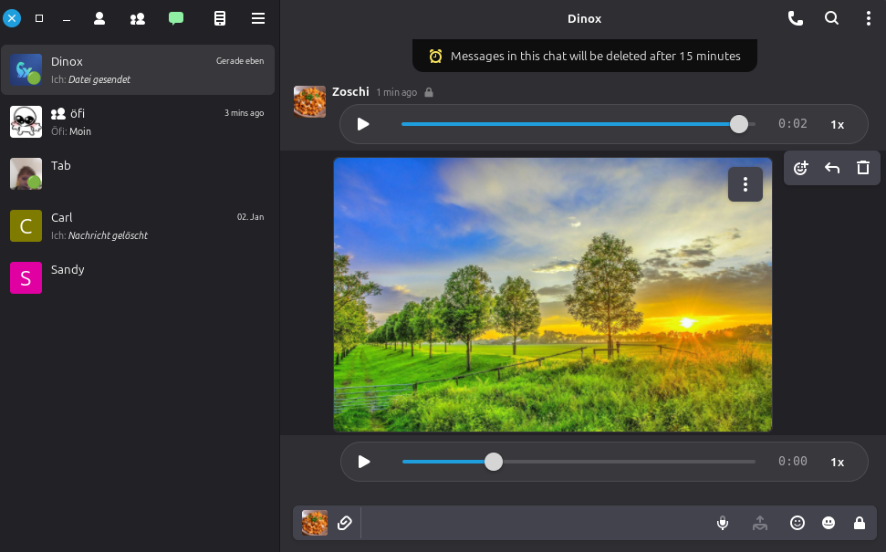
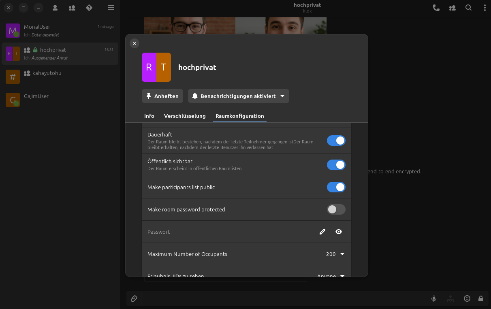
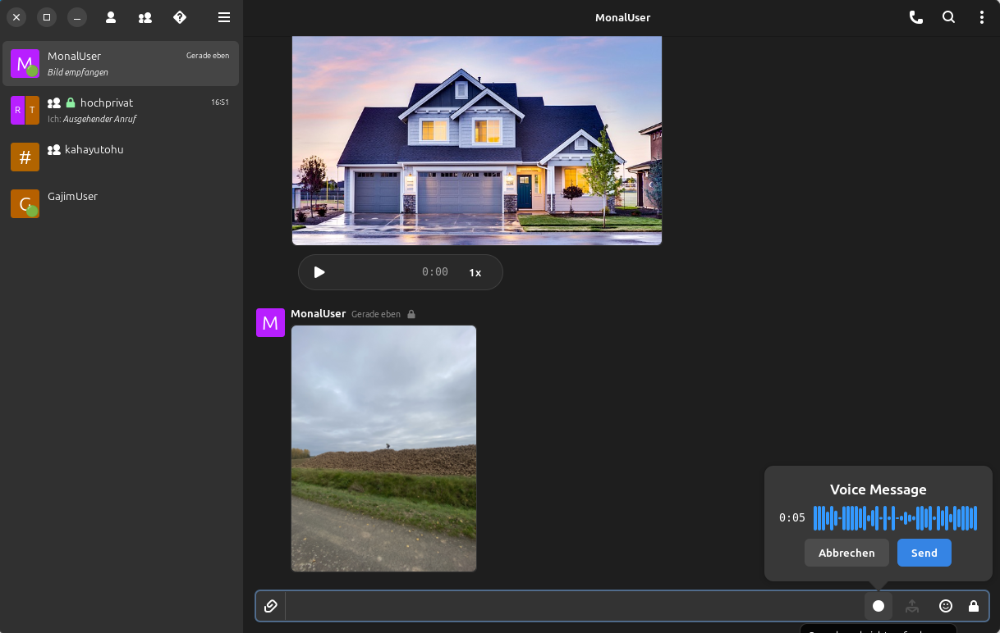
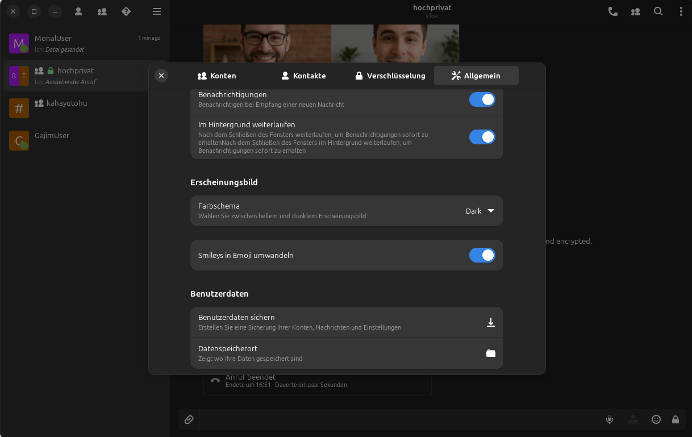

<div align="center">


# DinoX

[](LICENSE)
[](https://www.gtk.org/)
[](https://git.dinox.im/dinoxim/dinox/releases)


**Secure XMPP messenger for desktop chat, calls, files and automation**

DinoX is a GTK4/libadwaita XMPP client for Linux and Windows. It focuses on
private messaging, self-hosted infrastructure and practical interoperability:
encrypted 1:1 chats, group chats, file sharing, voice/video calls, voice/video
messages, optional Tor routing, local data encryption and OpenPGP/OMEMO key
management.

Beyond normal messenger use, DinoX includes optional modules for local REST
automation, Botmother bot management, AI provider integration, MQTT/IoT topics
and DTMF dialpad support for XMPP SIP provider workflows.

DinoX works with XMPP servers such as ejabberd and Prosody. The available
features depend on the server's modules, configuration and account permissions.
Server administration discovers the selected account's server and separates
XMPP ad-hoc commands from separately configured HTTP API operations.

[Website](https://dinox.im) • [Source](https://git.dinox.im/dinoxim/dinox) • [Releases](https://git.dinox.im/dinoxim/dinox/releases) • [Milestone 2.0.0](https://git.dinox.im/dinoxim/dinox/milestone/1) • [Download](#installation) • [Features](#key-features) • [XEP Support](#xep-support) • [Build](docs/internal/BUILD.md) • [Debug](docs/internal/DEBUG.md) • [Testing](docs/internal/TESTING.md) • [Changelog](docs/internal/CHANGELOG.md) • [Contributing](CONTRIBUTING.md)

</div>

---

## Key Features

| Feature | Description |
|---------|-------------|
| **Encrypted File Upload** | AES-GCM encrypted file URLs plus incoming XEP-0448 interoperability; DinoX does not currently emit outgoing ESFS payloads |
| **Local File Encryption** | Local avatars, stickers and transfers are encrypted at rest (AES-256-GCM) |
| **Secure Deletion** | Global history deletion with throttling and local cache cleanup |
| **OMEMO Encryption** | End-to-end encryption for messages and files; legacy OMEMO is enabled, while the OMEMO 2 path remains disabled in stable builds |
| **OpenPGP Encryption** | XEP-0027 compatibility, XEP-0373 key management and XEP-0374 signcrypt text messages, including key generation, deletion and revocation |
| **Encrypted Local Database** | Local data is stored in an encrypted SQLCipher database (password required at startup) |
| **Change Database Password** | Change the local database password via Preferences (SQLCipher rekey) |
| **Panic Wipe** | Quickly wipe local DinoX data (`Ctrl+Shift+Alt+P`) and exit (also triggered after 3 failed unlock attempts) |
| **OpenPGP Keyring Isolation** | Uses DinoX's own user-data `GNUPGHOME`; never falls back to the operating system's keyring |
| **Disappearing Messages** | Auto-delete messages after 15min, 30min, 1h, 24h, 7d or 30d |
| **Voice & Video Calls** | Google/libwebrtc 1:1 calls and private-MUC group calls with capable peers, participant invitations and rejoining an active call |
| **Turn a 1:1 Call into a Conference** | Invite more participants during a one-to-one audio or video call; DinoX checks group-call support before preparing a private conference |
| **Video Call Effects** | Local colour filters, picture adjustments, background blur/replacement, automatic framing and face accessories; available in 1:1 and MUJI video calls |
| **DTMF & Dialpad** | RFC 4733 telephone-event support with Dialpad UI for XMPP SIP Provider telephony (hotlines, IVR, conference controls) |
| **Voice Messages** | Record, preview and send audio messages (AAC format); compact waveform player with seeking in chat |
| **Video Messages** | Record and send video messages with camera preview (H.264+AAC in MP4, max 720p, 120s) |
| **Inline Video Player** | Play videos directly in chat (no external player) |
| **Group Chats (MUC)** | Group chats with moderation, roles and private-room workflows |
| **Tor Routing** | Optional integrated Tor with Lyrebird obfs4 and WebTunnel transports |
| **System Tray** | Background mode, status and notification controls; coloured native menus on Linux and Windows |
| **Message Retraction** | Delete messages for everyone (XEP-0424) |
| **Emoji Reactions** | React to messages (XEP-0444) |
| **Stickers** | Send and receive sticker packs (XEP-0449), import from an XMPP link or image folder, and control chat animations |
| **Server Administration** | Account-scoped ejabberd/Prosody command lists with readable actions and separate ad-hoc/API access |
| **Server User Directory** | Search a server-provided directory; stored contacts remain available through the local contact search |
| **Message Replies** | Quote and reply to messages (XEP-0461) |
| **MQTT Plugin** | IoT sensor data via MQTT 5.0 — topic subscriptions, alerts, sparkline charts, XMPP bridging, Home Assistant integration, Prosody mod_pubsub_mqtt support, ejabberd mod_mqtt support, Node-RED integration with free-text publish/response |
| **MUC Moderation** | Kick, ban and role management through XEP-0045; moderated message retraction through XEP-0425 |
| **TLS Certificate Pinning** | Trust self-signed certs for self-hosted servers |
| **TLS Certificate Info** | View TLS certificate details (issuer, validity, fingerprint) in account settings |
| **DNSSEC and DANE** | Optional verification per XMPP account and MQTT broker, with off, supported-domain and required modes; proxy-aware encrypted DNS |
| **Login Protection (MITM)** | Shows server support and actual use, reconnects the selected account after changes, and validates SCRAM/TLS downgrade proofs |
| **Feeds** | Read/share RSS and Atom, subscribe with a selectable interval while DinoX runs, and publish personal XMPP posts; open with Ctrl+Shift+F |
| **Backup & Restore** | Full data backup with optional GPG encryption (AES-256) |
| **Database Maintenance** | Clean orphaned records, optimize storage |
| **PGP Key Management** | Generate, select, delete, revoke OpenPGP keys in-app. Automatic key exchange via PEP |
| **38 Interface Languages** | English and 37 complete translations, including settings, dialogs, OMEMO and OpenPGP; unsupported system languages use English |
| **Appearance** | Classic or DinoX Design, each with System, Light and Dark modes |

### Feeds and connection security

[Feeds](docs/internal/FEEDS.md) separates web articles shared in encrypted chats
from personal XMPP posts, which are not end-to-end encrypted. Automatic web-feed
delivery runs only while DinoX and the selected account are online.
[DNSSEC/DANE](docs/internal/DNSSEC_DANE_PLAN.md) is optional and configured per
account or MQTT broker. [Login protection](docs/internal/SASL_SECURITY.md) shows
server support and the current connection's protection separately. PLAIN-only
servers require explicit permission; TLS certificate checks remain enabled.

### OpenPGP keys and server backups

DinoX uses its own GnuPG directory, normally
`~/.local/share/dinox/openpgp/gnupg` on Linux (under `XDG_DATA_HOME` when set).
Windows uses `openpgp/gnupg` below DinoX's user-data directory and prefers the
bundled GnuPG programs. DinoX does not use or modify the operating system's
default keyring; an unavailable DinoX keyring produces an error.

Key selections and server operations belong to the account shown in Key
Management. The local DinoX keyring is shared between its accounts, so a key
assigned to another account cannot be revoked or deleted until that account's
selections and manual assignment have been removed. Importing a private key
assigns it to the current account without activating it. A legacy XEP-0027
key's email address may differ from that account's XMPP address. XEP-0373/0374
selection still requires a matching `xmpp:` user ID.

Keep the displayed backup code, including its hyphens, before uploading a
server backup. New backups use the uppercase XEP-0373 code; older DinoX backups
remain restorable. The original private-key passphrase, if any, is requested
separately when preparing a backup and is not changed in the local keyring.

A server backup belongs to one XMPP account and may contain several private
keys. Revocation removes only a positively identified backup containing just
the selected key. An unrelated backup stays on the server. If a backup is
unknown or contains other keys, DinoX keeps the local key and asks you to
identify or explicitly remove the account's backup first. **Delete Server
Backup** removes that entire account backup, keeping local keys and public-key
publications. Failed key-related backup cleanup is saved for a checked retry
when the account reconnects; local revocation remains a separate explicit
action. See [OpenPGP isolation diagnostics](docs/internal/DEBUG.md).

## Message history

In a one-to-one chat or group, choose **Load messages now** from the chat's
three-dot menu, or press **Ctrl+Shift+H**. The shortcut is also listed in the
keyboard-shortcut overview. One-to-one chats request only that contact's
messages from the account archive, using DinoX's automatic history period.

Open a group's details and choose **Settings → Load message history**
(German: **Einstellungen → Nachrichtenverlauf nachladen**). Enable
**Set a custom period** to choose **1–365 days**, or leave it off to use
DinoX's automatic history rules. The choice is saved separately for each group
and account; changing it does not start an archive request.

Choose **Load now**, or use the chat menu, to request the selected period for a joined group. For an
offline account or a group you have left, the saved period applies on the next
join. The server must offer a room archive and may retain less history than
requested. One-to-one chats likewise require the server's account archive.
Cleared and expired messages remain excluded. This personal setting
does not change the group's server configuration.

## Installation

### Windows

Download the newest release that contains a Windows ZIP/prebuild artifact from
[DinoX Releases](https://git.dinox.im/dinoxim/dinox/releases). Extract the ZIP
archive and run `dinox.exe`. Keep the complete extracted directory together;
it contains the required runtime DLLs and the package-specific license
inventory under `share/licenses/dinox`.

To build DinoX from source on Windows, see the build instructions: [Deutsch](docs/internal/WINDOWS_BUILD.md) | [English](docs/internal/WINDOWS_BUILD_EN.md)

On first start after unpacking, Windows Defender may briefly scan the extracted files.
After that, DinoX should start normally. Calls and media-message capture load
the Google/libwebrtc worker on demand; media-file decoding is handled
separately by GStreamer.

Geolocation for locations is not available on Windows.

### Choose the Linux download for your system

| Your system | Download |
|-------------|----------|
| Ubuntu 24.04 or Linux Mint 22.x, 64-bit Intel/AMD | `.deb`, AppImage or Flatpak |
| Debian 13 (Trixie), including SparkyLinux 8.x, 64-bit Intel/AMD | AppImage or Flatpak; alternatively build from source |

The `.deb` extension describes the package format, not compatibility with every
Debian-based distribution. Our official `.deb` uses Ubuntu 24.04 libraries.
Installing development packages does not make that binary compatible with a
different distribution.

### Ubuntu 24.04 / Linux Mint 22 (.deb)

Download the `.deb` package and matching `.sha256` file from a DinoX release
that contains Debian-format package artifacts. The official binary `.deb` is
built and tested on Ubuntu 24.04 and Linux Mint 22; it is not the Debian 13
binary package. Debian 13 users should use the AppImage or Flatpak below, or
build DinoX from source:
[DinoX Releases](https://git.dinox.im/dinoxim/dinox/releases).

```bash
sha256sum -c dinox_*.deb.sha256
sudo apt update
sudo apt install ./dinox_*.deb
```

Run these commands in the download folder, with only the package version you
want to install there. APT downloads the required runtime libraries from your
distribution's configured repositories. A file-manager installer may instead
stop at an unresolved dependency; the APT command shows the complete reason.

If installation reports `libgpgme11t64` or `libicu74` as unavailable, first check
that you are using a supported Ubuntu/Mint version. On Debian Trixie or a
derivative, use AppImage or Flatpak instead. Do not install `libgpgme-dev`, add
Ubuntu repositories to Debian, or force the `.deb` installation to bypass the
error. See [installation troubleshooting](docs/internal/BUILD.md#deb-installation-troubleshooting).

### Flatpak

Download the Flatpak bundle and matching checksum from a DinoX release that
contains Flatpak artifacts:
[DinoX Releases](https://git.dinox.im/dinoxim/dinox/releases).

```bash
# Verify and install DinoX
sha256sum -c ./dinox-*-x86_64.flatpak.sha256
flatpak install --user ./dinox-*-x86_64.flatpak

# Run
flatpak run im.dinox.dinox
```

The bundle installation automatically fetches its required GNOME 50 and
matching codec runtimes from the embedded runtime repository when they are not
installed yet.
A manual `flatpak install flathub org.gnome.Platform//50` is only a
troubleshooting step if automatic runtime resolution reports an error; it is
not part of the normal installation.

### AppImage

- Download the AppImage and matching checksum from a DinoX release that
  contains AppImage artifacts:
  [DinoX Releases](https://git.dinox.im/dinoxim/dinox/releases).

  ```bash
  sha256sum -c DinoX-*.AppImage.sha256
  chmod +x DinoX-*.AppImage
  ./DinoX-*.AppImage
  ```

  The matching `.AppImage.sources.tar.xz` release asset provides the
  corresponding-source and license payload. It is not required to run DinoX.

- Install via [AppMan](https://github.com/ivan-hc/AppMan) (rootless)

  ```bash
  appman -i dinox
  ```

- Install via [AM](https://github.com/ivan-hc/AM)

  ```bash
  am -i dinox
  ```

### Build from Source

DinoX uses Meson/Ninja and normal distribution development packages. Official
release packages use a separately provisioned builder image for pinned custom
dependency versions. Every production build consumes the public, pinned
Google/libwebrtc DinoX runtime artifact (M152 on Linux and Windows). The current source-build reference
is Ubuntu 24.04 LTS, Linux Mint 22.x and Debian 13. For complete build
instructions and packaging notes, start with the
**[Linux Source Build](docs/internal/BUILD.md#linux-source-build)** guide.

## Local data encryption

DinoX stores your local data (accounts, messages, settings, cached metadata) in an **encrypted SQLCipher database**.

- You will be prompted for a **password on startup**.
- If you forget the password, the database cannot be recovered.
- A **Panic Wipe** action is available via the app menu and the shortcut `Ctrl+Shift+Alt+P`.

## Audio/Video calling notes

DinoX 1:1 calling focuses on cross-client interoperability, notably with
**Conversations/monocles (Android)** and **Monal (iOS)**:

- **Live-call engine:** pinned Google/libwebrtc in an external supervised
  worker process; GStreamer RTP is not a production call fallback.
- **Security profile:** mandatory **DTLS-SRTP**; XMPP/OMEMO verifies the call
  fingerprint before media is accepted.
- **Baseline codecs:** **Opus** (audio) and **VP8** (video). M152 also
  supports negotiated VP9 and H.264 with automatic hardware/software selection.
- **Network policy:** Automatic by default, with an explicit audio-only
  low-bandwidth (2G) mode using a 16 kbit/s Opus sender cap.
- **Devices:** libwebrtc owns microphone, speaker and camera integration on
  Linux and Windows. PipeWire, PulseAudio, ALSA and WASAPI are platform details
  behind that engine rather than separate DinoX call pipelines.

The media paths are deliberately separated:

- On Linux, Google/libwebrtc captures raw microphone/camera frames for voice
  and video messages. The `ffmpeg` command encodes and writes AAC/M4A or
  H.264+AAC/MP4 files.
- On Windows, Google/libwebrtc captures the raw frames and Windows Media
  Foundation encodes and writes the media-message files; a system `ffmpeg`
  executable is not used for this path.
- GStreamer demuxes and decodes received/local media files, extracts metadata
  and thumbnails, and feeds decoded audio PCM to the selected libwebrtc
  speaker. It is neither the production call engine nor the Linux recorder
  muxer.

Google/libwebrtc owns ICE, STUN and TURN for calls. `libnice` remains packaged
only because the separate legacy ICE plugin currently also supplies local
address discovery and per-account Tor/SOCKS5 policy hooks to direct Jingle-S5B
file transfer. For targeted call diagnostics, see
[DEBUG.md](docs/internal/DEBUG.md).

### Video effects and group calls

Video-call effects are applied locally to your outgoing camera picture. Your
preview and the picture sent to other participants use the same effects; the
other client receives an ordinary video stream. Choose a colour filter, adjust
brightness/contrast/saturation/sharpness, blur or replace the background, or add
glasses, hats, beards and animated decorations. Background images are still PNG
or JPEG files. Automatic framing follows the detected person; face accessories track one face.

The offline person/face models are included in the pinned runtime and are used
when the selected background, framing or face effect needs them. Basic colour
filters do not need those models. See the
[runtime guide](docs/internal/GOOGLE_WEBRTC_RELEASE_PACKAGING.md) for the exact
files and the remaining device/performance acceptance checks.

Group calls require MUJI support from the participating clients and an eligible
private room. Calls started in an existing private group use that room. The
phone menu can return to its running call; inviting another participant into
a 1:1 call requests a temporary private call room. A client's working 1:1 calls
alone do not establish group-call support.

Under **Preferences → General → Appearance**, choose **Classic** or
**DinoX Design**. Color scheme (System, Light or Dark), accent color and chat
font remain separate choices. Existing profiles and new installations start
with Classic. The website design follows the selected light/dark mode and
leaves system high-contrast colors in control. The choice is saved with the
encrypted profile and takes effect after unlocking it.

The application icon uses the website's mint DinoX mark in both designs.
The canonical source is `main/data/icons/hicolor/scalable/apps/im.dinox.dinox.svg`;
maintainers can regenerate the Linux PNGs and Windows ICO with
`python3 scripts/generate-app-icons.py` (Python GI/Rsvg, Cairo and Pillow).
These tools are not required for normal package builds.

Linux exports a native SNI tray menu with coloured icons, using the desktop's
menu theme. Windows draws its native tray menu to match DinoX's selected light
or dark appearance, with a system high-contrast fallback. Linux uses GIO's
session D-Bus and DinoX's own menu exporter; no external `libdbusmenu` is needed.

## XEP Support

The machine-readable [dino.doap](dino.doap) file is the authoritative DinoX
protocol inventory. The complete matrix below mirrors all 101 XEPs currently
claimed there. It was reconciled against the production paths and tests on
`master`, and against the official XSF catalogue on 25 August 2026.

The coverage labels describe DinoX, not the formal maturity of the XEP:

- **Production** — shipped and used for the stated DinoX workflow. This does not
  claim every optional server or component role in the specification.
- **Partial** — a clearly bounded subset is shipped.
- **Compatibility** — a legacy or supporting profile is used, but it is not a
  separate complete user feature.

<details>
<summary>Complete claimed XEP matrix (101 entries)</summary>

| XEP | Official name | Coverage | DinoX scope |
|-----|---------------|----------|-------------|
| [XEP-0004](https://xmpp.org/extensions/xep-0004.html) | Data Forms | Production | Parses, renders and submits the forms used by registration, MUC, PubSub and commands. |
| [XEP-0027](https://xmpp.org/extensions/xep-0027.html) | Current Jabber OpenPGP Usage | Compatibility | Legacy OpenPGP messages and signed presence remain an enabled interoperability path. |
| [XEP-0030](https://xmpp.org/extensions/xep-0030.html) | Service Discovery | Production | Disco info/items, feature advertisement and capability caching. |
| [XEP-0045](https://xmpp.org/extensions/xep-0045.html) | Multi-User Chat | Partial | Common join, invitation, configuration, moderation, role and private-room workflows; not every optional historical role. |
| [XEP-0047](https://xmpp.org/extensions/xep-0047.html) | In-Band Bytestreams | Compatibility | Bytestream substrate used by XEP-0261. |
| [XEP-0048](https://xmpp.org/extensions/xep-0048.html) | Bookmarks | Compatibility | Legacy bookmark fallback; XEP-0402 is preferred when the server advertises conversion. |
| [XEP-0049](https://xmpp.org/extensions/xep-0049.html) | Private XML Storage | Production | Reads and writes the legacy private XML data used by fallback workflows. |
| [XEP-0050](https://xmpp.org/extensions/xep-0050.html) | Ad-Hoc Commands | Partial | Discovers and executes multi-step remote commands and supports local handlers; DinoX is not a general command server. |
| [XEP-0054](https://xmpp.org/extensions/xep-0054.html) | vcard-temp | Production | Reads and writes vCard-temp data, including the vCard avatar path. |
| [XEP-0055](https://xmpp.org/extensions/xep-0055.html) | Jabber Search | Production | Discovers search services and submits legacy or data-form searches. |
| [XEP-0059](https://xmpp.org/extensions/xep-0059.html) | Result Set Management | Partial | Paging support used by MAM queries. |
| [XEP-0060](https://xmpp.org/extensions/xep-0060.html) | Publish-Subscribe | Partial | PubSub/PEP operations required by shipped features, not a general PubSub administration client. |
| [XEP-0065](https://xmpp.org/extensions/xep-0065.html) | SOCKS5 Bytestreams | Compatibility | Discovery and proxy substrate used by XEP-0260. |
| [XEP-0066](https://xmpp.org/extensions/xep-0066.html) | Out of Band Data | Production | HTTP-upload links and interoperable file fallbacks. |
| [XEP-0077](https://xmpp.org/extensions/xep-0077.html) | In-Band Registration | Production | Registration forms, submission and the pre-authenticated registration integration. |
| [XEP-0080](https://xmpp.org/extensions/xep-0080.html) | User Location | Production | Publishes and displays location data where the platform supports it. |
| [XEP-0082](https://xmpp.org/extensions/xep-0082.html) | XMPP Date and Time Profiles | Production | Parses and emits XMPP date/time values. |
| [XEP-0084](https://xmpp.org/extensions/xep-0084.html) | User Avatar | Production | Publishes, retrieves and removes PEP avatars. |
| [XEP-0085](https://xmpp.org/extensions/xep-0085.html) | Chat State Notifications | Production | Sends and receives chat states subject to privacy settings. |
| [XEP-0092](https://xmpp.org/extensions/xep-0092.html) | Software Version | Production | Answers software-version requests. |
| [XEP-0104](https://xmpp.org/extensions/xep-0104.html) | HTTP Scheme for URL Data | Compatibility | Serialises HTTP sources used by thumbnails, stickers and file-sharing payloads. |
| [XEP-0115](https://xmpp.org/extensions/xep-0115.html) | Entity Capabilities | Production | Advertises and verifies capability hashes. |
| [XEP-0128](https://xmpp.org/extensions/xep-0128.html) | Service Discovery Extensions | Partial | Consumes extended disco forms for MUC room information and HTTP upload limits. |
| [XEP-0133](https://xmpp.org/extensions/xep-0133.html) | Service Administration | Partial | Exposes server-advertised administration commands through XEP-0050; server-specific commands remain separate. |
| [XEP-0153](https://xmpp.org/extensions/xep-0153.html) | vCard-Based Avatars | Compatibility | Receives and sends avatar hashes in normal and directed MUC presence alongside XEP-0084. |
| [XEP-0158](https://xmpp.org/extensions/xep-0158.html) | CAPTCHA Forms | Production | Handles CAPTCHA fields in registration/data-form workflows. |
| [XEP-0163](https://xmpp.org/extensions/xep-0163.html) | Personal Eventing Protocol | Production | PEP event and storage layer for avatars, bookmarks, keys and displayed-state sync. |
| [XEP-0166](https://xmpp.org/extensions/xep-0166.html) | Jingle | Partial | Session subset required by calls and direct file transfer. |
| [XEP-0167](https://xmpp.org/extensions/xep-0167.html) | Jingle RTP Sessions | Partial | Audio/video RTP subset bridged to the Google/libwebrtc worker. |
| [XEP-0172](https://xmpp.org/extensions/xep-0172.html) | User Nickname | Production | Publishes and consumes PEP nicknames. |
| [XEP-0176](https://xmpp.org/extensions/xep-0176.html) | Jingle ICE-UDP Transport Method | Partial | Call transport mapped to libwebrtc ICE; not every historical transport path is claimed. |
| [XEP-0184](https://xmpp.org/extensions/xep-0184.html) | Message Delivery Receipts | Production | Sends, receives and displays delivery receipts where the peer supports them. |
| [XEP-0191](https://xmpp.org/extensions/xep-0191.html) | Blocking Command | Production | Retrieves and changes the server block list. |
| [XEP-0198](https://xmpp.org/extensions/xep-0198.html) | Stream Management | Production | Stream acknowledgement and resumption on the stable connection path. |
| [XEP-0199](https://xmpp.org/extensions/xep-0199.html) | XMPP Ping | Production | Client and MUC liveness pings. |
| [XEP-0202](https://xmpp.org/extensions/xep-0202.html) | Entity Time | Partial | Requests and answers entity-time queries with per-account timezone sharing control; focused protocol regression coverage is still missing. |
| [XEP-0203](https://xmpp.org/extensions/xep-0203.html) | Delayed Delivery | Production | Parses archived/offline message timestamps. |
| [XEP-0215](https://xmpp.org/extensions/xep-0215.html) | External Service Discovery | Partial | Discovers STUN/TURN services needed by calls. |
| [XEP-0221](https://xmpp.org/extensions/xep-0221.html) | Data Forms Media Element | Partial | Parses and displays media embedded in data forms. |
| [XEP-0222](https://xmpp.org/extensions/xep-0222.html) | Persistent Storage of Public Data via PubSub | Compatibility | Public PEP storage profile used by feature payloads. |
| [XEP-0223](https://xmpp.org/extensions/xep-0223.html) | Persistent Storage of Private Data via PubSub | Compatibility | Private/whitelist PEP storage profile used by feature payloads. |
| [XEP-0231](https://xmpp.org/extensions/xep-0231.html) | Bits of Binary | Compatibility | Retrieves and renders embedded binary data used by forms and related payloads. |
| [XEP-0234](https://xmpp.org/extensions/xep-0234.html) | Jingle File Transfer | Partial | Direct send/receive with the supported S5B and IBB transports; not every optional profile. |
| [XEP-0245](https://xmpp.org/extensions/xep-0245.html) | The /me Command | Production | Sends and renders action messages. |
| [XEP-0249](https://xmpp.org/extensions/xep-0249.html) | Direct MUC Invitations | Partial | Receives direct invitations and has an internal sender; the normal room invitation UI deliberately uses mediated XEP-0045 invitations. |
| [XEP-0260](https://xmpp.org/extensions/xep-0260.html) | Jingle SOCKS5 Bytestreams Transport Method | Production | Direct and proxy-capable Jingle file-transfer transport with account routing policy. |
| [XEP-0261](https://xmpp.org/extensions/xep-0261.html) | Jingle In-Band Bytestreams Transport Method | Production | IBB fallback transport for Jingle file transfer. |
| [XEP-0264](https://xmpp.org/extensions/xep-0264.html) | Jingle Content Thumbnails | Partial | Thumbnail elements are used in SFS metadata; direct XEP-0234 offers do not carry them. |
| [XEP-0272](https://xmpp.org/extensions/xep-0272.html) | Multiparty Jingle (MUJI) | Partial | Private-room and 1:1 participant-invitation calls; nickname election/readiness follow the Monocles profile proposal, with legacy OMEMO. |
| [XEP-0280](https://xmpp.org/extensions/xep-0280.html) | Message Carbons | Production | Synchronises sent and received messages across resources. |
| [XEP-0292](https://xmpp.org/extensions/xep-0292.html) | vCard4 Over XMPP | Partial | Reads and publishes the vCard4 fields used by DinoX. |
| [XEP-0293](https://xmpp.org/extensions/xep-0293.html) | Jingle RTP Feedback Negotiation | Partial | Maps supported RTCP feedback between Jingle and libwebrtc SDP. |
| [XEP-0294](https://xmpp.org/extensions/xep-0294.html) | Jingle RTP Header Extensions Negotiation | Partial | Maps supported RTP header extensions between Jingle and libwebrtc SDP. |
| [XEP-0297](https://xmpp.org/extensions/xep-0297.html) | Stanza Forwarding | Partial | Forwarded stanza handling for MAM and carbons, not a generic forwarding feature. |
| [XEP-0298](https://xmpp.org/extensions/xep-0298.html) | Delivering Conference Information to Jingle Participants (Coin) | Partial | Parses conference information used by the call UI. |
| [XEP-0300](https://xmpp.org/extensions/xep-0300.html) | Use of Cryptographic Hash Functions in XMPP | Production | Hash parsing and serialisation for avatars, files and thumbnails. |
| [XEP-0308](https://xmpp.org/extensions/xep-0308.html) | Last Message Correction | Production | Sends, receives and projects message edits. |
| [XEP-0313](https://xmpp.org/extensions/xep-0313.html) | Message Archive Management | Partial | MAM2 history synchronisation and paging; not general archive administration. |
| [XEP-0317](https://xmpp.org/extensions/xep-0317.html) | Hats | Partial | Parses and displays hats and supports the advertised hat administration commands used by DinoX. |
| [XEP-0320](https://xmpp.org/extensions/xep-0320.html) | Use of DTLS-SRTP in Jingle Sessions | Production | Mandatory fingerprinted DTLS-SRTP on the current call path. |
| [XEP-0333](https://xmpp.org/extensions/xep-0333.html) | Displayed Markers | Production | Read/displayed projection for 1:1, MUC and private-MUC conversations, subject to settings and peer support. |
| [XEP-0334](https://xmpp.org/extensions/xep-0334.html) | Message Processing Hints | Partial | Emits and consumes the hints required by the shipped message workflows. |
| [XEP-0352](https://xmpp.org/extensions/xep-0352.html) | Client State Indication | Production | Reports foreground/background state to the server. |
| [XEP-0353](https://xmpp.org/extensions/xep-0353.html) | Jingle Message Initiation | Production | XEP-0353 0.8.0 lifecycle for one-to-one Google/libwebrtc calls, including ringing, finish reasons, tie-breaking, full-JID migration and passive MAM/Carbon recovery. Private-room MUJI calls use their separate XEP-0272/XEP-0482 lifecycle. |
| [XEP-0359](https://xmpp.org/extensions/xep-0359.html) | Unique and Stable Stanza IDs | Production | Origin, stanza and stable IDs used for deduplication and message actions. |
| [XEP-0363](https://xmpp.org/extensions/xep-0363.html) | HTTP File Upload | Production | Slot discovery/request, upload limits, headers, errors and legacy/current namespace interop. |
| [XEP-0367](https://xmpp.org/extensions/xep-0367.html) | Message Attaching | Partial | Attach-to handling used for stateless file-source updates. |
| [XEP-0368](https://xmpp.org/extensions/xep-0368.html) | SRV records for XMPP over TLS | Production | Resolves direct-TLS client SRV records. |
| [XEP-0372](https://xmpp.org/extensions/xep-0372.html) | References | Partial | Parses and emits MUC mention references; other reference types are not claimed. |
| [XEP-0373](https://xmpp.org/extensions/xep-0373.html) | OpenPGP for XMPP | Production | Publishes, retrieves and verifies OpenPGP keys through PEP. |
| [XEP-0374](https://xmpp.org/extensions/xep-0374.html) | OpenPGP for XMPP Instant Messaging | Partial | Production supports signcrypt text messages; sign-only, crypt-only and arbitrary protected payloads are not wired into the runtime. |
| [XEP-0379](https://xmpp.org/extensions/xep-0379.html) | Pre-Authenticated Roster Subscription | Production | Parses invitation links and sends token-bearing subscription requests. |
| [XEP-0380](https://xmpp.org/extensions/xep-0380.html) | Explicit Message Encryption | Partial | Adds explicit-encryption metadata to outgoing encrypted messages. |
| [XEP-0384](https://xmpp.org/extensions/xep-0384.html) | OMEMO Encryption | Partial | Legacy OMEMO is enabled in production; OMEMO 2 source/tests exist but are disabled in stable builds. |
| [XEP-0391](https://xmpp.org/extensions/xep-0391.html) | Jingle Encrypted Transports | Partial | JET framework used by encrypted direct file transfer. |
| [XEP-0392](https://xmpp.org/extensions/xep-0392.html) | Consistent Color Generation | Production | Deterministic contact and participant colours. |
| [XEP-0393](https://xmpp.org/extensions/xep-0393.html) | Message Styling | Partial | Supports the styling syntax rendered by the DinoX message view. |
| [XEP-0394](https://xmpp.org/extensions/xep-0394.html) | Message Markup | Partial | Emphasis, strong-emphasis and deletion spans; other span types are not claimed. |
| [XEP-0396](https://xmpp.org/extensions/xep-0396.html) | Jingle Encrypted Transports - OMEMO | Production | Enabled JET-OMEMO path uses the production legacy OMEMO namespace. |
| [XEP-0401](https://xmpp.org/extensions/xep-0401.html) | Ad-hoc Account Invitation Generation | Partial | Discovers and executes invitation commands and parses returned account or roster invitation URIs. |
| [XEP-0402](https://xmpp.org/extensions/xep-0402.html) | PEP Native Bookmarks | Production | Reads, publishes, updates and removes PEP bookmarks. |
| [XEP-0410](https://xmpp.org/extensions/xep-0410.html) | MUC Self-Ping (Schrödinger's Chat) | Production | Checks room liveness and drives rejoin recovery. |
| [XEP-0411](https://xmpp.org/extensions/xep-0411.html) | Bookmarks Conversion | Compatibility | Uses the deprecated compatibility feature only to select XEP-0402 or XEP-0048. |
| [XEP-0421](https://xmpp.org/extensions/xep-0421.html) | Occupant identifiers for semi-anonymous MUCs | Production | Parses, stores and uses occupant IDs for stable MUC identity. |
| [XEP-0422](https://xmpp.org/extensions/xep-0422.html) | Message Fastening | Compatibility | Parses and emits the older fastening wrapper only for retraction interoperability. |
| [XEP-0424](https://xmpp.org/extensions/xep-0424.html) | Message Retraction | Production | Current direct retraction plus older namespace/wrapper interop, fallback handling and local projection. |
| [XEP-0425](https://xmpp.org/extensions/xep-0425.html) | Moderated Message Retraction | Partial | Moderator-side retraction and room-archive tombstones, including correction references. Removed text remains hidden; moderator/reason details have no separate UI. Kick, ban and roles are XEP-0045. |
| [XEP-0428](https://xmpp.org/extensions/xep-0428.html) | Fallback Indication | Partial | Fallback ranges used by replies and retractions. |
| [XEP-0440](https://xmpp.org/extensions/xep-0440.html) | SASL Channel-Binding Type Capability | Production | SASL1 SCRAM-PLUS negotiates tls-exporter or tls-server-end-point; this is not a SASL2 claim. |
| [XEP-0444](https://xmpp.org/extensions/xep-0444.html) | Message Reactions | Production | Sends, receives, aggregates and removes reactions. |
| [XEP-0445](https://xmpp.org/extensions/xep-0445.html) | Pre-Authenticated In-Band Registration | Production | Discovers support and submits the pre-authentication token during registration. |
| [XEP-0446](https://xmpp.org/extensions/xep-0446.html) | File metadata element | Partial | Implements the metadata fields used by DinoX file-sharing paths. |
| [XEP-0447](https://xmpp.org/extensions/xep-0447.html) | Stateless file sharing | Partial | HTTP sources and source updates; not every source type or optional field. |
| [XEP-0448](https://xmpp.org/extensions/xep-0448.html) | Encryption for stateless file sharing | Partial | Incoming ESFS is validated and decrypted; outgoing encryption uses the aesgcm URL body path instead of emitting ESFS. |
| [XEP-0449](https://xmpp.org/extensions/xep-0449.html) | Stickers | Production | Publishes, retrieves and sends sticker packs. |
| [XEP-0453](https://xmpp.org/extensions/xep-0453.html) | DOAP usage in XMPP | Production | The authoritative `dino.doap` capability document follows this profile. |
| [XEP-0454](https://xmpp.org/extensions/xep-0454.html) | OMEMO Media sharing | Partial | Encrypted media sharing without embedded-thumbnail support. |
| [XEP-0461](https://xmpp.org/extensions/xep-0461.html) | Message Replies | Production | Replies, quoted fallback removal and sender validation. |
| [XEP-0472](https://xmpp.org/extensions/xep-0472.html) | Pubsub Social Feed | Partial | Text posts/replies, subscriptions and personal microblogs; no gallery publishing or end-to-end encryption. |
| [XEP-0474](https://xmpp.org/extensions/xep-0474.html) | SASL SCRAM Downgrade Protection | Partial | SASL1 mechanism/binding hash verification; SASL2 is not implemented. |
| [XEP-0482](https://xmpp.org/extensions/xep-0482.html) | Call Invites | Partial | Jingle/MUJI invite, accept, retract, reject and left signalling for private-MUC calls; broader external-client interoperability remains unverified. |
| [XEP-0486](https://xmpp.org/extensions/xep-0486.html) | MUC Avatars | Production | Discovers bookmarked-room avatars before joining, verifies advertised roominfo hashes against vCard image bytes, follows status-code 104 refreshes, and supports joined-room publication and removal. Live ejabberd/Gajim interoperability covers these client paths. Discovery runs one room at a time in bounded, refillable batches; conference-list and member-list rows remain local-cache-only. |
| [XEP-0490](https://xmpp.org/extensions/xep-0490.html) | Message Displayed Synchronization | Production | Regular PEP sync, capability-gated server assistance and regular PEP for private-MUC conversations. |
| [XEP-0514](https://xmpp.org/extensions/xep-0514.html) | Emoji Markup | Receive fallback only | Preserves readable text and excludes referenced emoji images from ordinary attachments. No custom-emoji sending, rendering or capability advertisement. |
| [XEP-0515](https://xmpp.org/extensions/xep-0515.html) | SASL SCRAM TLS Downgrade Protection | Partial | Verifies the TLS-version proof in SASL1 SCRAM; SASL2 is not implemented. |

</details>

### Known gaps and next protocol work

These are explicit non-claims, not hidden implementation details:

| XEP | Current state | Required follow-up |
|-----|---------------|--------------------|
| [XEP-0177](https://xmpp.org/extensions/xep-0177.html) | Non-operational skeleton | Stop advertising Raw UDP unless a real connection path is implemented. |
| [XEP-0338](https://xmpp.org/extensions/xep-0338.html) | Not implemented | Decide whether call interoperability requires Jingle grouping/BUNDLE; current audio/video contents use separate transports. |
| [XEP-0357](https://xmpp.org/extensions/xep-0357.html) | Roadmap | Implement only when a tested desktop push use case and server matrix are defined. |
| [XEP-0374](https://xmpp.org/extensions/xep-0374.html) | Signcrypt text only | Wire and test sign-only, crypt-only and other protected payloads before claiming the complete IM profile. |
| [XEP-0384](https://xmpp.org/extensions/xep-0384.html) / [XEP-0420](https://xmpp.org/extensions/xep-0420.html) | Legacy OMEMO is claimed; OMEMO 2/SCE is not claimed in stable builds | Complete multi-client migration, downgrade and SCE interoperability gates before enabling the stable runtime. |
| [XEP-0386](https://xmpp.org/extensions/xep-0386.html) / [XEP-0388](https://xmpp.org/extensions/xep-0388.html) / [XEP-0484](https://xmpp.org/extensions/xep-0484.html) | Feature branch only | Rebase and merge SASL2/Bind2/FAST only after the upstream/server fixes and safe token-migration tests are available. |
| [XEP-0398](https://xmpp.org/extensions/xep-0398.html) | Not implemented | Add conversion-feature discovery and directed-presence refresh only if this compatibility path is needed. |
| [XEP-0425](https://xmpp.org/extensions/xep-0425.html) | Partial moderation metadata | Add moderator/reason details to the local model and UI if needed; archive tombstones already suppress removed correction chains. |
| [XEP-0426](https://xmpp.org/extensions/xep-0426.html) | Not implemented | Implement only if protocol-level character counting becomes a DinoX requirement. |
| [XEP-0448](https://xmpp.org/extensions/xep-0448.html) | Incoming only | Add an outgoing ESFS producer and wire-level tests before claiming bidirectional support. |
| [XEP-0272](https://xmpp.org/extensions/xep-0272.html) / [XEP-0482](https://xmpp.org/extensions/xep-0482.html) | Partial | Expand external-client coverage for private-room and direct-to-group calls; the Monocles profile remains a proposal. |

DinoX does not aim to implement every XEP in the catalogue. New claims should
be added only when a production call path and its exact boundary can be shown
in code and tests.

## Screenshots

<p align="center">
  
  
</p>
<p align="center">
  
  
</p>

## Resources

| Resource | Link |
|----------|------|
| **Website** | [dinox.im](https://dinox.im) |
| **Source** | [git.dinox.im/dinoxim/dinox](https://git.dinox.im/dinoxim/dinox) |
| **Releases** | [DinoX Releases](https://git.dinox.im/dinoxim/dinox/releases) |
| **Milestone** | [DinoX 2.0.0 Relaunch](https://git.dinox.im/dinoxim/dinox/milestone/1) |
| **Issues** | [Bug Tracker](https://git.dinox.im/dinoxim/dinox/issues) |
| **Security** | [Security Policy](SECURITY.md) |
| **XMPP Chat Room** | [dinox@conference.dinox.im](xmpp:dinox@conference.dinox.im?join) |
| **XMPP Contact** | [dinox@dinox.im](xmpp:dinox@dinox.im?message) |
| **Email** | contact@dinox.im |

## Contributing

Use [Forgejo Issues](https://git.dinox.im/dinoxim/dinox/issues) for bug reports
and feature requests. For code changes, DinoX uses Forgejo AGit pull requests
instead of forks:

```bash
git clone ssh://git@git.dinox.im:2222/dinoxim/dinox.git
cd dinox
git checkout -b fix-short-topic
# edit, build, test, commit
git push origin HEAD:refs/for/master -o topic="fix-short-topic"
```

See [CONTRIBUTING.md](CONTRIBUTING.md) for the full contributor workflow.

## Debug Mode

See [DEBUG.md](docs/internal/DEBUG.md) for debugging instructions.

## License

DinoX is free software licensed under
[GPL-3.0-or-later](LICENSE). Copyright and fork attribution are recorded in
[NOTICE](NOTICE).

Official Linux binary packages and the portable Windows distribution also
contain third-party components under their respective licenses.
Package-specific notices are installed with DinoX. The Windows ZIP contains
hash-bound inventories for every packaged PE file, bundled third-party runtime
assets, embedded Google/libwebrtc and Lyrebird Go components, and every
included license file, but no large source archives or build caches. Large
corresponding source payloads for the AppImage are published as a separate matching
`.AppImage.sources.tar.xz` release asset, so they do not enlarge the runnable
AppImage and are not required to run it. See the
[build and packaging documentation](docs/internal/BUILD.md) and the
[Flatpak third-party inventory](packaging/flatpak/THIRD_PARTY_NOTICES.md) for
details.

---

<div align="center">

**Made for the XMPP community**

[Repository](https://git.dinox.im/dinoxim/dinox) | [Report Issues](https://git.dinox.im/dinoxim/dinox/issues)

</div>
