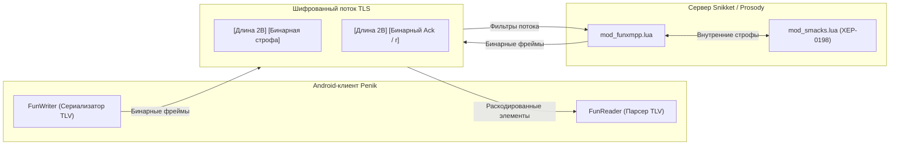

<p align="center">
  
</p>

<h1 align="center">Penik (XMPP)</h1>

<p align="center">
  <a href="README.md">English</a> | <b>Русский</b>
</p>

**Penik** (`ru.penik.xmpp`) — современный Android-мессенджер нового поколения, работающий на базе высокопроизводительного бинарного протокола **PXMPP** и современного плавного интерфейса на **Jetpack Compose**.

Проект объединяет децентрализованную мощь и безопасность открытых стандартов с отзывчивостью, скоростью и удобством современных потребительских мессенджеров.

---

## Ключевые возможности

- **Бинарный протокол PXMPP (FunXMPP)**
  - Заменяет тяжеловесный текстовый XML-поток на сверхкомпактный бинарный протокол формата Type-Length-Value (`penik:protocol:funxmpp`).
  - Сокращает потребление мобильного трафика на **40% – 70%**.
  - Исключает накладные расходы на парсинг XML на энергоэффективных ядрах мобильных процессоров, экономя заряд батареи и устраняя паузы сборщика мусора (GC).
  - Прозрачное согласование протокола со сверкой контрольной суммы словаря по алгоритму FNV-1a.
- **Современный интерфейс на Jetpack Compose**
  - Чистый дизайн Material 3 с фирменной палитрой Penik (`Theme.Penik`, круглые аватары, единая геометрия пузырей сообщений).
  - Индикация статусов доставки в реальном времени (одна/две галочки, отчеты о прочтении), живые реакции и индикация набора текста.
  - Удобная навигация: вкладки «Чаты», «Звонки», «Избранное» и «Профиль».
  - Telegram-стиль шторки вложений с мультивыбором и предпросмотром медиа.
- **Поддержка стикеров из Telegram**
  - Полная поддержка стикерпаков Telegram: статичные WebP, анимированные WebP и векторные анимации `.tgs`.
  - Высокопроизводительный Rust-микросервис конвертирует видеостикеры WebM VP9 с сохранением альфа-канала (`-c:v libvpx-vp9`) в оптимизированный Animated WebP без необходимости подключать тяжелые сторонние OpenGL-шейдеры.
  - 4-колоночная клавиатура стикеров с легкими статичными превью 128x128 для абсолютно плавного скролла в 60 FPS без лагов и утечек памяти.
- **Приватность и сквозное шифрование**
  - Бесшовное end-to-end шифрование (OMEMO), не требующее сложной ручной настройки.
  - Автоматическое подтверждение ключей и переход в защищенный режим при общении с поддерживающими шифрование собеседниками.
  - Строгий транспортный протокол TLS и архитектура privacy-by-design.
- **Голосовые и видеозвонки высокой четкости**
  - Peer-to-peer аудио- и видеосвязь на базе Jingle / WebRTC.
  - Независимое включение видеокамеры в стиле Telegram: видеопотоки переключаются с каждой стороны независимо без разрыва и прерывания текущего аудиозвонка.
  - Полноэкранный экран входящего вызова для мгновенного ответа.
- **Надёжная связь и push-уведомления**
  - Полная поддержка управления потоком XEP-0198 Stream Management с оптимизированным server piggybacking.
  - Мгновенное переподключение и восстановление сессии при переключении между Wi-Fi и мобильной сетью без потери пакетов.
  - Два бэкенда push-уведомлений: Google Play Services (FCM) и независимый UnifiedPush.

---

## Протокол PXMPP

PXMPP — это нативный бинарный протокол фрейминга Penik, реализованный как на клиенте Android, так и на сервере.



### Основные особенности:
1. **Статическая токенизация:** Более 140 базовых тегов, атрибутов, пространств имен XMPP и доменов сервера кодируются однобайтовыми токенами (`0x00`..`0xEE`).
2. **Сжатие JID:** Адреса с известными серверами упаковываются в один байт токена (`JID_BARE 0xFD`, `JID_FULL 0xFE`), устраняя постоянное дублирование доменных имен.
3. **Безопасный двухуровневый фрейминг:** Длины внешних фреймов (`u16` или `0xFFFF + u32`) строго исключают байт `<` (`0x3C`), гарантируя синхронизацию потока.
4. **Пиггибэкинг mod_smacks:** Запросы подтверждений piggyback разбираются и передаются сдвоенными бинарными фреймами без утечки сырых текстовых строк XML.

Подробная документация:
- [Русская спецификация протокола PXMPP](docs/PXMPP/README_RU.md)
- [English Technical Specification](docs/PXMPP/README.md)

---

## Стек технологий

| Компонент | Технологии |
| :--- | :--- |
| **UI-фреймворк** | Jetpack Compose (Material 3, Navigation, Coil, Lottie), Compose BOM 2026.09 |
| **Языки и компиляторы** | Kotlin 2.4, Java 21, Android SDK (minSdk 26, compileSdk 37) |
| **Ядро XMPP и криптография** | Penik XMPP Core (`im.conversations.android.xmpp`), Conscrypt TLS, OMEMO |
| **Бинарный протокол** | PXMPP / FunXMPP (`eu.siacs.conversations.xmpp.fun.*`) |
| **Медиа и звонки** | Jingle WebRTC RTP движок, ExoPlayer |
| **Серверные модули** | Prosody Lua модули (`server/Modules/mod_funxmpp.lua`, `mod_stickers_auth.lua`) |
| **Микросервисы** | Rust Axum вспомогательный бэкенд-сервис (`server/MicroServices/penik-service-rs`) |
| **Система сборки** | Gradle 9, AGP 9.2, оптимизатор R8, DataBinding |

---

## Быстрый старт и установка

### Автоматическая сборка и установка через ADB
В корне репозитория расположен скрипт полной автоматизации:

```bash
# Сборка и установка версии Playstore с FCM-уведомлениями (по умолчанию)
./install_phone.sh

# Сборка и установка версии Free с UnifiedPush
./install_phone.sh --free

# Установка уже собранного APK без повторной компиляции
./install_phone.sh -n

# Установка на конкретное устройство по серийному номеру
./install_phone.sh -s <серийный_номер>
```

### Ручная сборка через Gradle
```bash
# Сборка Playstore debug APK с FCM-уведомлениями
bash ./gradlew assembleConversationsPlaystoreDebug

# Сборка Free debug APK с UnifiedPush
bash ./gradlew assembleConversationsFreeDebug

# Запуск модульных тестов
bash ./gradlew testConversationsFreeDebugUnitTest
```
Собранные установочные пакеты APK располагаются в каталоге `build/outputs/apk/`.

---

## Структура репозитория

```
├── docs/
│   └── PXMPP/              # Спецификации протокола PXMPP (RU / EN)
├── server/
│   ├── Modules/            # Плагины для Prosody / Snikket на Lua
│   │   ├── mod_funxmpp.lua      # Плагин бинарного протокола
│   │   ├── test_mod_funxmpp.lua # Тесты плагина FunXMPP
│   │   ├── mod_stickers_auth.lua # Генерация HMAC-токенов стикеров
│   │   └── test_mod_stickers_auth.lua # Тесты авторизации стикеров
│   └── MicroServices/      # Автономные серверные микросервисы (Rust)
│       └── penik-service-rs/    # Сервис стикеров и справочника номеров Penik
├── src/
│   ├── main/
│   │   ├── AndroidManifest.xml
│   │   ├── java/eu/siacs/conversations/
│   │   │   ├── ui/compose/ # Экраны Compose (Чаты, Звонки, Пикер, Стикеры)
│   │   │   ├── stickers/   # Менеджер StickerManager и кеширование паков
│   │   │   ├── xmpp/fun/   # Движок PXMPP (FunWriter, FunReader, FunTokens)
│   │   │   └── ...         # Сетевой стек XMPP, криптография, менеджеры строф
│   │   └── res/            # Темы оформления, векторные ресурсы, цвета
│   └── test/               # JUnit-тесты (FunProtocolTest, JidTest и др.)
├── install_phone.sh        # Скрипт сборки и быстрой установки через ADB
├── PROJECT_MAP.md          # Полная карта файлов и архитектуры проекта
└── build.gradle            # Главный конфигурационный файл Gradle
```

> [!TIP]
> Точные пути к файлам и описание их назначения всегда доступны в [PROJECT_MAP.md](PROJECT_MAP.md).

---

## Развёртывание на сервере

- **Модули Prosody:** Скопируйте `server/Modules/mod_funxmpp.lua` и `server/Modules/mod_stickers_auth.lua` в каталог `modules/` сервера Prosody. Добавьте `"funxmpp"` и `"stickers_auth"` в список `modules_enabled`. Для проверки запустите соответствующие скрипты тестов Lua.
- **Вспомогательный бэкенд-сервис:** Соберите и запустите `server/MicroServices/penik-service-rs` через Cargo или Docker. Сервису требуется установленный `ffmpeg` с поддержкой декодера `libvpx-vp9`. Сервис предоставляет REST API для стикеров и справочника номеров, защищенный HMAC-SHA256 токенами.

---

## Наследие и благодарности

Сетевой стек, криптографическая база и соблюдение стандартов XMPP в Penik построены на надежном фундаменте открытого проекта [Conversations](https://codeberg.org/iNPUTmice/Conversations) за авторством Daniel Gultsch. Penik развивает эту основу, внедряя бинарный протокол PXMPP, полностью переработанный интерфейс на Jetpack Compose, поддержку стикеров Telegram и улучшения пользовательского опыта мобильных мессенджеров.
