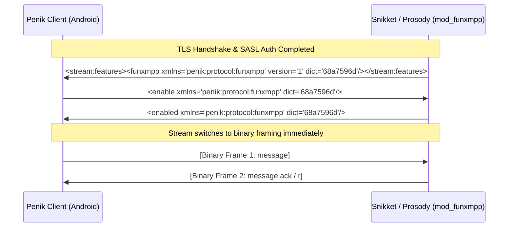

# PenikXMPP Binary Protocol (PXMPP / FunXMPP) Specification

## 1. Overview & Motivation

**PXMPP** (internally designated as **FunXMPP**, namespace `penik:protocol:funxmpp`) is a symmetric, tokenized binary framing layer for XMPP client-to-server (`c2s`) connections over TCP and TLS.

Traditional XMPP transmits stanzas as plain XML text. While XML is human-readable and extensible, it incurs significant overhead on mobile devices:
- **Bandwidth Consumption:** Repetitive XML tag names (`<message>`, `<presence>`, `<iq>`), common attributes (`type="chat"`, `xmlns=...`), and repetitive domain names (`alice@snikket.penik.ru`) inflate traffic by 40% to 70%.
- **CPU & Battery Impact:** Parsing XML pull-streams via SAX/Expat on low-power mobile CPU cores drains battery and introduces garbage collection (GC) churn.
- **Latency on Poor Connections:** Cellular radio wakeups and TCP packet fragmentation are exacerbated by bloated stanzas.

PXMPP solves this by tokenizing common XMPP strings, compressing JIDs into single-byte domain references, and replacing text XML with Type-Length-Value (TLV) binary frames while maintaining 100% semantic compatibility with XMPP standards (XEPs, RFC 6120, RFC 6121).

---

## 2. Stream Negotiation & Handshake

PXMPP operates transparently on top of standard TLS and SASL authentication. It is negotiated immediately following resource binding or stream resumption.



### 2.1. Feature Advertisement
When `c2s` connection is established and authenticated, the server advertises support in `<stream:features>`:
```xml
<funxmpp xmlns="penik:protocol:funxmpp" version="1" dict="68a7596d"/>
```
- `version`: Protocol version (`"1"`).
- `dict`: 32-bit FNV-1a hexadecimal checksum of the static token dictionary.

### 2.2. Enable Request & Idempotency
To activate binary framing, the client sends:
```xml
<enable xmlns="penik:protocol:funxmpp" dict="68a7596d"/>
```
If the client dictionary hash matches the server's, the server replies with:
```xml
<enabled xmlns="penik:protocol:funxmpp" dict="68a7596d"/>
```
If there is a dictionary mismatch, the server returns:
```xml
<failed xmlns="penik:protocol:funxmpp"><dictionary-mismatch/></failed>
```
Upon receiving `<enabled/>`, the XML parser is detached from the raw socket byte stream on both sides, and binary framing takes effect.

---

## 3. Binary Framing Architecture

### 3.1. Two-Level Length Encoding Scheme
PXMPP deliberately employs two distinct, specialized length encodings for different data layers:

| Layer | Encoding Mechanism | Range | Purpose |
| :--- | :--- | :--- | :--- |
| **Stream Frame & Node Body** | 2-byte Big-Endian (`u16`) or `0xFFFF` + 4-byte (`u32`) | 0 .. 4,294,967,295 B | Outer frame delimiter and large content blocks (MAM batches, file metadata). |
| **String Literals & Attributes** | Prefix markers `0xFA` (`u8`), `0xFB` (`u16`), `0xFC` (`u32`) | 0 .. 4,294,967,295 B | Inline tag names, attribute keys, and attribute values. |

#### Stream Frame Header
Every binary frame on the wire begins with its frame length:
- Standard frames (length `< 0xFFFF`):
  `[Length High Byte (1B)] [Length Low Byte (1B)] [Node Payload (N Bytes)]`
- Extended frames (length `>= 0xFFFF`):
  `[0xFF] [0xFF] [Length Byte 1 (MSB)] [Length Byte 2] [Length Byte 3] [Length Byte 4 (LSB)] [Node Payload (N Bytes)]`

> [!IMPORTANT]
> **XML Ambiguity Prevention:** The first byte of any valid PXMPP binary frame header is the high byte of its length. Because maximum normal frames are `< 0x3C00` (15 KB), the first byte is strictly `< 0x3C`. ASCII `<` (`0x3C`) is never emitted as the initial byte, ensuring instant detection of protocol desynchronization.

#### Frame Size Limits
To prevent expansion or memory-exhaustion attacks, `mod_funxmpp` enforces `MAX_FRAME_SIZE = 1,048,576` bytes (1 MB). Frames exceeding this limit terminate the connection with `policy-violation`.

---

## 4. String, Token & JID Serialization

### 4.1. Static Token Dictionary
Frequently repeated XMPP strings (tags, attributes, common values, namespaces) are mapped to 1-byte tokens (`0x00` .. `0xEE` / `0..239`).

- `0x00`..`0x13`: Core Stanzas & Elements (`message`, `presence`, `iq`, `body`, `error`, `text`, `status`, etc.)
- `0x14`..`0x27`: Chatstates & Tags (`active`, `composing`, `paused`, `reactions`, `reaction`, `enable`, `enabled`, `r`, `a`, etc.)
- `0x3C`..`0x4F`: Attributes (`to`, `from`, `id`, `type`, `xmlns`, `xml:lang`, `stamp`, `h`, etc.)
- `0x50`..`0x6D`: Common Attribute Values (`chat`, `groupchat`, `available`, `unavailable`, `get`, `set`, etc.)
- `0x6E`..`0x92`: Common Namespaces (`jabber:client`, `urn:xmpp:sm:3`, `urn:xmpp:chat-markers:0`, etc.)
- `0x8F`..`0x92`: Domain Tokens (e.g. `143 = snikket.penik.ru`, `144 = groups.snikket.penik.ru`).

### 4.2. JID Compression
Addresses are tokenized using dedicated prefixes:
- **Bare JID (`0xFD`):** `[0xFD] [User: Token or Literal String] [Domain: 1-Byte Token]`
- **Full JID (`0xFE`):** `[0xFE] [User: Token or Literal String] [Domain: 1-Byte Token] [Resource: Token or Literal String]`

If the domain is not in the dictionary, the JID is serialized as a standard literal string.

---

## 5. Node Body Structure

Each stanza node is serialized in a deterministic 4-part structure:

```
+-------------------------------------------------------------+
| 1. Tag Name       | Token (1B) or Literal String            |
+-------------------------------------------------------------+
| 2. Attribute Count| 1 Byte (0..255)                         |
|    Attributes     | Sorted by Key: [Key (T/S)] [Value (T/S)]|
+-------------------------------------------------------------+
| 3. Content Marker | 1 Byte: 0x00, 0x01, 0x02, or 0x03       |
+-------------------------------------------------------------+
| 4. Content Body   | Text, Child Nodes, or Mixed             |
+-------------------------------------------------------------+
```

### 5.1. Content Markers
- `CONTENT_EMPTY (0x00)`: Element has no text and no children (e.g. `<request xmlns='urn:xmpp:receipts'/>`).
- `CONTENT_TEXT (0x01)`: Element has text only. Preceded by 2-byte length (or `0xFFFF` + 4-byte length), followed by UTF-8 bytes.
- `CONTENT_CHILDREN (0x02)`: Element has child tags only. Preceded by 2-byte child count, followed by recursive child binary nodes.
- `CONTENT_MIXED (0x03)`: Legacy mixed content. Preceded by text content, then 2-byte child count and child nodes.

### 5.2. Attribute Safety Limit
The attribute count is stored in a single byte (`0..255`). If a malformed stanza contains `> 255` attributes:
- **Server (`mod_funxmpp.lua`):** Logs an error via `module:log("error", ...)` and returns `nil`, dropping the stanza safely without throwing an exception.
- **Client (`FunWriter.java`):** Catches `IllegalArgumentException` in `writeElement()`, logs `Log.e(...)`, and drops the single stanza without crashing the async writer thread.

---

## 6. XEP-0198 Stream Management & Smacks Piggybacking

XEP-0198 Stream Management enables stanza acknowledgment and fast stream resumption. Prosody's `mod_smacks.lua` optimizes traffic by concatenating an `<r/>` ack request to outgoing stanzas:
```lua
return tostring(stanza) .. tostring(st.stanza("r", { xmlns = xmlns_sm }))
```

### The Piggyback Stash Pipeline
To prevent raw XML string concatenation from bypassing binary serialization, `mod_funxmpp` uses a two-stage filter pipeline:

1. **Stash Filter (`priority -999`):** Intercepts the original stanza table right before `mod_smacks` (`priority -1000`) and stashes it in `session.funxmpp_last_out`.
2. **Piggyback Serializer (`priority -10000`):**
   - If incoming data is a string and `session.funxmpp_last_out` is present:
   - Validates that the string prefix matches `tostring(stashed)` to prevent silent corruption from intermediate filters.
   - Extracts the SM namespace from `<r xmlns='urn:xmpp:sm:[23]'/>`.
   - Serializes both `stashed` and `<r/>` into **two consecutive binary frames**: `encode(stashed) .. encode(r)`.
   - Clears the stash.
   - If smacks is hibernating, it returns `""`, which passes directly to socket write without encoding.

---

## 7. Metrics & Verification

`mod_funxmpp` tracks per-session throughput metrics:
- `in_bytes`, `out_bytes`: Total wire bytes exchanged.
- `in_frames`, `out_frames`: Total binary frames processed.

Memoization in the outgoing table metatable (`__tostring`) guarantees that stats are incremented exactly once per stanza even if multiple filters or logging hooks inspect the output.

### Test Coverage
- **Unit Tests (Android):** [FunProtocolTest.java](file:///filepomorika/Mysor/RandomProjets/PenikXMPP/src/test/java/eu/siacs/conversations/xmpp/fun/FunProtocolTest.java)
- **Unit Tests (Prosody):** [server/test_mod_funxmpp.lua](file:///filepomorika/Mysor/RandomProjets/PenikXMPP/server/test_mod_funxmpp.lua)
