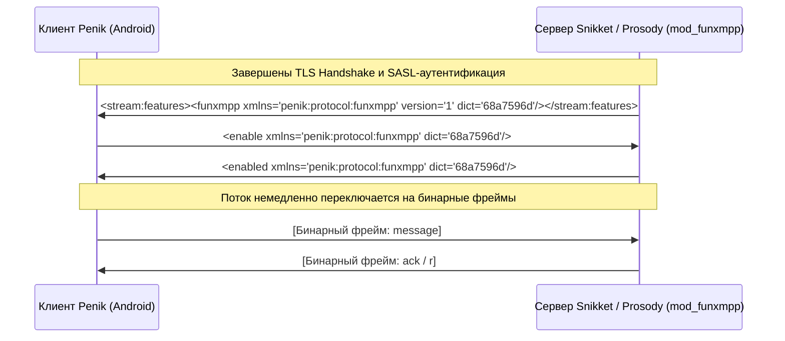

# Спецификация бинарного протокола PenikXMPP (PXMPP / FunXMPP)

## 1. Введение и назначение

**PXMPP** (в кодовой базе — **FunXMPP**, пространство имён `penik:protocol:funxmpp`) — это симметричный бинарный транспортный слой для соединений клиент-сервер (`c2s`) XMPP поверх TCP и TLS.

Классический XMPP передаёт XML в текстовом виде. Это обеспечивает наглядность, но создаёт ряд критических проблем на мобильных устройствах:
- **Высокий оверхед по трафику:** Постоянное повторение имён тегов (`<message>`, `<presence>`, `<iq>`), атрибутов (`type="chat"`, `xmlns=...`) и доменов (`alice@snikket.penik.ru`) увеличивает объём передаваемых данных на 40–70%.
- **Нагрузка на батарею и CPU:** Парсинг строкового XML через Expat/SAX на мобильных процессорах тратит энергию аккумулятора и создаёт постоянный GC churn.
- **Задержки в мобильных сетях:** Большие XML-пакеты фрагментируются на уровне TCP, вызывая лишние пробуждения радиомодуля (Radio Resource Control).

PXMPP решает это за счёт статической токенизации тегов и атрибутов, упаковки JID в однобайтовые токены и замены текста XML компактными бинарными фреймами (TLV), сохраняя 100% совместимость со стандартами XMPP (XEP, RFC 6120, RFC 6121).

---

## 2. Негоциация протокола и хендшейк

PXMPP активируется прозрачно после завершения TLS и SASL-аутентификации.



### 2.1. Объявление поддержки (Stream Features)
После аутентификации сервер отправляет в `<stream:features>`:
```xml
<funxmpp xmlns="penik:protocol:funxmpp" version="1" dict="68a7596d"/>
```
- `version`: Версия протокола (`"1"`).
- `dict`: 32-битный шестнадцатеричный FNV-1a хеш таблицы токенов.

### 2.2. Запрос на включение и проверка хеша словаря
Клиент запрашивает активацию протокола:
```xml
<enable xmlns="penik:protocol:funxmpp" dict="68a7596d"/>
```
- Если хеш словаря совпадает с серверным, сервер отвечает `<enabled xmlns="penik:protocol:funxmpp" dict="68a7596d"/>`.
- При несовпадении словарей сервер возвращает `<failed xmlns="penik:protocol:funxmpp"><dictionary-mismatch/></failed>`, и соединение остаётся в стандартном XML-режиме.
- После отправки/получения `<enabled/>` стандартный XML-парсер отключается от сокета, и начинается передача бинарных фреймов.

---

## 3. Архитектура бинарного фрейминга

### 3.1. Двухуровневая схема кодирования длин
В PXMPP намеренно используются две разные модели кодирования длины:

| Уровень | Способ кодирования | Диапазон | Назначение |
| :--- | :--- | :--- | :--- |
| **Фрейм потока и тело ноды** | 2 байта Big-Endian (`u16`) либо `0xFFFF` + 4 байта (`u32`) | 0 .. 4 294 967 295 Б | Внешний ограничитель фрейма в сокете и большие объёмы данных (MAM-архив, метаданные). |
| **Строковые литералы и атрибуты** | Маркеры `0xFA` (`u8`), `0xFB` (`u16`), `0xFC` (`u32`) | 0 .. 4 294 967 295 Б | Встроенные имена кастомных тегов, ключи и значения атрибутов. |

#### Заголовок фрейма
Каждый фрейм в сокете начинается с префикса длины:
- Обычные фреймы (длина `< 0xFFFF`):
  `[Старший байт (1Б)] [Младший байт (1Б)] [Тело ноды (N байт)]`
- Расширенные фреймы (длина `>= 0xFFFF`):
  `[0xFF] [0xFF] [Байт 1 (MSB)] [Байт 2] [Байт 3] [Байт 4 (LSB)] [Тело ноды (N байт)]`

> [!IMPORTANT]
> **Гарантия защиты от рассинхронизации XML:** Первый байт любого бинарного фрейма — это старший байт его длины. Так как длина типичной станзы не превышает 15 КБ (`< 0x3C00`), первый байт строго меньше `0x3C`. Символ `<` (`0x3C`) **никогда** не может появиться в заголовке фрейма. Это исключает случайный приём XML за бинарный фрейм.

#### Защита от DoS-атак
Серверный модуль `mod_funxmpp` задаёт лимит `MAX_FRAME_SIZE = 1 048 576` байт (1 МБ). При превышении этого размера сессия принудительно разрывается с ошибкой `policy-violation`.

---

## 4. Токенизация и сжатие JID

### 4.1. Статический словарь токенов
Часто встречающиеся строки сжаты в однобайтовые токены `0x00` .. `0xEE` (`0..239`):
- `0x00`..`0x13`: Базовые станзы и элементы (`message`, `presence`, `iq`, `body`, `error`, `status` и др.)
- `0x14`..`0x27`: Чат-состояния и теги (`active`, `composing`, `paused`, `reactions`, `reaction`, `enable`, `r`, `a` и др.)
- `0x3C`..`0x4F`: Атрибуты (`to`, `from`, `id`, `type`, `xmlns`, `xml:lang`, `stamp`, `h` и др.)
- `0x50`..`0x6D`: Значения атрибутов (`chat`, `groupchat`, `available`, `unavailable`, `get`, `set` и др.)
- `0x6E`..`0x92`: Пространства имён (`jabber:client`, `urn:xmpp:sm:3`, `urn:xmpp:chat-markers:0` и др.)
- `0x8F`..`0x92`: Токены локальных доменов (`143 = snikket.penik.ru`, `144 = groups.snikket.penik.ru`).

### 4.2. Сжатие JID
Адреса сжимаются через специальные префиксы:
- **Bare JID (`0xFD`):** `[0xFD] [Пользователь: токен или литерал] [Домен: токен 1 байт]`
- **Full JID (`0xFE`):** `[0xFE] [Пользователь: токен или литерал] [Домен: токен 1 байт] [Ресурс: токен или литерал]`

Если домен отсутствует в словаре токенов, адрес передаётся как обычный строковый литерал.

---

## 5. Структура ноды

Каждая станза сериализуется в строгой четырёхчастной структуре:

```
+-------------------------------------------------------------+
| 1. Имя тега       | Токен (1Б) или строковый литерал        |
+-------------------------------------------------------------+
| 2. Кол-во атрибутов| 1 Байт (0..255)                        |
|    Атрибуты       | Отсортированы по ключу: [Ключ] [Значение|
+-------------------------------------------------------------+
| 3. Маркер контента| 1 Байт: 0x00, 0x01, 0x02 или 0x03       |
+-------------------------------------------------------------+
| 4. Тело контента  | Текст, дочерние ноды или Mixed          |
+-------------------------------------------------------------+
```

### 5.1. Маркеры контента
- `CONTENT_EMPTY (0x00)`: У элемента нет текста и нет детей (например `<request xmlns='urn:xmpp:receipts'/>`).
- `CONTENT_TEXT (0x01)`: У элемента только текст. Предваряется 2-байтовой длиной (или `0xFFFF` + 4 байта), затем UTF-8 байты.
- `CONTENT_CHILDREN (0x02)`: У элемента только дочерние теги. Предваряется 2-байтовым числом детей, затем рекурсивные ноды.
- `CONTENT_MIXED (0x03)`: Устаревший смешанный контент. Сначала текст, затем 2-байтовое число детей и дочерние ноды.

### 5.2. Безопасность при переполнении атрибутов
Количество атрибутов хранится в одном байте (`0..255`). Если станза содержит `> 255` атрибутов:
- **На сервере (`mod_funxmpp.lua`):** Логируется ошибка в `module:log("error", ...)`, станза дропается (в сокет уходит пустая строка `""`), не роняя `session.send`.
- **На клиенте (`FunWriter.java`):** Ошибка отлавливается внутри `writeElement()`, логируется в `Log.e(...)`, а писательский поток `asyncStanzaWriter` продолжает работу.

---

## 6. Взаимодействие с XEP-0198 (Stream Management / Piggyback)

В Prosody модуль `mod_smacks.lua` для экономии пакетов прикрепляет запрос подтверждения `<r/>` к исходящей станзе строковой конкатенацией:
```lua
return tostring(stanza) .. tostring(st.stanza("r", { xmlns = xmlns_sm }))
```

### Двухэтапный конвейер фильтрации
Чтобы XML-строка от smacks не уходила в сокет в сыром виде, в `mod_funxmpp` реализован конвейер:

1. **Stash-фильтр (приоритет `-999`):** Перехватывает оригинальную таблицу-станзу непосредственно перед `mod_smacks` (приоритет `-1000`) и сохраняет её в `session.funxmpp_last_out`.
2. **Сериализатор FunXMPP (приоритет `-10000`):**
   - Если вход — строка и выставлен `session.funxmpp_last_out`:
   - Проверяет совпадение префикса строки с `tostring(stashed)` (защита от порчи данных сторонними фильтрами).
   - Выделяет суффикс `<r xmlns='urn:xmpp:sm:[23]'/>`.
   - Сериализует обе ноды в **два последовательных бинарных фрейма**: `encode(stashed) .. encode(r)`.
   - Очищает `session.funxmpp_last_out`.
   - При гибернации сессии smacks возвращает `""`, которая проходит в сокет напрямую без бинаризации.

---

## 7. Мониторинг и тестирование

Серверный модуль собирает метрики на уровне каждой сессии:
- `in_bytes`, `out_bytes`: Объём входящего и исходящего трафика в байтах.
- `in_frames`, `out_frames`: Число обработанных бинарных фреймов.

Мемоизация в метатаблице `__tostring` гарантирует однократный учёт метрик даже при многократных вызовах `tostring()` сторонними модулями Prosody.

### Наборы автоматических тестов
- **Клиентские тесты (Android/JUnit):** [FunProtocolTest.java](file:///filepomorika/Mysor/RandomProjets/PenikXMPP/src/test/java/eu/siacs/conversations/xmpp/fun/FunProtocolTest.java)
- **Серверные тесты (Lua):** [server/test_mod_funxmpp.lua](file:///filepomorika/Mysor/RandomProjets/PenikXMPP/server/test_mod_funxmpp.lua)
