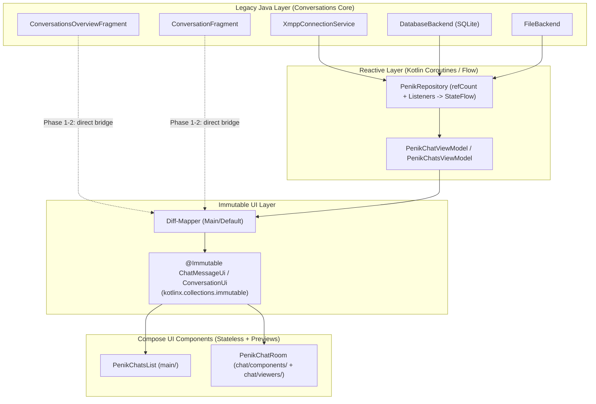

# PenikXMPP Compose Layer Refactoring Plan (v1.3 — Ready for Execution)

## 0. Architectural Rationale: Why Write New Features Strictly in Kotlin (Even When Invoked from Java)

1. **Coroutines and Flow Instead of AsyncTask / Manual Executor + Handler:**
   - In legacy Conversations Java code, background operations rely on callbacks, Guava's `ListenableFuture`, and manual `runOnUiThread` dispatches.
   - Kotlin provides **structured concurrency** (`viewModelScope`, `Dispatchers.IO`, automatic cancellation when screens finish without memory or context leaks). This is vital for network calls to Rust microservices, sticker conversions, and database prefetching.

2. **Null-Safety at the Boundary with Legacy Code:**
   - In Conversations Java code, instances of `Account`, `Conversation`, `Message`, and `xmppConnectionService` can be `null` at any moment in the lifecycle (account switching, async unbinding, delayed initialization).
   - Kotlin enforces explicit handling via safe calls `?.` and Elvis operators `?:` at the boundary with legacy code, catching potential `NullPointerException`s at compile time rather than in production crash reports.

3. **Direct Compatibility with Jetpack Compose:**
   - New screens and UI components live in Jetpack Compose.
   - If business logic, models, and managers are written in Kotlin (`data class`, `sealed interface`, `StateFlow`), Compose UI connects directly without adapters, wrapper layers, or overhead from converting Java collections.

4. **Clean Boundary When Called from Java:**
   - Annotations like `@JvmStatic`, `@JvmOverloads`, and simple facades allow legacy Java classes (`XmppConnectionService`, `ConversationFragment`, `ConversationsOverviewFragment`) to invoke new Kotlin code with a single line, preventing legacy patterns from spreading into new modules.

---

## Architecture Overview



---

## Phase 1. Targeted Fixes & Complete I/O Extraction from Composition

### 1.1. Player Lifecycle Management (`PenikChatRoom.kt`)
- **Issue:** Using per-row `DisposableEffect(uuid)` in `PenikVoiceRow` causes voice messages to terminate as soon as the item scrolls outside the `LazyColumn` viewport.
- **Solution:**
  - Remove per-row `DisposableEffect(uuid)` from `PenikVoiceRow`.
  - Add a single screen-level `DisposableEffect(Unit)` at the root of `PenikChatRoom`:
    ```kotlin
    DisposableEffect(Unit) {
        onDispose {
            PenikVoicePlayer.stop()
            PenikVideoNotePlayer.stop()
        }
    }
    ```
  - **Chat Switch Behavior:** When switching chats via `fragmentTransaction.replace()` inside `ConversationsActivity`, the old `ComposeView` detaches and is guaranteed to invoke `onDispose`; `ConversationFragment.onPause()` serves as the second line of defense.

### 1.2. Fix `MediaMetadataRetriever` Leak (`PenikChatRoom.kt`)
- **Issue:** Unreleased native `MediaMetadataRetriever` resources leak file descriptors and memory.
- **Solution:**
  - Wrap `mmr.release()` in a strict `finally` block in `PenikVoiceRow`.
  - **Important:** Do NOT use `.use {}`, because `minSdk = 26`, whereas `AutoCloseable` for `MediaMetadataRetriever` was introduced only in Android API 29.

### 1.3. Remove Synchronous Disk I/O & Decoding from `remember` (`PenikChatRoom.kt`)
- **Avatars:**
  - Calls to `avatarService()?.get(message, size, true)` inside `remember` must strictly use `cachedOnly = true`.
  - Full image loading, disk reads, and decoding must be moved to `LaunchedEffect` / `produceState` on `Dispatchers.IO` (following the pattern of `penikAvatarBitmap` from `PenikChatsList.kt`).
- **Media Files:**
  - Computing the file path via `fileBackend.getFile(message, cleartext)` remains in `remember` (pure string and path manipulation in memory without disk access).
  - Any checks such as `file.exists()`, `file.length()`, calls to `getThumbnail()`, and bitmap/media decoding must be dispatched to `Dispatchers.IO`.

### 1.4. Thread-Safe Preview Prefetching & Sorting (`ConversationsOverviewFragment.java` + `PenikChatsList.kt`)
- **Background Message Loading:**
  - Move the message prefetch loop (`databaseBackend.getMessages(c, 1)` instead of redundant `Config.PAGE_SIZE`) to a background `Executor` for both lists (`main` and `archived`).
- **Strict Thread Safety:**
  - Perform **only** `databaseBackend.getMessages(c, 1)` on the background IO thread.
  - Calling mutations `conversation.addAll(0, dbMessages)`, resorting via `Collections.sort(main)` (since `Conversation.compareTo()` relies on `getLatestMessage().getTimeSent()`), and publishing `penikChatsState` must be executed **strictly on the Main thread** (`runOnUiThread`) after loading completes.
- **Race Condition Guard & Multi-Account Empty Cache:**
  - Implement a generation-guard (atomic generation counter to discard stale background task results).
  - Add a cache for verified empty conversations `emptyCheckedKeys` with a composite key `account.uuid + ":" + conversation.uuid` to prevent key collisions during active account switches without logout.
  - Invalidate the cache when a conversation is deleted, archived, or when accounts are switched or logged out.
- **Compose Cleanup:**
  - Remove synchronous `databaseBackend.getMessages(...)` calls from `remember` blocks in `PenikConversationRow` and `PenikSelfRow`.

### 1.5. Phase 1 Verification
- **Build Checks:**
  ```bash
  cd android && bash ./gradlew compileConversationsFreeDebugKotlin
  cd android && bash ./gradlew compileConversationsPlaystoreDebugKotlin
  ```
- **Manual Verification Scenarios:**
  1. Scroll voice message past viewport during playback (audio continues uninterrupted).
  2. Switch conversation (playback stops immediately).
  3. Open archive folder (previews and correct sort order remain intact without UI stutters).

---

## Phase 2. Immutable UI Models, Thread-Safe Mapping & Compose Stability

### 2.1. Immutable Models (`@Immutable` + `kotlinx.collections.immutable`)
- Declare stable UI models:
  - `ChatMessageUi` — for chat timeline (`PenikChatRoom.kt`).
  - `ConversationUi` — for conversation list (`PenikChatsList.kt`).
- Replace Guava `ImmutableList` in `ConversationsOverviewFragment` and Compose models with `kotlinx.collections.immutable.ImmutableList`.
- **State Cleanups:**
  - Completely remove the `revision` field and `bumpRevision()` calls from `PenikChatsState` and `PenikChatState`.
  - Remove `neverEqualPolicy()` from `PenikChatState.messages`.

### 2.2. Thread-Safety and Mapping Cost
- **Data Snapshot Isolation:**
  - Before offloading heavy formatting to `Dispatchers.Default` / `Dispatchers.IO`, capture an immutable snapshot of mutable entity fields (`Message`, `Conversation`) on the Main thread (or perform mapping entirely on a single synchronized thread without concurrent modifications).
- **Performance Optimization ($O(1)$ instead of $O(n)$):**
  - Preserve update throttling (`Config.REFRESH_UI_INTERVAL`).
  - Remap only the changed tail of messages upon receiving packets, avoiding redundant $O(n)$ iterations across entire chat history.

### 2.3. Field, Timestamp, and Callback Rules
- **Media Attachments:**
  - Track local files via primitive properties: `localFilePath: String?`, `fileLength: Long`, `lastModified: Long` (updated from `Transferable` / `FileBackend`).
  - Read duration directly from `fileParams.runtime` (without instantiating `MediaMetadataRetriever` inside mappers).
- **Timestamps:**
  - Store raw timestamp `timeSent: Long` in models.
  - Relative time strings ("just now", "yesterday", "14:20") must be formatted inside composition to automatically handle midnight/day boundaries.
- **Callback Stability:**
  - Instantiate callback handlers once in the host bound to the listener:
    ```kotlin
    val callbacks = remember(listener) { 
        PenikChatCallbacks(onAction = { uuid, action -> ... }, ...) 
    }
    ```
  - In list items, use `remember(uuid, callbacks)` without capturing mutable `Message` instances in lambdas.
  - In the host, resolve messages via `Conversation.findMessageWithUuid(uuid)` with explicit `null` checking (ignore actions for recycled messages or perform fallback queries to `DatabaseBackend` when required).

### 2.4. Diff-Mapper by UUID
- Reuse existing UI model instances from `prevMap[uuid]` only when all displayable fields match.
- Preserve filtering of internal status entries (`TYPE_STATUS`) and messages with `uuid == null`.

### 2.5. Phase 2 Verification
- **Compilation:** `cd android && bash ./gradlew compileConversationsFreeDebugKotlin`.
- **Layout Inspector:**
  - Run Layout Inspector in Android Studio with Recomposition Counts enabled.
  - When updating a single message status (e.g. delivery or read receipt) or adding a message, adjacent rows in `LazyColumn` must be skipped rather than recomposed.

---

## Phase 3. Monolith Decomposition

### 3.1. Modularizing Monolithic Files
Decompose monolithic files into focused feature packages:
- `PenikChatRoom.kt` (~4,170 lines) -> `eu.siacs.conversations.ui.compose.chat`:
  - `chat/components/`: `PenikVoiceRow.kt`, `PenikVideoNoteBubble.kt`, `PenikQuoteBlock.kt`, `PenikBotKeyboard.kt`, `PenikMessageBubble.kt`, `PenikChatDateHeader.kt`.
  - `chat/viewers/`: Full-screen viewers and media dialogs.
  - `chat/PenikChatRoom.kt`: Root screen scaffold (Scaffold, TopBar, LazyColumn timeline, InputBar).
- `PenikChatsList.kt` (~2,815 lines) -> `eu.siacs.conversations.ui.compose.main`:
  - `main/PenikConversationRow.kt`, `main/PenikSelfRow.kt`, `main/PenikArchiveRow.kt`.
  - `main/PenikChatsTopBar.kt`, `main/PenikChatsTabs.kt`.
  - `main/PenikChatsList.kt`: Root chats list container.

### 3.2. Stateless Components and `@Preview` Support
- Start decomposition with stateless components: `PenikVoiceRow`, `PenikVideoNoteBubble`, `PenikQuoteBlock`, `PenikBotKeyboard`.
- **Isolation:** Forbid passing `Activity`, `XmppConnectionService`, or domain entities (`Message`, `Conversation`) into leaf components. Accept only UI models, primitives, lambdas, and standard UI resources (`LocalContext`, `stringResource`, `colorResource`).
- Add `@Preview` annotations for light and dark themes on every isolated component.

---

## Phase 4. Reactive Layer (Repository + ViewModel)

### 4.1. `PenikRepository`
- **Service Binding and Lifecycle:**
  - Implement reference counting (`refCount`) for service connections.
  - Implement explicit reference clearing in `XmppConnectionService.onDestroy()`, ensuring `unbindService` in `XmppActivity.onStop()` on screen rotation does not prematurely nullify the active service, while preventing stale references once the service genuinely terminates.
- **Event Subscriptions:**
  - Subscribe to multicast listener sets on the service (`mOnConversationUpdates`, `mOnAccountUpdates`, etc.).
  - Expose application state as reactive, strongly-typed `StateFlow`.

### 4.2. ViewModel and Event Handling
- **Business Logic Extraction:**
  - Move business logic and mutations (profile editing, message/file transmission, deletion, archiving) into ViewModels.
  - Collect state in UI using `collectAsStateWithLifecycle()`.
- **Segregated One-Shot Channels (`UiEffect`):**
  - **Dialogs, Pickers, Permissions:**
    - Use `Channel(Channel.BUFFERED).receiveAsFlow()`.
    - Collect strictly within `repeatOnLifecycle(Lifecycle.State.STARTED)` inside the host (`Activity` / `Fragment`) capable of launching `ActivityResultLauncher` and system dialogs.
  - **Ephemeral Alerts (Toast, Snackbar):**
    - Use `Channel(Channel.CONFLATED)` or `MutableSharedFlow(extraBufferCapacity = 1, onBufferOverflow = BufferOverflow.DROP_OLDEST)`.
    - Avoid unbuffered `RENDEZVOUS` to prevent coroutine suspension when no collector is actively listening.

### 4.3. Phase 4 Verification
- **Compilation:** `cd android && bash ./gradlew compileConversationsFreeDebugKotlin`.
- **Configuration Change Tests:**
  1. Rotate screen during an active file picker or permission request (effect does not re-fire or get lost).
  2. Rotate screen while XMPP is connected (connection is retained, UI seamlessly binds to current state).

---

## Phase 5. Navigation

### 5.1. Navigation Compose Adoption Strategy
- Maintain the existing hybrid architecture with 20+ Android `Activity` classes (`ShareWithActivity`, notification targets, deep link entry points, and telecom integrations).
- Introduce `navigation-compose` exclusively for new internal sub-screens and modular wizard flows (e.g. multi-step onboarding, profile detail editing, attachment previews).

---

## Task Checklist

- [x] **Phase 1: Targeted Fixes & I/O Extraction**
  - [x] Remove per-row `DisposableEffect(uuid)` from `PenikVoiceRow`
  - [x] Add root screen `DisposableEffect(Unit)` with `stop()` in `PenikChatRoom`
  - [x] Wrap `MediaMetadataRetriever.release()` in `finally` without `.use {}`
  - [x] In `remember`: `cachedOnly = true` for avatars, load full images via `Dispatchers.IO`
  - [x] Move media checks (`file.exists()`, `length()`, `getThumbnail()`) to `Dispatchers.IO`
  - [x] Prefetch preview messages (`getMessages(c, 1)`) on background `Executor`, mutate and sort on Main
  - [x] Implement generation-guard and `emptyCheckedKeys` cache (`account.uuid:conversation.uuid`)
  - [x] Remove synchronous `getMessages(...)` from `remember` in `PenikConversationRow` and `PenikSelfRow`
- [x] **Phase 2: Immutable UI Models & Stability**
  - [x] Create `@Immutable` models `ChatMessageUi` and `ConversationUi`
  - [x] Replace Guava `ImmutableList` with `kotlinx.collections.immutable.ImmutableList`
  - [x] Remove `revision`, `bumpRevision()`, and `neverEqualPolicy()`
  - [x] Implement immutable snapshot extraction and UUID-based diff-mapper
  - [x] Stabilize callbacks using `remember(uuid, callbacks)`
  - [x] Verify skipped recompositions in Layout Inspector
- [x] **Phase 3: Monolith Decomposition**
  - [x] Split `PenikChatRoom.kt` into `chat/components/` and `chat/viewers/`
  - [x] Split `PenikChatsList.kt` into `main/` modular rows and tab components
  - [x] Isolate leaf components from domain entities and enable `@Preview`
- [x] **Phase 4: Reactive Layer**
  - [x] Implement `PenikRepository` with ref-counting and cleanup in `onDestroy()`
  - [x] Create ViewModels with `StateFlow` and `collectAsStateWithLifecycle()`
  - [x] Segregate `UiEffect` channels: buffered for dialogs, conflated for snackbars
- [x] **Phase 5: Navigation**
  - [x] Introduce scoped `navigation-compose` for nested screens without breaking activities
