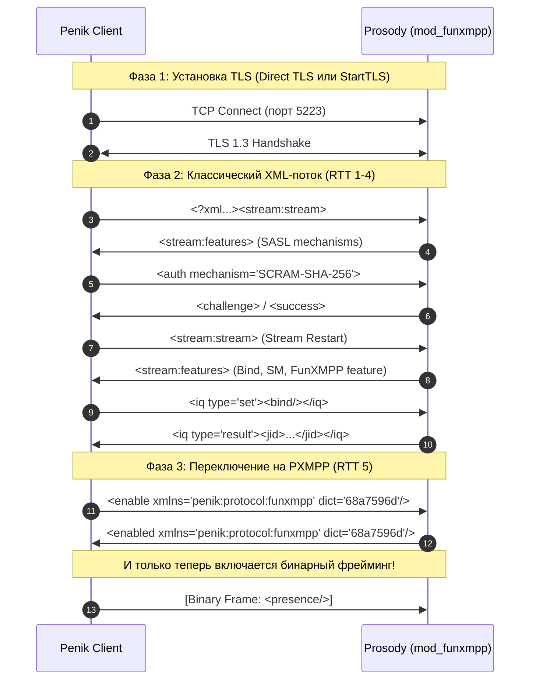
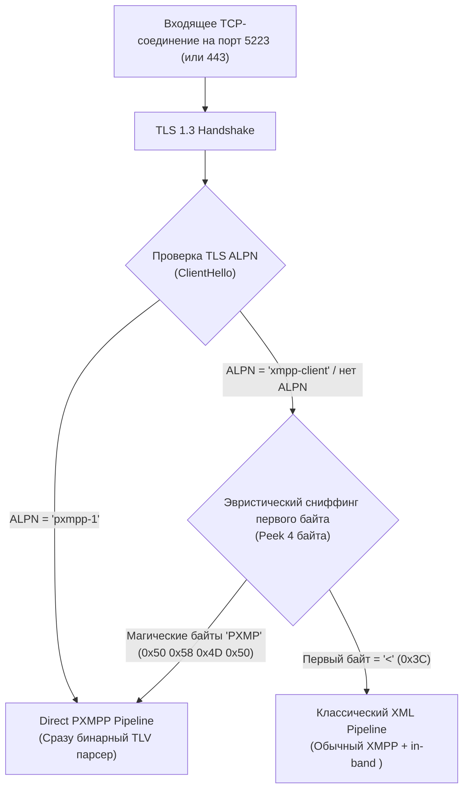
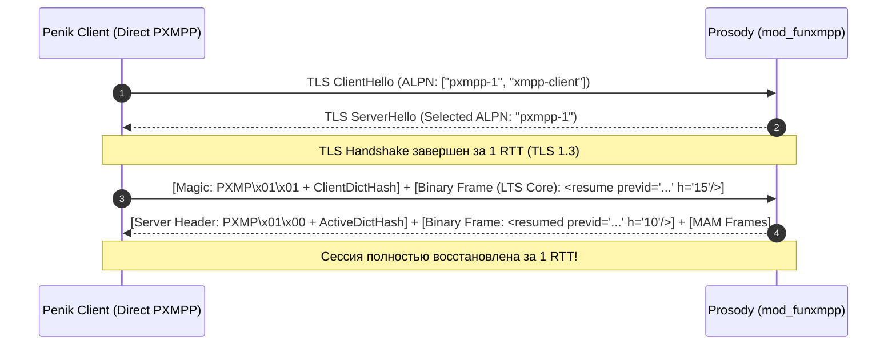
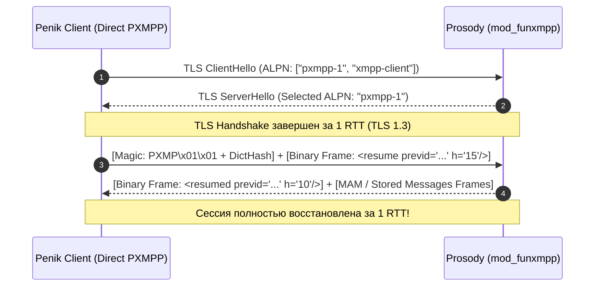

# Архитектурный план: Direct PXMPP (Implicit Binary Framing over TLS) с обратной совместимостью

## 1. Введение и проблематика

### 1.1. Текущее состояние FunXMPP (PXMPP v1)
В текущей реализации PXMPP (см. `docs/PXMPP/README.md`) переход на бинарный протокол происходит **In-Band** через расширение стандартного XML-потока:



### 1.2. Проблема текущего подхода
- **Задержка старта (High Latency / TTFB):** До первого полезного бинарного кадра требуется **4–6 полных RTT** (Round-Trip Time) текстового XML. На мобильных сетях с задержкой 100–150 мс это создает задержку в 500–900 мс до начала синхронизации сообщений.
- **Двойной парсер:** Клиент и сервер обязаны инициализировать тяжелый XML-парсер (Expat / SAX / XmlPullParser), загрузить его контекст, обработать аутентификацию и bind в XML, а затем полностью выгрузить и переключиться на бинарный TLV-ридер.
- **Оверхед трафика при реконнекте:** Повторные подключения передают одинаковые XML-заголовки пространств имен, SASL-теги и Stream Management возобновление в XML-виде.

### 1.3. Цель Direct PXMPP
Подобно тому, как **Direct TLS (XEP-0368)** заменил медленный `StartTLS` прямым TLS-рукопожатием с 1-го байта, **Direct PXMPP** переносит бинарный фрейминг на **нулевой шаг внутри TLS**:
- Поток с первого байта после TLS является **бинарным TLV**.
- Аутентификация, Stream Management Resumption и Bind передаются в сжатых бинарных кадрах.
- При этом **сохраняется 100% совместимость** со всеми сторонними XMPP-клиентами (Dino, Gajim, Monal, Conversations) и старыми версиями Penik.

---

## 2. Архитектура согласования и мультиплексирования

Главный вызов Direct PXMPP — обеспечить работу на существующих портах (5223 / 443) без выделения отдельных портов и без поломки старых клиентов.

Для этого используется трехуровневая стратегия мультиплексирования:



### 2.1. Уровень 1: Согласование через TLS ALPN (Основной путь)
В расширении TLS **ALPN (Application-Layer Protocol Negotiation, RFC 7301)** клиент объявляет список поддерживаемых протоколов при рукопожатии:
- **Новый Penik клиент отправляет:**
  `ALPN: ["pxmpp-1", "xmpp-client"]`
- **Сервер Prosody с `mod_funxmpp`:**
  - Если сервер поддерживает Direct PXMPP: выбирает протокол `"pxmpp-1"`.
  - Обе стороны **еще до отправки первого байта данных приложения** знают, что канал работает в режиме Direct PXMPP.
- **Старый клиент (любой XMPP-клиент):**
  - Отправляет `ALPN: ["xmpp-client"]` или не передает ALPN вовсе.
  - Сервер выбирает `"xmpp-client"` и отдает соединение в стандартный XML-обработчик Prosody.

### 2.2. Уровень 2: Sniffing первого буфера в Prosody и защита от TCP-фрагментации
В сетевой модели Prosody (`net.server` на базе LuaSocket / libevent) нет нативного неблокирующего `MSG_PEEK` над TLS-буфером OpenSSL.
Кроме того, из-за специфики TCP и MTU первый чанк данных при плохом мобильном сигнале может прийти фрагментированным (например, всего 1–2 байта).

Поэтому проверка в `mod_funxmpp.lua` строится по строгому алгоритму:
1. **Если ALPN согласовался как `"pxmpp-1"`:**
   Сниффинг **вообще не выполняется**. Соединение сразу переводится в бинарный декодер со стейт-машиной.
2. **Если соединение без ALPN (ветка эвристического сниффинга):**
   В перехваченном обработчике `session.data(data)`:
   - Если первый байт `data:byte(1) == 0x3C` (`<`): это классический XML. `session.data` восстанавливается на стандартный `xmppstream.feed()`, куда и передается буфер.
   - Если первый байт `data:byte(1) == 0x50` (`'P'`), но длина `#data < 4`: сокет накапливает байты во временный буфер `session.sniff_buf = (session.sniff_buf or "") .. data` и ждет следующего события `on_incoming`, пока `#session.sniff_buf` не достигнет минимум 4 байт.
   - Как только накопилось $\ge 4$ байт:
     - Если префикс равен `"PXMP"`: `session.data` заменяется на `handle_funxmpp_binary_chunk`, и весь накопленный буфер скармливается бинарному ридеру.
     - Иначе: поток признается поврежденным или нестандартным и сбрасывается в XML-обработчик для генерации корректной XMPP stream-error.

### 2.3. Уровень 3: DNS SRV-записи
Для автообнаружения клиентами без лишних попыток на DNS добавляется приоритетная запись:
```dns
_pxmpps-client._tcp.penik.ru.   86400 IN SRV 10 0 5223 snikket.penik.ru.
_xmpps-client._tcp.penik.ru.    86400 IN SRV 20 0 5223 snikket.penik.ru.
_xmpp-client._tcp.penik.ru.     86400 IN SRV 30 0 5222 snikket.penik.ru.
```
Новые клиенты Penik сначала резолвят `_pxmpps-client` (приоритет 10), а в случае недоступности или ошибки откатываются на стандартные SRV-записи.

---

## 3. Протокол Direct PXMPP Handshake

### 3.1. Бинарный стартовый фрейм (Stream Header)
Вместо громоздкого текстового тега `<stream:stream xmlns='jabber:client' xmlns:stream='http://etherx.jabber.org/streams' to='penik.ru' version='1.0'>` клиент отправляет компактный бинарный заголовок **Magic Stream Header**:

```
+---------------+---------------+---------------+---------------+
|  'P' (0x50)   |  'X' (0x58)   |  'M' (0x4D)   |  'P' (0x50)   |  [4 байта Magic]
+---------------+---------------+---------------+---------------+
| Version (0x01)| Flags (0x00)  |  Dict Hash: FNV-1a (0x68a7596d)|  [6 байт: Версия, Флаги, Хеш словаря]
+---------------+---------------+-------------------------------+
| Domain Token / Literal Length | Server Domain Name ("penik.ru") |
+-------------------------------+-------------------------------+
```

- **Magic (4B):** ASCII-маркер `PXMP`.
- **Version (1B):** Версия бинарного стрима (`0x01`).
- **Flags (1B):**
  - `0x01` (`FLAG_RESUME`): Попытка мгновенного возобновления сессии (Fast Session Resumption).
  - `0x02` (`FLAG_COMPACT_JID`): Поддержка расширенной компрессии JID.
- **Dict Checksum (4B):** 32-битный FNV-1a хеш статического словаря токенов (`0x68a7596d`). Если хеш совпадает, сервер сразу начинает использовать сжатие токенами.
- **Server Domain:** Токенизированный домен или строковый литерал.

### 3.2. Ответ сервера: Симметричный заголовок (Server Stream Header) и Stream Features
Чтобы исключить рассинхронизацию словаря при 1-RTT Fast Resumption (когда кадр `StreamFeatures` может опускаться, и сразу шлются накопленные сообщения), протокол использует **симметричный заголовок потока от сервера**:

Самые первые байты, которые сервер отправляет в ответ клиенту:
```
+---------------+---------------+---------------+---------------+
|  'P' (0x50)   |  'X' (0x58)   |  'M' (0x4D)   |  'P' (0x50)   |  [4 байта Magic]
+---------------+---------------+---------------+---------------+
| Version (0x01)| Flags (0x00)  |  Active Dict Hash (4 байта)   |  [6 байт: Версия, Флаги, Согласованный хеш]
+---------------+---------------+-------------------------------+
```

Сразу вслед за этим заголовком сервер отправляет:
- При первичном подключении: бинарный кадр `StreamFeatures`:
```
[Frame Length (u16 или 0xFFFF+u32)]
[Node: 0x01 (stream:features)]
    [Child Node: SASL Mechanisms (SCRAM-SHA-256-PLUS с Channel Binding RFC 9266, SCRAM-SHA-256, PLAIN)]
    [Child Node: Stream Management (0x1B = urn:xmpp:sm:3)]
```
- При 1-RTT Fast Resumption: бинарный кадр `<resumed/>` и следом накопленные сообщения истории.

> [!IMPORTANT]
> **Гарантия синхронизации при 1-RTT Resumption:**  
> Так как `Active Dict Hash` (4 байта) передаётся в первичном **Server Stream Header** (первые 10 байт ответа сервера), клиент **гарантированно переключает свой словарь** ещё до того, как начнёт читать первый прицепленный кадр `<resumed/>` или последующие фреймы накопленных сообщений MAM.

### 3.3. Fast Resumption в 1 RTT и строгое правило 0-RTT Pipelining
Если у клиента есть валидный токен возобновления сессии (XEP-0198 Stream Management `sm_id` и счетчик `h`), клиент выставляет флаг `FLAG_RESUME` и в том же начальном TCP-пакете (0-RTT pipelining) отправляет бинарный фрейм `<resume/>`.



> [!CAUTION]
> **Критическое правило 0-RTT кодирования:**
> До получения ответа сервера с `Active Dict Hash` клиент **НЕ ЗНАЕТ**, какую версию словаря выберет сервер. Поэтому любые кадры, передаваемые клиентом в 0-RTT фазе (включая `<resume/>`, `<auth/>`), **ОБЯЗАНЫ** кодироваться исключительно токенами базового замороженного словаря **LTS Core (`0x00..0xD0`)** либо строковыми литералами (`0xFA`).  
> Базовые теги `resume`, `urn:xmpp:sm:3`, `previd`, `h`, `auth`, `mechanism` входят в LTS Core и гарантированно будут распарсены сервером любой версии.



---

## 4. Матрица обратной совместимости

Архитектура гарантирует, что ни один существующий клиент или сервер не будет сломан:

| Тип клиента | Порт | Поведение при подключении | Режим работы | Совместимость |
| :--- | :--- | :--- | :--- | :--- |
| **Сторонний клиент** (Dino, Gajim, Monal, Conversations) | 5223 / 5222 | Шлет `xmpp-client` в ALPN или чистый `<stream:stream>` | Чистый XML XMPP (RFC 6120/6121). Сервер не включает бинарный режим. | **100% совместимо** |
| **Текущий Penik Android** (v1, без Direct PXMPP) | 5223 | Шлет обычный XML `<stream:stream>`, проходит SASL и Bind в XML, затем шлет `<enable xmlns='penik:protocol:funxmpp'/>` | In-Band апгрейд на FunXMPP после авторизации. | **100% совместимо** |
| **Новый Penik Android / Desktop** (v2, с Direct PXMPP) | 5223 | Шлет ALPN `pxmpp-1` и Magic `PXMP`. | Прямой бинарный стрим с 1-го байта. | **Максимальная скорость** |
| **Новый Penik v2 при подключении к старому Prosody** (без Direct PXMPP) | 5223 / 5222 | Сервер игнорирует `pxmpp-1` в ALPN и выбирает `xmpp-client`. Клиент видит это и откатывается на стандартный XML + In-band `<enable/>`. | Автоматический Fallback на In-Band PXMPP. | **100% отказоустойчиво** |

---

## 5. Необходимые изменения в компонентах проекта

### 5.1. Сервер: `server/Modules/mod_funxmpp.lua`
1. **Регистрация ALPN в сетевом хуке TLS:**
   - Хук `ssl-handshake-complete` или регистрация поддерживаемых ALPN-протоколов в Prosody net listeners (`net.server`):
     ```lua
     local alpn_protocols = { "pxmpp-1", "xmpp-client" };
     ```
2. **Перехват инициализации потока (Early Stream Hook):**
   - Если соединение получило ALPN `"pxmpp-1"`, сокет сразу помечается `session.funxmpp_direct = true`.
   - Входящий поток перенаправляется в `handle_binary_stream_header(session, data)` вместо стандартного XML-парсера `xmppstream.new(...)`.
3. **Обработка Magic Header и выбор словаря:**
   - Валидация маркера `PXMP`, проверка версии и поиск словаря в реестре: `local dict = DICTIONARIES[client_dict_hash] or DICTIONARIES[LTS_V1_HASH]`.
   - Сервер фиксирует выбранный словарь `session.fun_dict = dict` и отправляет клиенту симметричный **Server Stream Header** с `Active Dict Hash` (4B).
   - Установка состояния сессии `session.funxmpp_active = true`.
4. **Сохранение In-band обработчиков:**
   - Существующие обработчики станз `<enable xmlns='penik:protocol:funxmpp'/>` остаются активными для обслуживания текущих версий приложений.

### 5.2. Мобильный клиент: `android/src/main/java/eu/siacs/conversations/`
1. **Настройка ALPN в TLS Socket:**
   - В `XmppConnection.java` при создании SSL/TLS сокета через Conscrypt:
     ```java
     Conscrypt.setApplicationProtocols(socket, new String[] { "pxmpp-1", "xmpp-client" });
     ```
2. **Логика после TLS Handshake:**
   - Проверка `Conscrypt.getApplicationProtocol(socket)`:
     - Если равен `"pxmpp-1"`: инициализировать `FunWriter` и отправить стартовый заголовок `PXMP`. Не запускать `XmlReader`.
     - Если `"xmpp-client"` или `null`: запустить стандартный `XmlReader` и продолжить текущий путь с последующим in-band апгрейдом.
3. **Бинарный SASL и возобновление:**
   - Формирование кадров `<auth/>` и `<resume/>` через `FunWriter`.

### 5.3. Десктопное ядро на Rust: `desktop/core/crates/penik-net`
1. **Конфигурация `rustls`:**
   ```rust
   let mut client_config = ClientConfig::builder()
       .with_safe_defaults()
       .with_root_certificates(root_store)
       .with_no_client_auth();
   client_config.alpn_protocols = vec![b"pxmpp-1".to_vec(), b"xmpp-client".to_vec()];
   ```
2. **Ветвление после рукопожатия:**
   ```rust
   let negotiated = tls_stream.get_ref().1.alpn_protocol();
   if negotiated == Some(b"pxmpp-1") {
       // Direct PXMPP: инициализируем FunXmppCodec поверх Framed<TlsStream>
   } else {
       // Legacy Fallback: отправка XML <stream:stream>
   }
   ```

---

## 6. Сравнение производительности: Handshake & Data Transfer

| Параметр | Обычный XMPP (StartTLS) | Direct TLS (XEP-0368) + In-Band PXMPP | **Direct PXMPP (v2)** |
| :--- | :--- | :--- | :--- |
| **Количество RTT до начала синхронизации** | 6–8 RTT | 4–5 RTT | **1–2 RTT** |
| **Время установления связи (при пинге 80 мс)** | ~640 мс | ~380 мс | **~120 мс** |
| **Объем переданных данных при логине** | ~3.8 КБ (XML) | ~2.1 КБ (XML + бинарный) | **~480 Байт (Чистый бинарный TLV)** |
| **Инициализация парсера** | XML SAX/Pull Parser | Сначала XML-парсер, затем TLV-парсер | **Только легковесный TLV-ридер (0 парсеров XML)** |
| **Нагрузка на CPU мобильного устройства** | Высокая (XML DOM/Pull) | Средняя (смена парсеров) | **Минимальная (чистый потоковый скан байт)** |

---

## 7. Пошаговый план реализации

### Этап 1: Спецификация и прототип на сервере (Prosody)
- [ ] Описать точную структуру бинарных кадров для Stream Features, SASL Auth и SM Resumption в спецификации `docs/PXMPP/DIRECT_PXMPP.md`.
- [ ] Добавить обработку ALPN `pxmpp-1` в сетевом слое Prosody.
- [ ] Реализовать распознавание Magic `PXMP` и бинарный парсер для первых кадров соединения в `mod_funxmpp.lua`.
- [ ] Написать автономный интеграционный тест на Lua/Python, симулирующий Direct PXMPP подключение.

### Этап 2: Поддержка в Rust Core (Десктоп) и Android
- [ ] Настроить передачу `pxmpp-1` в ALPN через Conscrypt на Android и `rustls` в ядре Rust.
- [ ] Реализовать отправку стартового пакета `PXMP` и обработку бинарных `StreamFeatures`.
- [ ] Реализовать передачу SASL SCRAM-SHA-256 в бинарном TLV виде.
- [ ] Реализовать Fast Resumption (возобновление сессии в 1-м фрейме после TLS).

### Этап 3: Тестирование обратной совместимости (Regression Suite)
- [ ] Тест 1: Подключение сторонних клиентов (Gajim/Conversations) на порт с Direct PXMPP — проверка, что они успешно работают по старому XML-протоколу.
- [ ] Тест 2: Подключение текущей версии Penik Android (без Direct PXMPP) — проверка успешного in-band перехода по `<enable/>`.
- [ ] Тест 3: Подключение нового клиента с Direct PXMPP к серверу без поддержки `pxmpp-1` — проверка гладкого отката на XML.
- [ ] Тест 4: Имитация обрыва связи и проверка 1-RTT восстановления сессии (Stream Management Resumption).
