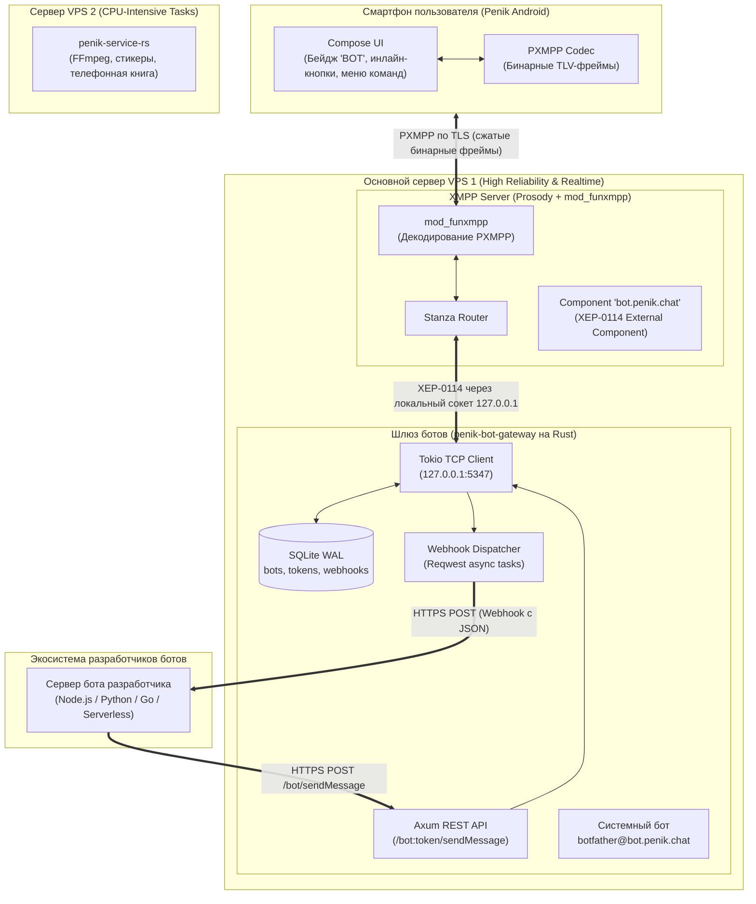

# План архитектуры и реализации платформы ботов в PenikXMPP

## 1. Контекст и цели

### 1.1. Зачем нужна платформа ботов
В современной экосистеме мессенджеров боты — ключевой фактор интерактивности (уведомления, ИИ-ассистенты, мини-сервисы, интеграции).
Классический подход XMPP предполагает, что бот подключается как обычный клиент (C2S) по постоянному TCP/TLS-соединению со своим логином и паролем. Однако для современных разработчиков этот порог входа неприемлем:
- Разработчики не хотят реализовывать XML-парсинг, SASL-аутентификацию, keep-alive пинги и поддерживать постоянный демон.
- Современные боты живут в **Serverless / Cloud** средах (Cloudflare Workers, AWS Lambda, Vercel), где взаимодействие строится исключительно вокруг **HTTP REST API** и входящих **Webhooks (JSON)**.

**Цель:** Создать высокопроизводительный, надежный и удобный для сторонних разработчиков шлюз (Telegram-style Bot API), гармонично интегрированный в экосистему PenikXMPP и протокол PXMPP.

---

## 2. Архитектурное решение: Разделение доменов отказа (Failure Domains)

### 2.1. Почему боты размещаются на основном VPS 1 (вместе с Prosody)
В инфраструктуре PenikXMPP задействованы два сервера:
* **VPS 1 (Основной, надежный):** Сервер Prosody/Snikket (ядро мессенджера, роутинг станз, SQLite/PostgreSQL, C2S-соединения).
* **VPS 2 (Мощный CPU):** Сервис `penik-service-rs` (тяжелая конвертация Telegram-видеостикеров через FFmpeg из WebM VP9 в Animated WebP, сборка архивов `bundle.zip`).

**Ключевой вывод:** Размещать ботов на VPS 2 **нельзя**, потому что:
1. **Профиль нагрузки ботов — чистый Real-time Network I/O:**  
   Шлюз ботов не выполняет тяжелых математических расчетов или транскодирования видео. Это потоковая маршрутизация: `JSON ↔ XMPP Stanza`. На Rust такой шлюз потребляет **< 0.1% CPU** и **15–20 МБ RAM**. Даже базовый VPS с Prosody справится с тысячами сообщений в секунду без малейшей просадки.
2. **Изоляция сбоев (High Availability):**  
   Если VPS 2 (со стикерами) временно недоступен или перезагружается под тяжелой нагрузкой FFmpeg — клиенты продолжают использовать закэшированные стикеры. Но если бы там жили боты, интерактивная переписка сломалась бы. Размещение ботов на VPS 1 гарантирует: **пока жив основной сервер, переписка с ботами работает всегда**.
3. **Локальный loopback (0 мс задержки):**  
   Связь между Prosody и шлюзом ботов происходит внутри VPS 1 через `127.0.0.1`. Нет сетевых задержек, нет риска разрыва интернет-канала между дата-центрами, нет необходимости настраивать межсерверные туннели и файрволы.

---

## 3. Общая схема архитектуры



---

## 4. Детальное описание компонентов

### 4.1. Маршрутизация на стороне Prosody (XEP-0114)
В `prosody.cfg.lua` регистрируется внешний компонент:
```lua
Component "bot.penik.chat"
    component_secret = "env_bot_gateway_secret"
```
* **Принцип работы:** Prosody не хранит аккаунты ботов в своей базе. Любое входящее сообщение с JID вида `<любой_бот>@bot.penik.chat` автоматически передается по локальному TCP-соединению шлюзу ботов.
* **Пользовательский трафик (PXMPP):** Мобильный клиент Penik общается с сервером исключительно через оптимизированный бинарный протокол PXMPP (`mod_funxmpp`). Распаковка в станзу происходит внутри Prosody на лету — телефон пользователя тратит минимум батареи и трафика.

### 4.2. Легковесный Rust-шлюз (`penik-bot-gateway`)
Автономный сервис на Rust (Tokio + Axum + Reqwest + SQLite WAL), живущий на VPS 1 под `systemd`.

#### Основные обязанности:
1. **XEP-0114 TCP Client:**
   Подключается к `127.0.0.1:5347`, проходит рукопожатие с паролем `component_secret` и слушает XML-поток от Prosody.
2. **База данных ботов (SQLite):**
   ```sql
   CREATE TABLE bots (
       id INTEGER PRIMARY KEY AUTOINCREMENT,
       username TEXT UNIQUE NOT NULL,      -- e.g. "weather_bot" -> weather_bot@bot.penik.chat
       token TEXT UNIQUE NOT NULL,         -- e.g. "123456:ABCdef..."
       title TEXT NOT NULL,
       owner_jid TEXT NOT NULL,            -- e.g. "alice@penik.chat"
       webhook_url TEXT,                   -- URL разработчика для доставки апдейтов
       is_active BOOLEAN DEFAULT 1,
       commands_json TEXT,                 -- список команд для подсказок [/start, /help]
       created_at INTEGER NOT NULL
   );
   ```
3. **HTTP REST API (Telegram-совместимый):**
   - `POST /bot<token>/getMe` — информация о боте.
   - `POST /bot<token>/setWebhook` — установка URL для приема событий.
   - `POST /bot<token>/deleteWebhook` — удаление вебхука.
   - `POST /bot<token>/sendMessage` — отправка текстового сообщения (с поддержкой markdown и кнопок).
   - `POST /bot<token>/sendPhoto` / `sendDocument` — отправка медиа.
4. **Диспетчеризация Webhook:**
   При получении сообщения от пользователя в XMPP-сокете:
   - Шлюз извлекает `bot_username` из поля `to` (`bot_username@bot.penik.chat`).
   - Находит в SQLite соответствующий `webhook_url`.
   - Асинхронно спавнит Tokio-таску: отправляет `POST` запрос с JSON структурой на сервер автора бота.
   - Таймаут запроса — 5 секунд. При ошибках 5xx/таймаутах — до 3 повторных попыток с экспоненциальной задержкой.
5. **Встроенный BotFather (`botfather@bot.penik.chat`):**
   Системный бот, доступный прямо из чата Penik.
   Команды:
   - `/newbot` — диалог создания нового бота (запрос имени, юзернейма, генерация токена).
   - `/mybots` — список своих ботов, смена описания, регенерация токена, настройка команд.
   - `/setcommands` — настройка подсказок по командам бота.

---

## 5. Расширения интерфейса и протокола в Android (Penik Compose UI)

Для нативного пользовательского опыта на клиенте реализуются следующие доработки:

### 5.1. Идентификация бота в UI
- Клиент определяет контакт как бота, если его домен оканчивается на `@bot.penik.chat` (или сервер возвращает disco identity `category='client' type='bot'`).
- В списке чатов (`PenikChatsList.kt`) и карточке профиля контакта (`ContactDetailsActivity.java`) отрисовывается компактный акцентный бейдж **`BOT`**.
- В чате с ботом кнопка микрофона/звонка по умолчанию скрывается или заменяется на кнопку вызова командного меню **`/`**.

### 5.2. Управление сквозным шифрованием (OMEMO)
- Для контактов-ботов OMEMO-шифрование **по умолчанию отключается** (сообщения отправляются в виде открытых или сервер-зашифрованных станз, как это принято для сервисных аккаунтов).

### 5.3. Интерактивные кнопки (Inline Keyboards)
Для поддержки кнопок под сообщениями в станзу `<message>` добавляется легковесный XML-элемент пространства имён `penik:bot:markup`:
```xml
<message type="chat" to="alice@penik.chat" from="weather_bot@bot.penik.chat" id="msg123">
  <body>Выберите город для прогноза:</body>
  <markup xmlns="penik:bot:markup">
    <row>
      <button text="Москва" data="city:msk"/>
      <button text="Санкт-Петербург" data="city:spb"/>
    </row>
    <row>
      <button text="Открыть сайт" url="https://weather.service.com"/>
    </row>
  </markup>
</message>
```
* В `PenikChatRoom.kt` карточка сообщения рендерит ряд кнопок под пузырем.
* При клике на кнопку с `data` клиент отправляет скрытую станзу нажатия (аналог `callback_query`), и автор бота получает событие на вебхук.

---

## 6. Этапы реализации (Roadmap)

### Этап 1: Базовый шлюз и XEP-0114 на VPS 1
- [ ] Настройка `Component "bot.penik.chat"` в конфиге Prosody.
- [ ] Создание каркаса Rust-микросервиса `server/MicroServices/penik-bot-gateway`.
- [ ] Реализация устойчивого Tokio TCP-клиента к XEP-0114 с автоматическим реконнектом при сбоях.
- [ ] Таблица SQLite для хранения ботов, токенов и вебхуков.

### Этап 2: REST API и Webhook Dispatcher
- [ ] Реализация эндпоинтов Axum: `/bot<token>/getMe`, `/bot<token>/sendMessage`, `/bot<token>/setWebhook`.
- [ ] Реализация асинхронного воркера доставки вебхуков (Reqwest с таймаутами и ограничением параллелизма).
- [ ] Поддержка базовой текстовой переписки (пользователь ↔ бот).

### Этап 3: BotFather и управление
- [ ] Логика системного бота `botfather@bot.penik.chat` для создания ботов и выдачи токенов.
- [ ] Обработка команд `/start`, `/newbot`, `/token`.

### Этап 4: Android UI и интерактивность
- [ ] Добавление бейджа `BOT` в списках диалогов и профиле контакта.
- [ ] Отключение OMEMO по умолчанию для доменов `bot.*`.
- [ ] Парсинг тега `<markup xmlns="penik:bot:markup">` и отрисовка Compose-кнопок под сообщениями в `PenikChatRoom.kt`.
- [ ] Отправка обратных вызовов при нажатии на кнопки (`callback_data`).
