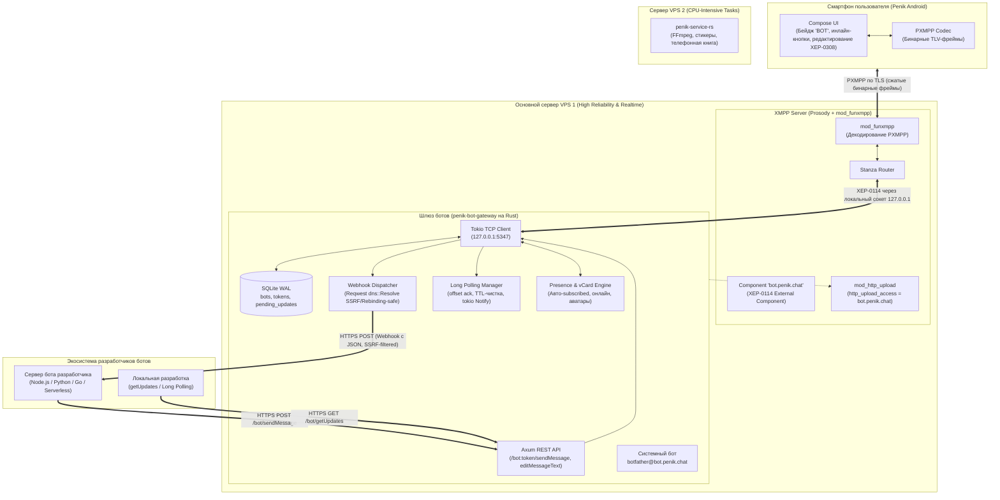

# План архитектуры и реализации платформы ботов в PenikXMPP (v3)

## 1. Контекст и цели

### 1.1. Зачем нужна платформа ботов
В современной экосистеме мессенджеров боты — ключевой фактор интерактивности (уведомления, ИИ-ассистенты, мини-сервисы, интеграции).
Классический подход XMPP предполагает, что бот подключается как обычный клиент (C2S) по постоянному TCP/TLS-соединению со своим логином и паролем. Однако для современных разработчиков этот порог входа неприемлем:
- Разработчики не хотят реализовывать XML-парсинг, SASL-аутентификацию, keep-alive пинги и поддерживать постоянный демон.
- Современные боты живут в **Serverless / Cloud** средах (Cloudflare Workers, AWS Lambda, Vercel), где взаимодействие строится исключительно вокруг **HTTP REST API** и входящих **Webhooks (JSON)** либо **Long Polling (`getUpdates`)**.

**Цель:** Создать высокопроизводительный, надежный и удобный для сторонних разработчиков шлюз (Telegram-style Bot API), гармонично интегрированный в экосистему PenikXMPP и протокол PXMPP.

---

## 2. Архитектурное решение: Разделение доменов отказа (Failure Domains)

### 2.1. Почему боты размещаются на основном VPS 1 (вместе с Prosody)
В инфраструктуре PenikXMPP задействованы два сервера:
* **VPS 1 (Основной, надежный):** Сервер Prosody/Snikket (ядро мессенджера, роутинг станз, SQLite/PostgreSQL, C2S-соединения).
* **VPS 2 (Мощный CPU):** Сервис `penik-service-rs` (тяжелая конвертация Telegram-видеостикеров через FFmpeg из WebM VP9 в Animated WebP, сборка архивов `bundle.zip`).

**Ключевой вывод:** Размещать ботов на VPS 2 **нельзя**, потому что:
1. **Профиль нагрузки ботов — чистый Real-time Network I/O:**  
   Шлюз ботов не выполняет тяжелых математических расчетов или транскодирования видео. Это потоковая маршрутизация: `JSON ↔ XMPP Stanza`. На Rust такой шлюз потребляет **< 0.1% CPU** и **15–20 МБ RAM**. Даже базовый VPS с Prosody справится с тысячами сообщений в секунду без малейшей просадки.
2. **Изоляция сбоев (High Availability):**  
   Если VPS 2 (со стикерами) временно недоступен или перезагружается под тяжелой нагрузкой FFmpeg — клиенты продолжают использовать закэшированные стикеры. Но если бы там жили боты, интерактивная переписка сломалась бы. Размещение ботов на VPS 1 гарантирует: **пока жив основной сервер, переписка с ботами работает всегда**.
3. **Локальный loopback (0 мс задержки):**  
   Связь между Prosody и шлюзом ботов происходит внутри VPS 1 через `127.0.0.1`. Нет сетевых задержек, нет риска разрыва интернет-канала между дата-центрами, нет необходимости настраивать межсерверные туннели и файрволы.

---

## 3. Общая схема архитектуры



---

## 4. Детальное описание серверного ядра (VPS 1)

### 4.1. Маршрутизация и права на стороне Prosody (XEP-0114 и XEP-0363)
В `prosody.cfg.lua`:
```lua
-- Компонент ботов:
Component "bot.penik.chat"
    component_secret = "env_bot_gateway_secret"

-- Разрешение внешнему компоненту запрашивать слоты загрузки медиа:
http_upload_access = { "bot.penik.chat" }
```
* **Принцип работы:** Prosody не хранит аккаунты ботов в своей базе. Любое входящее сообщение с JID вида `<любой_бот>@bot.penik.chat` автоматически передается по локальному TCP-соединению шлюзу ботов.
* **Доступ к медиа (XEP-0363):** По умолчанию Prosody блокирует запросы слотов от внешних компонентов. Параметр `http_upload_access = { "bot.penik.chat" }` позволяет шлюзу прозрачно загружать картинки и файлы разработчиков через `mod_http_upload`.
* **Пользовательский трафик (PXMPP):** Мобильный клиент Penik общается с сервером исключительно через оптимизированный бинарный протокол PXMPP (`mod_funxmpp`). Распаковка в станзу происходит внутри Prosody на лету — телефон пользователя тратит минимум батареи и трафика.

---

### 4.2. Легковесный Rust-шлюз (`penik-bot-gateway`)
Автономный сервис на Rust (Tokio + Axum + Reqwest + SQLite WAL), живущий на VPS 1 под `systemd`.

#### 1. XEP-0114 TCP Client & Presence/vCard Engine:
* Подключается к `127.0.0.1:5347`, проходит рукопожатие с паролем `component_secret` и слушает XML-поток от Prosody.
* **Обработка Presence:** Шлюз перехватывает станзы присутствия:
  - При получении `<presence type="subscribe"/>` от пользователя моментально отвечает `<presence type="subscribed"/>` и шлет ответный `<presence/>` (бот всегда взаимно подписан).
  - При подключении пользователя отправляет `<presence/>`, чтобы бот отображался в сети («В сети» / статус бота).
* **Обработка профиля (vCard / PEP Avatar):**
  - При получении `<iq type="get"><vCard xmlns="vcard-temp"/></iq>` шлюз генерирует и возвращает vCard с именем (`title`), описанием (`about`) и аватаром (`avatar_base64` или бинарным хешем) из SQLite.

#### 2. База данных ботов (SQLite WAL):
```sql
CREATE TABLE bots (
    id INTEGER PRIMARY KEY AUTOINCREMENT,
    username TEXT UNIQUE NOT NULL,      -- e.g. "weather_bot" -> weather_bot@bot.penik.chat
    token TEXT UNIQUE NOT NULL,         -- e.g. "123456:ABCdef..."
    title TEXT NOT NULL,
    about TEXT,                         -- Описание профиля бота
    avatar_url TEXT,                    -- URL аватарки бота
    owner_jid TEXT NOT NULL,            -- e.g. "alice@penik.chat"
    webhook_url TEXT,                   -- URL разработчика (если NULL -> режим getUpdates)
    fail_count INTEGER DEFAULT 0,       -- Счетчик последовательных ошибок вебхука
    is_active BOOLEAN DEFAULT 1,
    commands_json TEXT,                 -- Список команд для подсказок [/start, /help]
    created_at INTEGER NOT NULL
);

CREATE TABLE pending_updates (
    id INTEGER PRIMARY KEY AUTOINCREMENT,
    bot_id INTEGER NOT NULL,
    update_data TEXT NOT NULL,          -- JSON сериализованный апдейт
    created_at INTEGER NOT NULL,
    FOREIGN KEY(bot_id) REFERENCES bots(id) ON DELETE CASCADE
);
CREATE INDEX idx_pending_bot ON pending_updates(bot_id, id);
```

#### 3. Защита от SSRF и DNS Rebinding в Webhooks (Reqwest `dns::Resolve`):
> [!IMPORTANT]
> Если разрешать DNS отдельно от HTTP-клиента, возникает уязвимость **Time-of-Check to Time-of-Use (TOCTOU) / DNS Rebinding**: злоумышленник с доменом с TTL=0 при первой проверке отдаёт публичный IP, а в момент отправки запроса Reqwest резолвит `127.0.0.1`.

**Архитектурное решение в коде шлюза:**
1. Разрешаются **исключительно URL со схемой `https://`** (отклоняются `http://`, `file://`, `ftp://`).
2. Запрещаются автоматические редиректы: `ClientBuilder::redirect(redirect::Policy::none())`.
3. Реализуется кастомный DNS-резолвер через трейт `reqwest::dns::Resolve`:
   ```rust
   pub struct SafeDnsResolver;
   impl reqwest::dns::Resolve for SafeDnsResolver {
       fn resolve(&self, name: reqwest::dns::Name) -> reqwest::dns::Resolving {
           Box::pin(async move {
               let addrs = tokio::net::lookup_host((name.as_str(), 443)).await?;
               let safe_addrs: Vec<SocketAddr> = addrs.filter(|addr| {
                   let ip = addr.ip();
                   !ip.is_loopback() 
                   && !ip.is_unspecified()
                   && match ip {
                       IpAddr::V4(ipv4) => !ipv4.is_private() && !ipv4.is_link_local(),
                       IpAddr::V6(ipv6) => !ipv6.is_unique_local() && !ipv6.is_unicast_link_local(),
                   }
               }).collect();

               if safe_addrs.is_empty() {
                   return Err(Box::new(std::io::Error::new(
                       std::io::ErrorKind::PermissionDenied, 
                       "Target IP is private or loopback (SSRF blocked)"
                   )));
               }
               Ok(Box::new(safe_addrs.into_iter()) as reqwest::dns::Addrs)
           })
       }
   }
   ```
4. Резолвер внедряется в `ClientBuilder::dns_resolver(Arc::new(SafeDnsResolver))`. В этом случае Reqwest соединяется **строго по проверенному IP-адресу**, одновременно сохраняя корректный SNI для валидации TLS-сертификата.

#### 4. Защита от зависших вебхуков (Circuit Breaker):
* Таймаут каждого HTTP POST вебхука — **5 секунд**.
* При получении 5xx, таймаута или ошибки соединения поле `fail_count` увеличивается на 1. При успешном ответе (200 OK) — сбрасывается в 0.
* Если `fail_count >= 50`:
  - Поле `webhook_url` сбрасывается в `NULL` (вебхук временно замораживается).
  - Шлюз отправляет уведомление владельцу (`owner_jid`) от имени `botfather@bot.penik.chat`:
    > *«⚠️ Вебхук для бота @weather_bot недоступен (50 ошибок подряд) и был временно отключён. Проверьте ваш сервер и настройте setWebhook заново.»*

#### 5. Long Polling (`getUpdates`) с подтверждением `offset` и TTL-чисткой:
Если `webhook_url` не задан (NULL):
* Входящие сообщения сохраняются в таблицу `pending_updates`.
* При вызове `GET /bot<token>/getUpdates?offset=105&timeout=30`:
  1. **Подтверждение и очистка через offset:**
     Шлюз сразу выполняет:
     ```sql
     DELETE FROM pending_updates WHERE bot_id = ? AND id < 105;
     ```
  2. Запрашивает оставшиеся записи с `id >= 105`.
  3. Если записей нет — ожидает поступления новых событий через `tokio::sync::Notify` до `timeout` секунд.
* **Фоновая очистка от заброшенных ботов (TTL Cleaner):**
  Фоновая Tokio-задача (запуск каждый час):
  ```sql
  DELETE FROM pending_updates WHERE created_at < unixepoch() - 86400;
  ```
  Также действует лимит: не более 1000 записей на одного бота (старые вытесняются по принципу FIFO).

#### 6. Работа с медиа (`sendPhoto`, `sendDocument`):
* **По ссылке:** Автор бота передает URL. Шлюз упаковывает URL в станзу через XEP-0066 OOB (`<x xmlns="jabber:x:oob"><url>...</url></x>`).
* **Бинарная загрузка (`multipart/form-data`):**
  - Шлюз принимает файл от разработчика.
  - Запрашивает HTTP Upload слот у Prosody (XEP-0363) через локальный компонент `http_upload`.
  - Загружает файл по полученному PUT URL и возвращает клиенту URL скачивания в OOB-теге.

#### 7. Встроенный системный бот BotFather (`botfather@bot.penik.chat`):
В отличие от внешних ботов, BotFather не использует Webhook или HTTP API, а исполняется внутри процесса шлюза:
- **Перехват трафика:** Станзы с `to="botfather@bot.penik.chat"` не перенаправляются в очередь вебхуков, а обрабатываются локальным модулем `BotFatherEngine`.
- **FSM диалога (в памяти):** Шлюз отслеживает состояние создания бота (`State::WaitingForTitle`, `State::WaitingForUsername`) для каждого проверенного `from` JID пользователя в потокобезопасной `DashMap<Jid, (DialogState, Instant)>`.
- **Генерация токена и валидация:**
  - Валидация username (длина 3–32 символа, допустимые символы `a-z0-9_`, обязательный суффикс `_bot`).
  - Проверка уникальности юзернейма в SQLite.
  - Генерация токена формата `<bot_id>:<64_hex_random>` с помощью криптостойкого генератора (`rand::rngs::OsRng`).
  - Выполнение `INSERT INTO bots (username, token, title, owner_jid)` и мгновенная готовность токена в Axum REST API.

---

## 5. Протокольный контракт клиент-сервер (XMPP & PXMPP)

Этот раздел фиксирует правила формирования станз между шлюзом и любым клиентом.

### 5.1. Интерактивные кнопки (Inline Keyboards)
Формат отображения кнопок (от бота к пользователю):
```xml
<message type="chat" to="alice@penik.chat" from="weather_bot@bot.penik.chat" id="msg123">
  <body>Выберите город для прогноза:</body>
  <markup xmlns="penik:bot:markup">
    <row>
      <button text="Москва" data="city:msk"/>
      <button text="Санкт-Петербург" data="city:spb"/>
    </row>
    <row>
      <button text="Открыть сайт" url="https://weather.service.com"/>
    </row>
  </markup>
</message>
```

### 5.2. Формат нажатия кнопки (Callback Query)
> [!IMPORTANT]
> При клике на кнопку клиент **НЕ** отправляет текстовое `<body>`, чтобы исключить визуальный мусор в чате. Отправляется станза с хинтом `<no-store/>`, предотвращающим засорение истории MAM:

```xml
<message type="chat" to="weather_bot@bot.penik.chat" from="alice@penik.chat">
  <callback xmlns="penik:bot:markup" msg_id="msg123" data="city:msk"/>
  <no-store xmlns="urn:xmpp:hints"/>
</message>
```

### 5.3. Редактирование сообщений на месте (XEP-0308 Last Message Correction)
Когда пользователь нажимает кнопку, боту часто нужно обновить текущее сообщение (заменить текст и перерисовать кнопки) вместо отправки нового:
* Эндпоинт `POST /bot<token>/editMessageText` формирует станзу с `<replace>`:
```xml
<message type="chat" to="alice@penik.chat" from="weather_bot@bot.penik.chat" id="msg124">
  <body>Погода в Москве: +15°C, солнечно</body>
  <replace id="msg123" xmlns="urn:xmpp:message-correct:0"/>
  <markup xmlns="penik:bot:markup">
    <row>
      <button text="Назад" data="back_to_menu"/>
    </row>
  </markup>
</message>
```

### 5.4. Бинарный транспорт PXMPP (FunXMPP)
- В `server/Modules/mod_funxmpp.lua` и Android `FunTokens` расширяется таблица словаря токенов:
  - `markup`, `row`, `button`, `callback`, `penik:bot:markup`.
- Тег `urn:xmpp:message-correct:0` уже токенизирован в существующем словаре FunTokens под индексом 63.

---

## 6. Клиентская часть (Android UI & UX — Спринт 2)

> [!NOTE]
> Текстовые боты (без инлайн-кнопок) работают в Penik **сразу после запуска серверного шлюза без единой строчки правок в Android**. Доработки ниже являются вторым этапом (полировка интерфейса и интерактивность).

1. **Идентификация бота в UI:**
   - Клиент определяет контакт как бота по домену `@bot.penik.chat` (или disco identity `category='client' type='bot'`).
   - В списке чатов (`PenikChatsList.kt`) и карточке профиля контакта (`ContactDetailsActivity.java`) отрисовывается компактный акцентный бейдж **`BOT`**.
   - В чате с ботом кнопка звонка скрывается, а кнопка микрофона заменяется на меню команд **`/`**.
2. **Управление сквозным шифрованием (OMEMO):**
   - Для контактов-ботов OMEMO-шифрование **по умолчанию отключается** (сообщения отправляются открытыми станзами).
3. **Рендеринг инлайн-кнопок:**
   - В `PenikChatRoom.kt` карточка сообщения парсит `<markup>` и рендерит сетку кнопок под пузырем.
   - Нажатие на кнопку формирует станзу `<callback msg_id="..." data="..."><no-store/></callback>`.
4. **Бесшовное обновление сообщений:**
   - Обработка тега `<replace>` (XEP-0308) на лету обновляет содержимое пузыря сообщения и набор кнопок без скролла.

---

## 7. Поэтапный план реализации (Roadmap)

### Спринт 1: Бэкенд и Серверная платформа (MVP)
> **Результат:** 100% рабочие текстовые боты, BotFather, REST API и Long Polling. Работает с существующим клиентом Penik без изменения Android-кода.

#### Этап 1: Базовый шлюз и XEP-0114 на VPS 1
- [ ] Настройка `Component "bot.penik.chat"` и `http_upload_access = { "bot.penik.chat" }` в Prosody.
- [ ] Создание каркаса Rust-микросервиса `server/MicroServices/penik-bot-gateway`.
- [ ] Реализация устойчивого Tokio TCP-клиента к XEP-0114 с автоматическим реконнектом при сбоях.
- [ ] Обработка `<presence type="subscribe"/>` (авто-ответ `subscribed`) и vCard-запросов (аватары и имена ботов).
- [ ] Таблицы SQLite: `bots`, `pending_updates` с индексами.

#### Этап 2: REST API, SSRF-safe Webhook Dispatcher и Long Polling
- [ ] Реализация эндпоинтов Axum: `/bot<token>/getMe`, `/bot<token>/sendMessage`, `/bot<token>/editMessageText`, `/bot<token>/setWebhook`, `/bot<token>/deleteWebhook`.
- [ ] Реализация `GET /bot<token>/getUpdates` с подтверждением `offset`, удалением старых записей и `tokio::sync::Notify`.
- [ ] Фоновый воркер очистки `pending_updates` по TTL (старше 24 часов / лимит 1000 записей).
- [ ] Реализация `SafeDnsResolver` через `reqwest::dns::Resolve` (защита от SSRF и DNS Rebinding / TOCTOU).
- [ ] Circuit breaker для упавших серверов разработчиков (заморозка после 50 ошибок подряд).
- [ ] Поддержка медиа: отправка по URL и multipart/form-data загрузка через XEP-0363.

#### Этап 3: BotFather и управление ботами
- [ ] Логика системного бота `botfather@bot.penik.chat` для создания ботов и выдачи токенов.
- [ ] Обработка команд `/start`, `/newbot`, `/mybots`, `/token`, `/setcommands`.

---

### Спринт 2: Android UI и интерактивность (Polish & UX)
> **Результат:** Премиальный Telegram-like UX в Android-клиенте: бейджи BOT, авто-отключение OMEMO, рендеринг инлайн-кнопок в Compose и XEP-0308 замена сообщений.

#### Этап 4: Android UI и PXMPP
- [ ] Добавление токенов `markup`, `callback`, `row`, `button` в словарь FunXMPP (`mod_funxmpp.lua` + `FunTokens.java`).
- [ ] Добавление бейджа `BOT` в списках диалогов (`PenikChatsList.kt`) и профиле контакта (`ContactDetailsActivity.java`).
- [ ] Автоматическое отключение OMEMO по умолчанию для доменов `@bot.penik.chat`.
- [ ] Рендеринг Compose-кнопок под сообщениями в `PenikChatRoom.kt`.
- [ ] Обработка XEP-0308 Last Message Correction для обновления текста и кнопок в карточке сообщения.
- [ ] Отправка станции `<callback msg_id="..." data="..."><no-store/></callback>` при клике на кнопки.
