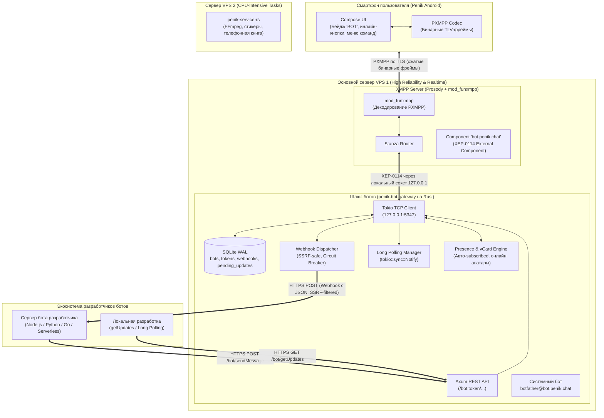

# План архитектуры и реализации платформы ботов в PenikXMPP (v2)

## 1. Контекст и цели

### 1.1. Зачем нужна платформа ботов
В современной экосистеме мессенджеров боты — ключевой фактор интерактивности (уведомления, ИИ-ассистенты, мини-сервисы, интеграции).
Классический подход XMPP предполагает, что бот подключается как обычный клиент (C2S) по постоянному TCP/TLS-соединению со своим логином и паролем. Однако для современных разработчиков этот порог входа неприемлем:
- Разработчики не хотят реализовывать XML-парсинг, SASL-аутентификацию, keep-alive пинги и поддерживать постоянный демон.
- Современные боты живут в **Serverless / Cloud** средах (Cloudflare Workers, AWS Lambda, Vercel), где взаимодействие строится исключительно вокруг **HTTP REST API** и входящих **Webhooks (JSON)** либо **Long Polling (`getUpdates`)**.

**Цель:** Создать высокопроизводительный, надежный и удобный для сторонних разработчиков шлюз (Telegram-style Bot API), гармонично интегрированный в экосистему PenikXMPP и протокол PXMPP.

---

## 2. Архитектурное решение: Разделение доменов отказа (Failure Domains)

### 2.1. Почему боты размещаются на основном VPS 1 (вместе с Prosody)
В инфраструктуре PenikXMPP задействованы два сервера:
* **VPS 1 (Основной, надежный):** Сервер Prosody/Snikket (ядро мессенджера, роутинг станз, SQLite/PostgreSQL, C2S-соединения).
* **VPS 2 (Мощный CPU):** Сервис `penik-service-rs` (тяжелая конвертация Telegram-видеостикеров через FFmpeg из WebM VP9 в Animated WebP, сборка архивов `bundle.zip`).

**Ключевой вывод:** Размещать ботов на VPS 2 **нельзя**, потому что:
1. **Профиль нагрузки ботов — чистый Real-time Network I/O:**  
   Шлюз ботов не выполняет тяжелых математических расчетов или транскодирования видео. Это потоковая маршрутизация: `JSON ↔ XMPP Stanza`. На Rust такой шлюз потребляет **< 0.1% CPU** и **15–20 МБ RAM**. Даже базовый VPS с Prosody справится с тысячами сообщений в секунду без малейшей просадки.
2. **Изоляция сбоев (High Availability):**  
   Если VPS 2 (со стикерами) временно недоступен или перезагружается под тяжелой нагрузкой FFmpeg — клиенты продолжают использовать закэшированные стикеры. Но если бы там жили боты, интерактивная переписка сломалась бы. Размещение ботов на VPS 1 гарантирует: **пока жив основной сервер, переписка с ботами работает всегда**.
3. **Локальный loopback (0 мс задержки):**  
   Связь между Prosody и шлюзом ботов происходит внутри VPS 1 через `127.0.0.1`. Нет сетевых задержек, нет риска разрыва интернет-канала между дата-центрами, нет необходимости настраивать межсерверные туннели и файрволы.

---

## 3. Общая схема архитектуры



---

## 4. Детальное описание компонентов и безопасность

### 4.1. Маршрутизация на стороне Prosody (XEP-0114)
В `prosody.cfg.lua` регистрируется внешний компонент:
```lua
Component "bot.penik.chat"
    component_secret = "env_bot_gateway_secret"
```
* **Принцип работы:** Prosody не хранит аккаунты ботов в своей базе. Любое входящее сообщение с JID вида `<любой_бот>@bot.penik.chat` автоматически передается по локальному TCP-соединению шлюзу ботов.
* **Пользовательский трафик (PXMPP):** Мобильный клиент Penik общается с сервером исключительно через оптимизированный бинарный протокол PXMPP (`mod_funxmpp`). Распаковка в станзу происходит внутри Prosody на лету — телефон пользователя тратит минимум батареи и трафика.

---

### 4.2. Легковесный Rust-шлюз (`penik-bot-gateway`)
Автономный сервис на Rust (Tokio + Axum + Reqwest + SQLite WAL), живущий на VPS 1 под `systemd`.

#### 1. XEP-0114 TCP Client & Presence/vCard Engine:
* Подключается к `127.0.0.1:5347`, проходит рукопожатие с паролем `component_secret` и слушает XML-поток от Prosody.
* **Обработка Presence:** Так как ботов нет в базе пользователей Prosody, шлюз перехватывает станзы присутствия:
  - При получении `<presence type="subscribe"/>` от пользователя моментально отвечает `<presence type="subscribed"/>` и шлет ответный `<presence/>` (бот всегда взаимно подписан).
  - При подключении пользователя отправляет `<presence/>`, чтобы бот отображался в сети («В сети» / статус бота).
* **Обработка профиля (vCard / PEP Avatar):**
  - При получении `<iq type="get"><vCard xmlns="vcard-temp"/></iq>` шлюз генерирует и возвращает vCard с именем (`title`), описанием (`about`) и аватаром (`avatar_base64` или бинарным хешем) из SQLite.

#### 2. База данных ботов (SQLite WAL):
```sql
CREATE TABLE bots (
    id INTEGER PRIMARY KEY AUTOINCREMENT,
    username TEXT UNIQUE NOT NULL,      -- e.g. "weather_bot" -> weather_bot@bot.penik.chat
    token TEXT UNIQUE NOT NULL,         -- e.g. "123456:ABCdef..."
    title TEXT NOT NULL,
    about TEXT,                         -- Описание профиля бота
    avatar_url TEXT,                    -- URL аватарки бота
    owner_jid TEXT NOT NULL,            -- e.g. "alice@penik.chat"
    webhook_url TEXT,                   -- URL разработчика (если пустой -> режим getUpdates)
    fail_count INTEGER DEFAULT 0,       -- Счетчик последовательных ошибок вебхука
    is_active BOOLEAN DEFAULT 1,
    commands_json TEXT,                 -- Список команд для подсказок [/start, /help]
    created_at INTEGER NOT NULL
);

CREATE TABLE pending_updates (
    id INTEGER PRIMARY KEY AUTOINCREMENT,
    bot_id INTEGER NOT NULL,
    update_data TEXT NOT NULL,          -- JSON сериализованный апдейт
    created_at INTEGER NOT NULL,
    FOREIGN KEY(bot_id) REFERENCES bots(id) ON DELETE CASCADE
);
CREATE INDEX idx_pending_bot ON pending_updates(bot_id);
```

#### 3. Защита от SSRF в Webhooks (Критично!):
Поскольку шлюз работает на VPS 1 рядом с Prosody, свободный вызов вебхуков создает риск SSRF (атаки на локальные порты `127.0.0.1:5347`, `127.0.0.1:5280`, внутреннюю сеть).
* **Реализация защиты в Reqwest:**
  - На этапе `setWebhook` выполняется предварительная валидация схемы: **строго `https://`** (запрет `http://`, `file://`, `ftp://`).
  - Перед выполнением запроса в `WebhookWorker` выполняется DNS-резолвинг домена через системный резолвер.
  - Жёсткий фильтр IP-адресов целевого хоста. Запрос **немедленно блокируется**, если IP входит в любой из диапазонов:
    - `127.0.0.0/8` (Loopback)
    - `10.0.0.0/8`, `172.16.0.0/12`, `192.168.0.0/16` (Private IPv4)
    - `169.254.0.0/16` (Link-local)
    - `::1`, `fc00::/7`, `fe80::/10` (IPv6 Loopback / ULA / Link-local)
    - `0.0.0.0/8`
  - Запрет на редиректы (`redirect::Policy::none()`), чтобы сервер разработчика не мог перенаправить шлюз на локальный IP.

#### 4. Защита от зависших вебхуков (Circuit Breaker):
* Таймаут каждого HTTP POST вебхука — **5 секунд**.
* При получении 5xx, таймаута или ошибки соединения поле `fail_count` увеличивается на 1. При успешном ответе (200 OK) — сбрасывается в 0.
* Если `fail_count >= 50`:
  - Поле `webhook_url` сбрасывается в `NULL` (вебхук временно замораживается).
  - Шлюз отправляет уведомление владельцу (`owner_jid`) от имени `botfather@bot.penik.chat`:
    > *«⚠️ Вебхук для бота @weather_bot недоступен (50 ошибок подряд) и был временно отключён. Проверьте ваш сервер и настройте setWebhook заново.»*

#### 5. Поддержка Long Polling (`getUpdates`) для локальной разработки:
Если `webhook_url` не задан (NULL):
* Входящие сообщения для бота сохраняются в таблицу `pending_updates`.
* Метод `GET /bot<token>/getUpdates?offset=123&timeout=30`:
  - Если в очереди есть сообщения — отдаются сразу.
  - Если очередь пуста — Tokio-задача ожидает уведомления от `tokio::sync::Notify` до `timeout` секунд (Long Polling).
* Это позволяет авторам ботов отлаживать код на домашнем компьютере за NAT без `ngrok`, белых IP и SSL.

#### 6. Работа с медиа (`sendPhoto`, `sendDocument`):
* **Вариант 1 (По ссылке):** Автор бота передает URL. Шлюз упаковывает URL в станзу через XEP-0066 OOB (`<x xmlns="jabber:x:oob"><url>...</url></x>`).
* **Вариант 2 (Бинарная загрузка multipart/form-data):**
  - Шлюз принимает файл от разработчика.
  - Запрашивает HTTP Upload слот у Prosody (XEP-0363) через локальный компонент `http_upload`.
  - Загружает файл по полученному PUT URL и возвращает клиенту URL скачивания в OOB-теге.

---

## 5. Расширения интерфейса и протокола в Android (Penik Compose UI)

### 5.1. Идентификация бота в UI
- Клиент определяет контакт как бота, если его домен оканчивается на `@bot.penik.chat` (или сервер возвращает disco identity `category='client' type='bot'`).
- В списке чатов (`PenikChatsList.kt`) и карточке профиля контакта (`ContactDetailsActivity.java`) отрисовывается компактный акцентный бейдж **`BOT`**.
- В чате с ботом кнопка микрофона/звонка по умолчанию скрывается или заменяется на кнопку вызова командного меню **`/`**.

### 5.2. Управление сквозным шифрованием (OMEMO)
- Для контактов-ботов OMEMO-шифрование **по умолчанию отключается** (сообщения отправляются в виде открытых или сервер-зашифрованных станз, как это принято для сервисных аккаунтов).

### 5.3. Интерактивные кнопки (Inline Keyboards) и протокол Callback Query

#### Формат отображения кнопок (от бота к пользователю):
```xml
<message type="chat" to="alice@penik.chat" from="weather_bot@bot.penik.chat" id="msg123">
  <body>Выберите город для прогноза:</body>
  <markup xmlns="penik:bot:markup">
    <row>
      <button text="Москва" data="city:msk"/>
      <button text="Санкт-Петербург" data="city:spb"/>
    </row>
    <row>
      <button text="Открыть сайт" url="https://weather.service.com"/>
    </row>
  </markup>
</message>
```

#### Формат нажатия кнопки (от пользователя к боту):
> [!IMPORTANT]
> При клике на кнопку клиент **НЕ** отправляет текстовое `<body>`, чтобы исключить визуальный мусор в чате. Отправляется специальная станза с хинтом `<no-store/>`, чтобы не засорять историю сообщений (MAM):

```xml
<message type="chat" to="weather_bot@bot.penik.chat" from="alice@penik.chat">
  <callback xmlns="penik:bot:markup" msg_id="msg123" data="city:msk"/>
  <no-store xmlns="urn:xmpp:hints"/>
</message>
```

### 5.4. Токенизация `penik:bot:markup` в бинарном PXMPP
Чтобы новые теги не ломали и не замедляли бинарный протокол PXMPP:
- В `server/Modules/mod_funxmpp.lua` и Android `FunTokens` расширяется таблица словаря токенов:
  - `markup` -> токен
  - `row` -> токен
  - `button` -> токен
  - `callback` -> токен
  - `penik:bot:markup` -> токен пространства имён
- Нераспознанные атрибуты и кастомные `data` передаются как строковые литералы без потери данных.

---

## 6. Этапы реализации (Roadmap)

### Этап 1: Базовый шлюз и XEP-0114 на VPS 1
- [ ] Настройка `Component "bot.penik.chat"` в конфиге Prosody.
- [ ] Создание каркаса Rust-микросервиса `server/MicroServices/penik-bot-gateway`.
- [ ] Реализация устойчивого Tokio TCP-клиента к XEP-0114 с автоматическим реконнектом при сбоях.
- [ ] Обработка `<presence type="subscribe"/>` (авто-ответ `subscribed`) и vCard-запросов (аватары и имена ботов).
- [ ] Таблица SQLite для хранения ботов, токенов, вебхуков и буфера `pending_updates`.

### Этап 2: REST API, SSRF-безопасный Webhook Dispatcher и Long Polling
- [ ] Реализация эндпоинтов Axum: `/bot<token>/getMe`, `/bot<token>/sendMessage`, `/bot<token>/setWebhook`, `/bot<token>/deleteWebhook`.
- [ ] Реализация `GET /bot<token>/getUpdates` (Long Polling через `tokio::sync::Notify`) для удобной локальной разработки.
- [ ] Асинхронный `WebhookWorker` в Reqwest с блокировкой приватных IP-диапазонов (защита от SSRF).
- [ ] Circuit breaker для упавших серверов разработчиков (заморозка после 50 ошибок подряд).
- [ ] Поддержка медиа: отправка по URL и multipart/form-data загрузка через XEP-0363.

### Этап 3: BotFather и управление ботами
- [ ] Логика системного бота `botfather@bot.penik.chat` для создания ботов и выдачи токенов.
- [ ] Обработка команд `/start`, `/newbot`, `/mybots`, `/token`, `/setcommands`.

### Этап 4: Android UI и PXMPP
- [ ] Добавление токенов `markup`, `callback`, `row`, `button` в словарь FunXMPP (`mod_funxmpp.lua` + `FunTokens.java`).
- [ ] Добавление бейджа `BOT` в списках диалогов (`PenikChatsList.kt`) и профиле контакта (`ContactDetailsActivity.java`).
- [ ] Автоматическое отключение OMEMO по умолчанию для доменов `@bot.penik.chat`.
- [ ] Рендеринг Compose-кнопок под сообщениями в `PenikChatRoom.kt`.
- [ ] Отправка станции `<callback msg_id="..." data="..."><no-store/></callback>` при клике на кнопки.
