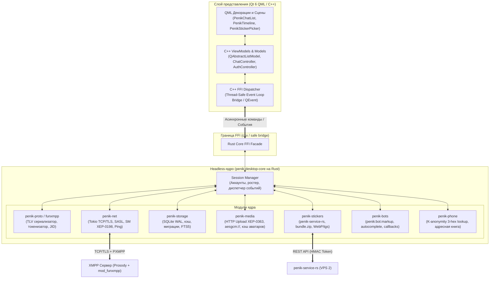
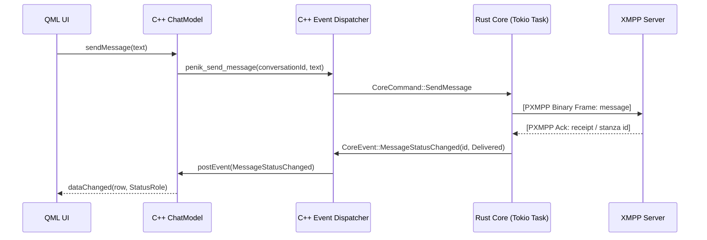

# Архитектурный план: Модульный десктоп-клиент PenikXMPP (Qt 6 C++ / QML & Rust Core)

## 1. Введение и цели проекта

### 1.1. Назначение
Цель проекта — разработать современный, быстрый и ресурсоэффективный кроссплатформенный (Linux, Windows, macOS) десктопный клиент для экосистемы **PenikXMPP**.

### 1.2. Ключевые требования
1. **Единый визуальный стиль и UX с Android-клиентом Penik:**
   - Интерфейс в стиле Telegram/Penik Android: кастомная темная палитра (`DarkAppColors`), идентичная типографика, двух-/трехпанельный адаптивный лейаут (Sidebar, список чатов, таймлайн сообщений, панель профиля).
   - Поддержка rich-сообщений: цитирование, пересылка, реакции (XEP-0444), медиа-вложения с прогрессом, стикеры (WebP, Animated WebP, Telegram `.tgs` Lottie), аудиосообщения со спектрограммой.
   - Интерактивные бот-клавиатуры: инлайн-кнопки (`penik:bot:markup`) под пузырями и reply-кнопки над полем ввода.
2. **Модульное headless-ядро на Rust (`penik-desktop-core`):**
   - Полная инкапсуляция сетевого ввода-вывода, протоколов, криптографии, кэширования и работы с локальной базой данных SQLite.
   - Ядро не зависит от GUI и может собираться как разделяемая библиотека (`cdylib` / `staticlib`), CLI-демон или использоваться для тестов.
3. **Поддержка бинарного протокола PXMPP (FunXMPP):**
   - Симметричное TLV-фреймирование, токенизация тегов/атрибутов/пространств имен (словарь 240+ токенов), сжатие JID (Bare/Full), согласование потока (`<enable dict='...'/>`).
   - Сокращение оверхеда трафика до 70% по сравнению с чистым XML.
4. **Высокая производительность UI:**
   - GUI на **Qt 6 (QML + C++)**: аппаратное ускорение рендеринга (Vulkan / Metal / Direct3D 11 / OpenGL через Qt RHI), плавная прокрутка виртуализированных списков (до 100 000 сообщений в кэше без лагов), мгновенный запуск.

---

## 2. Общая архитектурная схема



---

## 3. Детализация модулей Rust Core (`penik-desktop-core`)

Headless-ядро организовано как Cargo Workspace, состоящий из слабо связанных модулей (crates):

### 3.1. `crates/penik-proto` (Сетевые протоколы и Direct PXMPP)
- **Direct PXMPP Кодек (Implicit Binary Framing over TLS):**
  - Подключение с 1-го байта через TLS ALPN `pxmpp-1` на портах 5223 / 443 без промежуточных текстовых XML-рукопожатий.
  - **10-байтный Client Stream Header:** `Magic ("PXMP", 4B) + Version (0x01) + Flags (1B, e.g. 0x01 FLAG_RESUME) + Dict Hash (4B, FNV-1a) + Domain Token/Literal`.
  - **10-байтный Server Stream Header:** `Magic ("PXMP", 4B) + Version (0x01) + Flags (1B) + Active Dict Hash (4B)`.
  - **Симметричный TLV-фрейминг:** Двухуровневая длина кадра (`u16` или `0xFFFF` + `u32`), строковые префиксы (`0xFA` до 255B, `0xFB` до 64KB, `0xFC` до 4GB).
  - **Сжатие JID:** Префиксы `0xFD` (Bare JID `user@domain`) и `0xFE` (Full JID `user@domain/resource`) с токенизацией домена в 1 байт.
  - **Эволюция словарей (Dictionary Evolution):**
    - LTS Core v1 (`0x68a7596d`) — замороженный базовый диапазон `0x00..0xD0`.
    - v2 (`0x3a145c7a`) — токены бот-платформы, стикеров и компонентов (`bot`, `share`, `tg`, `stickers`, `markup`, `callback`).
    - Динамический PubSub-словарь (`penik:protocol:dict`) — подгрузка новых токенов для кастомных бот-сервисов на лету.
  - **1-RTT Fast Session Resumption & 0-RTT Pipelining:**
    - Отправка заголовка `PXMP` с флагом `FLAG_RESUME` и прицепленным бинарным кадром `<resume previd='...' h='...'/>` в первом же TCP-пакете.
    - Возобновление сессии и получение истории MAM ровно за 1 RTT (время TLS 1.3 Handshake).

### 3.2. Архитектурная дилемма: Pure Direct PXMPP (Zero XML) vs Hybrid (XML Fallback)

При проектировании ядра встает ключевой инженерный вопрос: **нужен ли десктопному клиенту XML-парсер вообще, или можно полностью вырезать XML из Rust Core?**

#### Сравнительный анализ подходов:

| Критерий | Вариант 1: Pure Direct PXMPP (Zero XML) ⭐ | Вариант 2: Hybrid (Direct PXMPP + XML Fallback) |
| :--- | :--- | :--- |
| **Архитектура кодека** | Минималистичная, строгая TLV стейт-машина (~800 строк безопасного Rust). Единый конвейер. | Сложная: 2 параллельных кодека, абстрактный `StanzaTransport`, переключатели рантайма (~3500+ строк). |
| **Зависимости ядра** | **0 XML-библиотек.** Только `bytes`, `tokio`, `rustls`. Граф зависимостей чист. | Тянет `quick-xml`, `minidom` или `tokio-xmpp`, парсеры сущностей, таблицы аллокаций. |
| **Размер бинарника** | Минус ~1.5–2.5 МБ в stripped-бинарнике `penik-desktop-core`. Сборка быстрее на 40%. | Бинарник раздут кодом разбора строк, валидацией XML-неймспейсов и DOM-деревьев. |
| **Потребление памяти (RAM)** | **Zero-Copy / Linear Memory:** токены мапятся напрямую в `enum Token(u8)` на стеке. Без аллокаций. | Высокое: XML DOM аллоцирует `String` для каждого тега, атрибута и текстового узла. |
| **Безопасность (Attack Surface)** | Неуязвимо к XML-атакам: нет Billion Laughs, Quadratic Blowup, Entity Injection, namespace confusion. | Требует санитизации XML, ограничения глубины вложенности, защиты от DoS/OOM в XML-парсере. |
| **Скорость старта (TTFB)** | **1 RTT** (Fast Resumption) или **2 RTT** (Full Auth + Bind). Мгновенная готовность к UI. | 4–6 RTT в XML-режиме, либо сложная логика тайм-аутов отката при сбоях ALPN. |
| **Совместимость с серверами** | **Только сервера экосистемы Penik** (Snikket/Prosody с `mod_funxmpp`). | Любой стандартный публичный XMPP-сервер в мире (`jabber.ru`, `conversations.im` и т.д.). |

#### Вопрос: "А зачем вообще делать XML-парсер в десктопе Penik?" (Разбор аргументов)

1. **Аргумент «А вдруг пользователь захочет войти под аккаунтом со стороннего сервера (например, jabber.ru)?»**
   - **Реальность Penik:** Penik — это **не generic XMPP-клиент** общего назначения (как Gajim или Dino). Penik — это клиент экосистемы PenikXMPP:
     - Все ключевые возможности Penik: мост с Telegram (`tg.snikket.penik.ru`), Bot Gateway (`bot.snikket.penik.ru`), инлайн-клавиатуры `penik:bot:markup`, стикеры с HMAC-токенами (`penik-service-rs`), K-anonymity синхронизация телефонной книги — **жестко завязаны на серверную инфраструктуру Penik**.
     - На стороннем ванильном сервере без модулей Penik клиент превратится в обычный текстовый чат без стикеров, ботов и интеграций. Пользователь получит сломанный UX.
   - **Вывод:** Поддержка сторонних серверов — ложная цель, создающая огромный техдолг ради невостребованного сценария.

2. **Аргумент «А если на сервере Penik сломается `mod_funxmpp`?»**
   - **Реальность:** Сервер администрируется нами. `mod_funxmpp` — это неотъемлемая часть бэкенда. Если сломается `mod_funxmpp`, то сломается и мобильный Penik Android, и синхронизация. Решать проблему администрирования бэкенда усложнением десктопного клиента — архитектурная ошибка.

3. **Аргумент «Отладка трафика через Wireshark / tcpdump»**
   - **Реальность:** Трафик и в XML, и в PXMPP полностью зашифрован TLS 1.3. В сниффере снаружи виден только TLS-поток. А внутри ядра Rust пишется элементарный трассировочный логгер: `tracing::debug!(stanza = ?stanza)`, который печатает человекочитаемое представление станции в консоль разработчика.

#### Рекомендованное архитектурное решение для Penik Desktop:
1. **Основной режим (Pure Direct PXMPP, 100% Zero XML):**
   - В ядре `penik-desktop-core` **полностью отсутствует XML-парсер**.
   - Соединение устанавливается исключительно через ALPN `pxmpp-1` на портах 5223 / 443.
   - Все станзы от рукопожатия до сообщений идут в чистом бинарном TLV-формате.
   - Максимальная производительность, минимальный вес бинарника, нулевая уязвимость к XML-атакам.
2. **Страховка на будущее (Feature Flag):**
   - В `penik-proto` при необходимости можно оставить за флагом `features = ["xml-fallback"]` опциональный адаптер на `quick-xml`. По умолчанию фича **выключена**.

---

### 3.3. `crates/penik-net` (Сетевой стек и сессии)
- Асинхронный рантайм на **Tokio**.
- TLS-соединение через `rustls` (без зависимости от системного OpenSSL) с проверкой сертификатов и ALPN.
- Аутентификация SASL: `SCRAM-SHA-256`, `SCRAM-SHA-1`, `PLAIN`.
- Поддержка XEP-стандартов надежности:
  - **XEP-0198 (Stream Management):** учет номеров подтверждений станз (`<r/>`, `<a h='...'/>`), восстановление сессии без дублирования сообщений.
  - **XEP-0280 (Message Carbons):** синхронизация сообщений между всеми устройствами пользователя.
  - **XEP-0313 (MAM):** синхронизация истории чатов с пейджингом (RSM).
  - **XEP-0352 (Client State Indication):** переход в неактивный режим (CSI Inactive) при сворачивании окна для экономии трафика.

### 3.4. `crates/penik-storage` (Хранилище данных и кэш)
- База данных **SQLite** в режиме WAL (`Write-Ahead Logging`) с пулом соединений на базе `sqlx` или `rusqlite`.
- Таблицы:
  - `accounts`: аккаунты, JID, токены сессий, настройки.
  - `conversations`: активные диалоги, последний сниппет, счетчик непрочитанных, статус закрепления, черновики.
  - `messages`: входящие/исходящие сообщения, серверные/локальные ID, временные метки, статусы доставки (`Sent`, `Delivered`, `Read`), реакции, разметка ботов.
  - `contacts` / `roster`: список контактов, никнеймы, статусы присутствия, хэши аватаров.
  - `stickers` & `sticker_packs`: локальный каталог стикеров, метаданные паков, пути к закэшированным файлам.
- **FTS5:** Виртуальная таблица полнотекстового поиска для мгновенного поиска по истории сообщений без блокировки интерфейса.

### 3.5. `crates/penik-media` (Медиа и файлы)
- Загрузка вложений по **XEP-0363 (HTTP File Upload)** с получением слота через IQ и отправкой через HTTP `PUT`.
- Скачивание файлов по протоколам `https://` и `aesgcm://` (автоматическая расшифровка AES-GCM-256 на лету).
- Генерация миниатюр (thumbnails) для изображений через `image-rs`.
- Локальный LRU-кэш аватарок и вложений с автоочисткой устаревших файлов.

### 3.6. `crates/penik-stickers` & `crates/penik-bots`
- **Стикеры:**
  - Авторизация через IQ `penik:stickers:auth:0` (`mod_stickers_auth`) с получением Bearer HMAC-токена.
  - Загрузка архивов `bundle.zip` с `penik-service-rs` и распаковка в локальное кэш-хранилище.
  - Каталог недавних стикеров (Recents) и установленных паков.
- **Боты:**
  - Десериализация XML-расширения `penik:bot:markup`.
  - Генерация интерактивных callback-запросов (нажатие инлайн-кнопок пользователем) в форме IQ или сообщений.
  - Парсинг описаний команд бота (`penik:bot:commands`) для автодополнения в строке ввода.

---

## 4. Архитектура FFI и интеграция Rust ↔ C++ / Qt

### 4.1. Выбор FFI-подхода: `cxx` + Event-Driven Actor Pattern
Вместо связывания Rust напрямую с метаобъектной системой Qt (что усложняет сборку и отладку), выбирается надежный шаблон **Event-Driven Broker**:

1. **Библиотека моста (`penik-ffi`):**
   - Использует `cxx` для генерации безопасных C++ заголовков и биндингов с проверкой типов на этапе компиляции.
2. **Асинхронная передача событий (Rust → Qt):**
   - Rust-ядро порождает события (`CoreEvent::NewMessage`, `CoreEvent::ConversationUpdated`, `CoreEvent::StickerPackDownloaded` и т.д.).
   - События отправляются в кросс-поточную очередь `crossbeam-channel`.
   - C++ класс-адаптер (`PenikEventDispatcher`) получает уведомление через wake-up сигнал (сокетпар или вызов `QCoreApplication::postEvent`).
   - События распаковываются в главном потоке GUI Qt и маршрутизируются в соответствующие `QAbstractListModel`.
3. **Команды пользователя (Qt → Rust):**
   - C++ контроллеры вызывают методы FFI фасада (`penik_send_message`, `penik_join_room`, `penik_import_sticker_pack`).
   - Rust помещает команду в Tokio channel и возвращает `Promise`/`RequestId` для последующего асинхронного ответа.



---

## 5. Слой представления: Qt 6 (QML & C++)

### 5.1. Дизайн-система и адаптация под Desktop
Дизайн повторяет мобильный Penik (Jetpack Compose), адаптируя его под десктопное использование (горячие клавиши, drag-and-drop, контекстные меню, мультиселект):

| Мобильный компонент (Android) | Десктопный аналог (Qt 6 QML) | Особенности десктопного UX |
| :--- | :--- | :--- |
| `PenikChatsList.kt` | `PenikChatList.qml` + `ChatListModel.cpp` | Закрепленные чаты, папки, глобальный поиск по `Ctrl+F`, бейджи непрочитанных, ховер-эффекты. |
| `PenikChatRoom.qml` | `PenikTimeline.qml` + `MessagesModel.cpp` | Виртуализированный `ListView`, группировка по датам, пузыри сообщений, цитирование по `Reply`, индикаторы доставки. |
| `PenikStickerBubble.kt` | `StickerBubble.qml` | Рендеринг статических/анимированных WebP и Lottie `.tgs` (векторные стикеры через `rlottie-qt`). |
| `PenikStickerPicker.kt` | `StickerPickerPopup.qml` | Модальное окно или всплывающая панель над кнопкой смайлика: вкладка Emoji, Стикеры, GIF, быстрый импорт паков. |
| `PenikAttachmentPicker.kt` | `AttachmentDropZone.qml` | Поддержка Drag & Drop файлов в окно чата, вставка скриншота из буфера обмена (`Ctrl+V`), диалог выбора файлов. |
| `PenikBotCommands.kt` | `BotCommandsOverlay.qml` | Автодополнение команд при вводе `/`, плавающий список с описаниями и иконками, навигация стрелками. |
| `penik:bot:markup` | `BotInlineKeyboard.qml` | Динамическая сетка кнопок под пузырем сообщения с анимацией загрузки при клике. |
| `PenikAuthScreen.kt` | `PenikAuthWizard.qml` | 3-шаговый визард подключения/регистрации (Welcome, логин/никнейм, пароль, профиль). |

### 5.2. Цветовая палитра Penik (QML Theme Singleton)
Создается синглтон `PenikTheme.qml`, зеркалирующий цвета из `android/src/main/res/values-night/penik_colors.xml`:
- `background`: `#0F141C` (глубокий темный фон).
- `surface`: `#1A222D` (панели чатов, верхний тулбар).
- `primary`: `#5288C1` (акцентный синий цвет Penik).
- `bubbleOut`: `#2B5278` (исходящие сообщения).
- `bubbleIn`: `#182533` (входящие сообщения).
- `textPrimary`: `#FFFFFF`, `textSecondary`: `#7E8B9B`.
- `bubbleReadCheck`: `#4FAE4E` (зеленые двойные галочки прочтения).

---

## 6. Структура репозитория десктоп-клиента

Клиент создается как самостоятельный модуль или подпапка в корне проекта (`desktop/`):

```
desktop/
├── CMakeLists.txt                # Корневой CMake для сборки Qt + вызова Cargo
├── Cargo.toml                    # Cargo Workspace ядра
├── core/                         # Rust headless-ядро
│   ├── Cargo.toml
│   ├── crates/
│   │   ├── penik-proto/          # Direct PXMPP кодек (TLV, словари v1/v2, без XML)
│   │   ├── penik-net/            # Tokio сокеты, TLS ALPN pxmpp-1, SASL, 1-RTT SM
│   │   ├── penik-storage/        # SQLite WAL, FTS5, миграции
│   │   ├── penik-media/          # Загрузка/скачивание, HTTP Upload, AES-GCM
│   │   ├── penik-stickers/       # Стикерпаки, bundle.zip, кэш
│   │   ├── penik-bots/           # penik:bot:markup, bot commands
│   │   ├── penik-phone/          # K-anonymity lookup контактов
│   │   └── penik-ffi/            # CXX биндинги к C++
│   └── tests/                    # Интеграционные тесты ядра
└── ui/                           # Qt 6 C++ / QML
    ├── CMakeLists.txt
    ├── src/
    │   ├── main.cpp              # Инициализация QApplication, QML движка, FFI
    │   ├── bridge/
    │   │   ├── PenikClientBridge.hpp/cpp  # Мост между Rust FFI и Qt
    │   │   └── PenikEventDispatcher.hpp/cpp
    │   ├── controllers/
    │   │   ├── AuthController.hpp/cpp     # Логин / регистрация
    │   │   ├── ChatController.hpp/cpp     # Отправка сообщений, управление чатом
    │   │   └── MediaController.hpp/cpp    # Загрузка файлов, просмотрщик
    │   └── models/
    │       ├── ChatListModel.hpp/cpp      # QAbstractListModel для списка диалогов
    │       ├── MessagesModel.hpp/cpp      # QAbstractListModel для таймлайна
    │       └── StickersModel.hpp/cpp      # Модель каталога стикеров
    └── qml/
        ├── Main.qml                       # Главное окно (Sidebar + Chat Area)
        ├── theme/
        │   └── PenikTheme.qml             # Цвета и шрифты 1:1 с Android
        ├── screens/
        │   ├── AuthWizard.qml
        │   └── MainChatScreen.qml
        └── components/
            ├── ChatList.qml
            ├── ChatTimeline.qml
            ├── MessageBubble.qml
            ├── StickerBubble.qml
            ├── StickerPicker.qml
            ├── BotKeyboards.qml
            └── AttachmentDialog.qml
```

---

## 7. Поэтапный план разработки (Roadmap)

### Этап 0: Инфраструктура и прототипирование сборки (Неделя 1)
- [ ] Настройка сборочной инфраструктуры `CMake + Corrosion (или Custom Cargo Command)`.
- [ ] Проверка компиляции минимального Rust FFI (`cxx`) и линковки с тестовым Qt 6 приложением на Linux, Windows и macOS.
- [ ] Базовая структура папок `desktop/` и фиксация архитектурных контрактов.

### Этап 1: Сетевое ядро, Direct PXMPP и авторизация (Недели 2–3)
- [ ] Реализация `penik-proto`: TLV-сериализатор/десериализатор, двухуровневая длина, словари LTS v1 (`0x68a7596d`) и v2 (`0x3a145c7a`), сжатие JID, FNV-1a хеширование (Pure Zero-XML кодек).
- [ ] Реализация `penik-net`: Tokio TCP + `rustls` с согласованием TLS ALPN `pxmpp-1`, отправка 10-байтного Magic Stream Header `PXMP`.
- [ ] SASL-аутентификация (SCRAM-SHA-256) и Bind в бинарных TLV-фреймах с автоматическим переоткрытием потока Prosody.
- [ ] 1-RTT Fast Session Resumption (Stream Management XEP-0198) с 0-RTT Pipelining фрейма `<resume/>`.
- [ ] Слой хранения `penik-storage`: базовая схема SQLite, сохранение учетной записи и сессии.
- [ ] Экран авторизации в QML (`AuthWizard.qml`): приветствие, ввод логина/пароля, переключение на экран чатов.

### Этап 2: Список чатов, базовые сообщения и MAM (Недели 4–5)
- [ ] Поддержка XEP-0313 (MAM): дозагрузка истории сообщений при открытии клиента.
- [ ] Реализация `ChatListModel` и `MessagesModel` на C++ с реактивным обновлением от событий Rust.
- [ ] QML-интерфейс списка диалогов: адаптивный Sidebar, аватарки с кэшированием, последнее сообщение, бейджи непрочитанных.
- [ ] QML-интерфейс таймлайна: текстовые пузыри сообщений, дата, временные метки, галочки статусов (Sent / Delivered / Read).

### Этап 3: Rich Media, стикеры и боты (Недели 6–7)
- [ ] Поддержка XEP-0363 (HTTP Upload) и скачивание вложений (`aesgcm://`, `https://`).
- [ ] Реализация модуля стикеров `penik-stickers`: получение токена через `mod_stickers_auth`, скачивание и распаковка `bundle.zip`.
- [ ] Рендеринг стикеров в QML: WebP (статические и анимированные) + интеграция `rlottie` для Telegram `.tgs` анимаций.
- [ ] Стикер-пикер с вкладками недавних стикеров и установленных паков.
- [ ] Поддержка ботов: отрисовка инлайн-кнопок `penik:bot:markup`, отправка нажатий (callback queries), автокомплит команд в поле ввода.

### Этап 4: Продвинутые возможности и десктопный UX (Неделя 8)
- [ ] Полнотекстовый локальный поиск FTS5 по истории сообщений (`SearchPopup.qml`).
- [ ] Реакции на сообщения (XEP-0444) с плавающим селектором эмодзи.
- [ ] Drag-and-drop отправка файлов и вставка изображений из буфера обмена (`Ctrl+V`).
- [ ] Нативные системные уведомления (libnotify на Linux, Windows Action Center, macOS Notifications).
- [ ] Модуль телефонного справочника `penik-phone`: K-anonymity 3-hex lookup контактов.

### Этап 5: Оптимизация, тестирование и дистрибуция (Неделя 9)
- [ ] Нагрузочное тестирование базы данных SQLite (100k+ сообщений, замеры FPS прокрутки).
- [ ] Проверка утечек памяти в мосте FFI и QML.
- [ ] Сборка пакетов дистрибуции:
  - Linux: AppImage, Flatpak.
  - Windows: Portable ZIP + Inno Setup инсталлятор.
  - macOS: DMG бандл с Universal Binary (Apple Silicon + x86_64).

---

## 8. Ключевые архитектурные решения и развилки

1. **Технология интеграции Rust и C++:**
   - *Рекомендовано:* **`cxx`** + чистая событийная очередь (`crossbeam::channel` + Qt Custom Event). Это исключает гонки потоков, гарантирует, что весь UI работает исключительно в Main GUI Thread Qt, а все блокирующие операции (сеть, криптография, диск) изолированы в Tokio Runtime в Rust.
2. **QML vs Qt Widgets:**
   - *Рекомендовано:* **QML (Qt Quick)**. Позволяет достичь 1:1 сходства с Jetpack Compose (реактивные свойства, плавные пружинные анимации, скругления, динамические шторки, адаптивные лейауты), в то время как Qt Widgets потребовал бы сложной ручной перерисовки (`QPainter`) и стилизации таблицами стилей (QSS), которые плохо подходят для современных чат-мессенджеров.
3. **Рендеринг анимаций стикеров (.tgs Lottie):**
   - *Рекомендовано:* Использование легковесной C++ библиотеки **`rlottie`** с экспортом кадров в QQuickPaintedItem / QSGNode. Для WebP используется нативный плагин Qt ImageFormats (libwebp).
