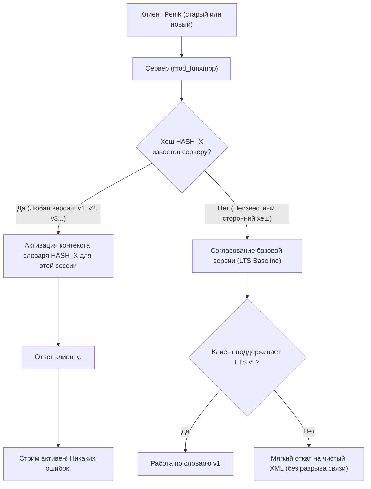

# Архитектурный план: Сохранение совместимости при эволюции словаря PXMPP

## 1. Проблема: Почему меняется словарь и что ломается у старых клиентов

В спецификации PXMPP (FunXMPP) токены привязаны к статическому словарю, целостность которого верифицируется 32-битным FNV-1a хешем:
```xml
<!-- Сервер рекламирует свой словарь -->
<funxmpp xmlns='penik:protocol:funxmpp' version='1' dict='68a7596d'/>

<!-- Клиент отправляет запрос с хешем своего словаря -->
<enable xmlns='penik:protocol:funxmpp' dict='68a7596d'/>
```

### В чем уязвимость текущей реализации:
1. **Жесткий отказ при несовпадении (Brittle Handshake):**  
   Если в `mod_funxmpp` на сервере добавить хотя бы один новый токен (например, для ботов `penik:bot:markup`, аудио-голосовых или стикеров), хеш словаря изменится с `68a7596d` на новый (например, `a41f92c1`).
2. **Потеря бинарного режима старыми клиентами:**  
   Сотни установленных мобильных клиентов Penik предыдущих версий имеют зашитый хеш `68a7596d`. Получив ответ:
   ```xml
   <failed xmlns='penik:protocol:funxmpp'><dictionary-mismatch/></failed>
   ```
   старые клиенты либо аварийно откатываются на чистый XML (теряя экономию 70% трафика и батареи), либо вообще сталкиваются с ошибками потока.

---

## 2. Предлагаемое архитектурное решение

Чтобы изменение словаря никогда не ломало старые клиенты, внедряется гибридная модель:
**«Многоверсионность на сервере + Монотонное расширение (Append-Only) + Fallback на строковые литералы»**.



---

## 3. Ключевые механизмы совместимости

### 3.1. Стратегия 1: Многоверсионный реестр словарей на сервере (Server Multi-Dictionary Registry)
Сервер Prosody (`mod_funxmpp.lua`) не заменяет старый словарь новым, а хранит **реестр всех когда-либо выпущенных словарей**:

```lua
-- server/Modules/mod_funxmpp.lua

local DICTIONARIES = {
    -- v1 (LTS релиз Android Penik): FNV-1a = 0x68a7596d
    ["68a7596d"] = {
        version = 1,
        tokens = require "funxmpp_dict_v1",
        tokens_rev = reverse_table(require "funxmpp_dict_v1"),
    },
    -- v2 (С ботами, стикерами и WebRTC): FNV-1a = 0xa41f92c1
    ["a41f92c1"] = {
        version = 2,
        tokens = require "funxmpp_dict_v2",
        tokens_rev = reverse_table(require "funxmpp_dict_v2"),
    },
};

local LATEST_DICT_HASH = "a41f92c1";
```

#### Поведение при подключении:
1. В `<stream:features>` сервер объявляет свой самый свежий словарь:
   ```xml
   <funxmpp xmlns='penik:protocol:funxmpp' version='2' dict='a41f92c1'/>
   ```
2. **Старый клиент** игнорирует объявление сервера и запрашивает свой словарь:
   ```xml
   <enable xmlns='penik:protocol:funxmpp' dict='68a7596d'/>
   ```
3. Сервер ищет хеш `68a7596d` в таблице `DICTIONARIES`.
   * Хеш найден! Сервер привязывает к объекту сессии `session.fun_dict = DICTIONARIES["68a7596d"]`.
   * Сервер отвечает: `<enabled xmlns='penik:protocol:funxmpp' dict='68a7596d'/>`.
4. **Результат:** Старый клиент счастлив — он работает со своим словарем v1, для него ничего не изменилось. Новый клиент подключается с `a41f92c1` и получает возможности словаря v2.

---

### 3.2. Стратегия 2: Монотонное расширение и Fallback на строковые литералы (Literal Fallback)
Правило разработки PXMPP: **Словарь является строго монотонным (Append-Only)**.
- Токены с `0x00` по `0xEE` (базовые 239 токенов v1) **никогда не переназначаются и не удаляются**.
- Новые теги и атрибуты получают индексы начиная с `0xEF` или используют двухбайтовые токены `0xEF [token]`.

#### Как сервер общается со старым клиентом, если в сообщении появились новые сущности?
Представим, что бот отправляет сообщение с разметкой `penik:bot:markup` (токен есть в v2, но его **нет** в v1):
- Сервер видит, что у сессии активен словарь v1 (`68a7596d`).
- Сервер проверяет строку `penik:bot:markup` по реверсивной таблице v1: токена нет.
- **Вместо ошибки сервер кодирует строку как строковый литерал (String Literal)!**
  В PXMPP для строковых литералов уже предусмотрены префиксы:
  `0xFA` (длина до 255 байт) + `[длина]` + `UTF-8 байты`.
- **Результат:** Старый клиент (v1) без проблем читает фрейм, так как парсер `FunReader` обязан уметь читать и токены, и строковые литералы. Он видит тег `penik:bot:markup` как обычную строку и корректно передает его вышележащему коду.

---

### 3.3. Стратегия 3: Согласование диапазона версий (Version Negotiation)
Чтобы избежать ситуации, когда клиенту нужно перебирать хеши вслепую, переходим от проверки "хеш в лоб" к **согласованию минимальной поддерживаемой версии**:

В stream features сервер объявляет:
```xml
<funxmpp xmlns='penik:protocol:funxmpp' version='2' dict='a41f92c1' min_compat='68a7596d'/>
```
Атрибут `min_compat='68a7596d'` явно говорит клиентам:
> *"Я поддерживаю новейший словарь `a41f92c1`, но полностью обратно совместим со словарем `68a7596d`"*.

Если клиент видит знакомый `min_compat`, он может сразу слать `<enable dict='68a7596d'/>`, будучи на 100% уверенным, что сервер его примет.

---

### 3.4. Стратегия 4: Двухуровневое пространство токенов и виртуальные домены

Для долгосрочной эволюции (v2, v3 и далее) пространство токенов строго сегментируется:

| Диапазон байт | Назначение | Политика версионирования и хеширования |
| :--- | :--- | :--- |
| `0x00 .. 0xD0` (0..208) | **LTS Core Tokens** (message, presence, iq, body, chat, to, from, resume, auth и т.д.) | **Заморожено навечно**. Входит в `Dict Hash`. Все 0-RTT кадры до согласования версии кодируются только отсюда. |
| `0xD1 .. 0xEE` (209..238) | **Виртуальные доменные токены сессии (Virtual Session Domains)** | **НЕ входят в `Dict Hash`!** Динамически привязываются при старте сессии: `0xD1` = домен сервера из Stream Header, `0xD2` = `conference.<domain>` и т.д. Разворачивание на новом домене **не меняет** хеш словаря! |
| `0xEF [byte]` | **Extension Space (256 расширенных токенов для v2+)** | Входит в `Dict Hash` версии v2+. **КРИТИЧЕСКИ ВАЖНО:** Сервер **никогда не отправляет префикс `0xEF` клиентам v1**. Для сессий со словарем v1 любые расширенные токены сервер автоматически сбрасывает в строковые литералы (`0xFA` + длина + UTF-8). |

> [!CAUTION]
> **Изоляция старых клиентов от префикса `0xEF`:**
> Старый парсер v1 не обучен структуре двухбайтовых токенов `0xEF`. Если он получит `0xEF`, он воспримет его как неизвестный 1-байтный токен и потеряет выравнивание потока. Благодаря **Стратегии 1 (Реестр словарей)** сервер точно знает версию клиента: клиентам v1 сервер транслирует новые фичи исключительно строковыми литералами (`0xFA`), а двухбайтовый префикс `0xEF [byte]` генерирует только для клиентов v2+.

---

## 4. Сравнительный анализ стратегий

```
+------------------------------------+--------------------------+-----------------------+
| Метод совместимости                | Сложность реализации     | Эффективность трафика |
+------------------------------------+--------------------------+-----------------------+
| 1. Серверный реестр словарей       | Очень простая (Lua-табл) | 100% (максимальная)   |
| 2. Fallback на строковые литералы  | Нулевая (уже есть в коде)| 95% (небольшой оверхед|
|                                    |                          | только на новые теги) |
| 3. min_compat атрибут в features   | 5 строк кода             | 100%                  |
| 4. Двухбайтовые токены 0xEF        | Средняя                  | 99%                   |
+------------------------------------+--------------------------+-----------------------+
```

---

## 5. Практический чеклист внедрения

1. **Сервер (`server/Modules/mod_funxmpp.lua`):**
   - Вынести текущий словарь в `funxmpp_dict_v1.lua` с хешем `68a7596d`.
   - Завести таблицу `session.dictionaries` и при получении `<enable dict='...'>` проверять наличие хеша в таблице, а не сравнивать с одной жесткой константой.
   - В `FunWriter` на сервере: если токен не найден в активном словаре сессии, автоматически сбрасывать запись в строковый литерал `write_literal(str)` вместо генерации ошибки или пропуска тега.
2. **Клиент (Android / Rust Desktop):**
   - В обработчике `<stream:features>` считывать опциональный `min_compat`.
   - При получении `dictionary-mismatch` (если сервер сторонний и очень старый) — автоматически переходить в прозрачный режим чистого XML без показа ошибки пользователю и без разрыва сокета.
