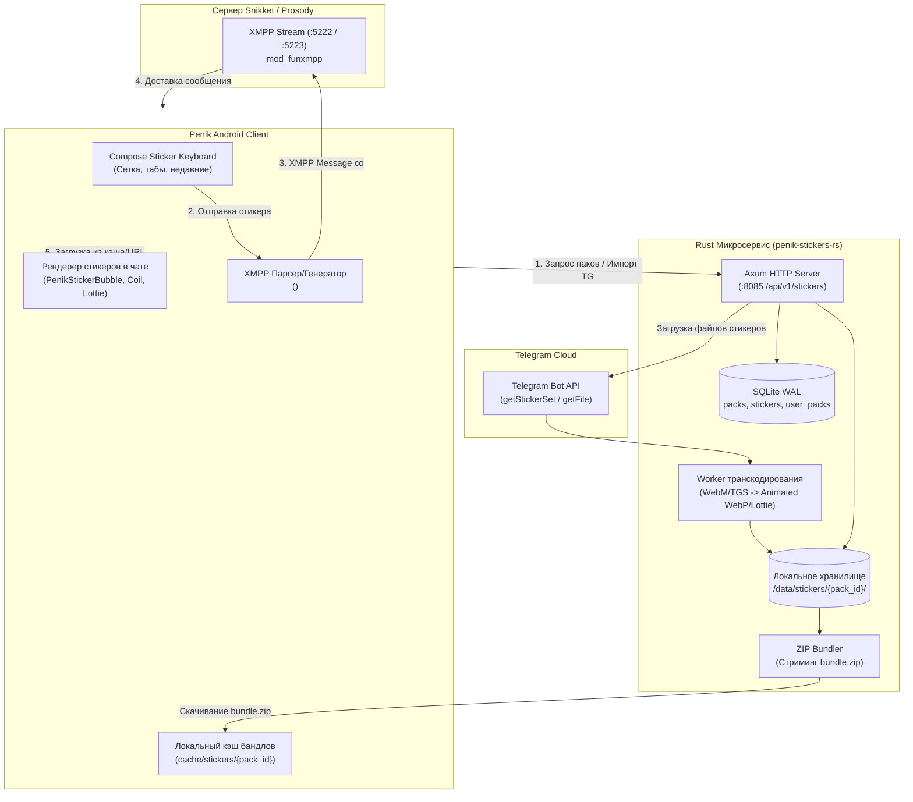

# План реализации стикеров в PenikXMPP на базе Rust-микросервиса

## 1. Архитектурный обзор

Система стикеров объединяет легковесный автономный Rust-микросервис для управления медиа и импорта, расширение XMPP-станз сообщений с обратной совместимостью (XEP-0066 OOB) и современный Compose UI в Android-клиенте.



---

## 2. Компоненты системы

### 2.1. Rust-микросервис (`server/penik-stickers-rs`)
Высокопроизводительный сервис на **Rust**, компилируемый в единый статический бинарник без тяжелых зависимостей.

- **Стек:**
  - `axum` + `tokio`: Асинхронный HTTP сервер.
  - `sqlx` + `sqlite`: Быстрая встроенная база данных в режиме WAL.
  - `reqwest`: HTTP-клиент для взаимодействия с Telegram Bot API.
  - `image` / `webp` / `libwebp-sys`: Оптимизация и транскодирование стикеров.
  - `async-zip` / `flate2`: Генерация ZIP-бандлов на лету.
  - `tower-http`: Раздача статики с агрессивным кэшированием (`Cache-Control: public, max-age=31536000, immutable`).

- **Схема базы данных (SQLite):**
  ```sql
  CREATE TABLE IF NOT EXISTS sticker_packs (
      id TEXT PRIMARY KEY,
      title TEXT NOT NULL,
      author_jid TEXT NOT NULL DEFAULT '',
      cover_sticker_id TEXT NOT NULL DEFAULT '',
      is_animated INTEGER NOT NULL DEFAULT 0,
      is_video INTEGER NOT NULL DEFAULT 0,
      created_at INTEGER NOT NULL
  );

  CREATE TABLE IF NOT EXISTS stickers (
      id TEXT PRIMARY KEY,
      pack_id TEXT NOT NULL REFERENCES sticker_packs(id) ON DELETE CASCADE,
      emoji TEXT NOT NULL DEFAULT '',
      file_name TEXT NOT NULL,
      width INTEGER NOT NULL DEFAULT 512,
      height INTEGER NOT NULL DEFAULT 512,
      sort_order INTEGER NOT NULL DEFAULT 0
  );
  CREATE INDEX IF NOT EXISTS idx_stickers_pack ON stickers(pack_id, sort_order);

  CREATE TABLE IF NOT EXISTS user_sticker_packs (
      user_jid TEXT NOT NULL,
      pack_id TEXT NOT NULL REFERENCES sticker_packs(id) ON DELETE CASCADE,
      sort_order INTEGER NOT NULL DEFAULT 0,
      installed_at INTEGER NOT NULL,
      PRIMARY KEY (user_jid, pack_id)
  );
  CREATE INDEX IF NOT EXISTS idx_user_packs ON user_sticker_packs(user_jid, sort_order);
  ```

- **REST API интерфейс:**
  - `GET /api/v1/stickers/my?jid={user_jid}` — Список установленных стикерпаков пользователя.
  - `GET /api/v1/stickers/pack/{id}` — Метаданные конкретного пака со списком стикеров.
  - `POST /api/v1/stickers/pack/{id}/install?jid={user_jid}` — Добавление пака пользователю.
  - `DELETE /api/v1/stickers/pack/{id}/install?jid={user_jid}` — Удаление пака из коллекции.
  - `POST /api/v1/stickers/import/telegram` — Импорт стикерпака по Telegram-ссылке (`t.me/addstickers/{name}`) с автоматическим скачиванием и транскодированием.
  - `GET /api/v1/stickers/pack/{id}/bundle.zip` — Скачивание всех стикеров пака единым архивом для мгновенного оффлайн-кэша.
  - `GET /api/v1/stickers/file/{pack_id}/{file_name}` — Раздача конкретного файла стикера (WebP / TGS).

---

### 2.2. XMPP Протокол и формат передачи станз

Для обеспечения совместимости с другими XMPP-клиентами (Dino, Monal, Gajim) и сохранения чистоты протокола используется расширение с fallback-механизмом:

```xml
<message to='contact@snikket.penik.ru' type='chat' id='msg_stk_1001'>
  <body>[Стикер: 🔥]</body>
  <sticker xmlns='penik:stickers:0'
           pack_id='tg_meme_cats'
           sticker_id='cat_fire'
           emoji='🔥'
           width='512'
           height='512'
           format='webp'
           url='https://snikket.penik.ru/api/v1/stickers/file/tg_meme_cats/cat_fire.webp'/>
  <!-- Fallback для сторонних клиентов по стандарту XEP-0066 OOB -->
  <x xmlns='jabber:x:oob'>
    <url>https://snikket.penik.ru/api/v1/stickers/file/tg_meme_cats/cat_fire.webp</url>
  </x>
</message>
```

- **Клиенты Penik:** Обнаруживают тег `<sticker xmlns='penik:stickers:0'/>`, игнорируют `<body>` и рендерят нативный стикер без пузыря сообщения.
- **Сторонние клиенты:** Отображают `[Стикер: 🔥]` и интерактивное изображение по ссылке OOB.
- **В FunXMPP:** Тег `sticker` и его атрибуты компактно пакуются в TLV-ноду без раздувания трафика.

---

### 2.3. Android Клиент (Compose UI & Storage)

1. **Компонент чата (`PenikChatRoom.kt`):**
   - Новый тип ряда сообщений: `ChatRow.StickerRow`.
   - `PenikStickerBubble`: прозрачный контейнер фиксированного масштабируемого размера (200–240dp), без фона и рамок, с отображением галочек доставки в правом нижнем углу и плашкой реакций.
   - Поддержка форматов:
     - **WebP статический:** Отображение через `AsyncImage` (Coil).
     - **WebP анимированный:** Coil `ImageLoader` с `AnimatedImageDecoder` (API 28+) / `WebPDecoder`.
     - **TGS (Lottie):** Распаковка gzip в Lottie JSON и воспроизведение через `com.airbnb.android.lottie:lottie-compose`.

2. **Клавиатура стикеров (Sticker Picker Sheet):**
   - Раскрывающаяся панель снизу рядом с полем ввода сообщений (по кнопке стикера).
   - Верхний ряд вкладок: Недавние (Recent / Favorite) + установленные паки с иконками обложек.
   - Сетка стикеров (LazyVerticalGrid на 4–5 колонок).
   - Кнопка «+» / «Импорт» для добавления нового пака по ссылке Telegram.
   - Предварительный просмотр стикера по долгому нажатию (Haptic Feedback + всплывающее превью).

3. **Менеджер кэширования (`StickerManager.kt`):**
   - Хранение скачанных паков в `context.filesDir/stickers/{pack_id}/`.
   - Фоновая загрузка `bundle.zip` при добавлении пака.
   - Мгновенная загрузка стикера из локального файла, если пак уже установлен; если нет — стриминг по HTTP URL с параллельным кэшированием.

---

## 3. Пошаговый план реализации

### Этап 1: Разработка Rust-микросервиса (`server/penik-stickers-rs`)
1. Создать проект `server/penik-stickers-rs` (`Cargo.toml`, модули `main`, `config`, `db`, `telegram`, `transcoder`, `handlers`).
2. Реализовать клиент Telegram Bot API для получения информации о стикерсете и скачивания файлов.
3. Реализовать пайплайн транскодирования:
   - WebM-видеостикеры → оптимизированный анимированный WebP (масштабирование до 256x256, 15fps, палитра с ограничением размера).
   - TGS → распакованный/валидированный Lottie.
   - Статический WebP → прямое сохранение с проверкой заголовков.
4. Реализовать эндпоинты REST API для управления коллекциями пользователей (`user_sticker_packs`) и отдачи файлов.
5. Написать юнит-тесты на Rust (`cargo test`) для парсинга ответов Telegram и генерации ZIP-бандлов.

### Этап 2: Протокол и модель данных в PenikXMPP (Android)
1. Создать XML-модель стикера `eu.siacs.conversations.entities.Sticker` и парсер в `MessageParser.java`.
2. Добавить генерацию тега `<sticker xmlns='penik:stickers:0'>` и `<x xmlns='jabber:x:oob'>` в `MessageGenerator.java`.
3. Добавить токены `sticker`, `pack_id`, `sticker_id`, `penik:stickers:0` в бинарный словарь FunXMPP (`FunTokens.java` и `server/mod_funxmpp.lua`).
4. Написать юнит-тесты в `FunProtocolTest.java` на сериализацию и парсинг станз со стикерами.

### Этап 3: Менеджер стикеров и сетевой клиент (Android)
1. Реализовать `StickerManager.kt`:
   - Взаимодействие с REST API микросервиса (получение установленных паков, импорт, установка/удаление).
   - Скачивание и распаковка `bundle.zip` во внутреннюю память.
   - Хранение локальной истории недавних отправленных стикеров в SharedPreferences/Room.
2. Интегрировать зависимости Coil animated / Lottie в `build.gradle` (если еще не подключены).

### Этап 4: Пользовательский интерфейс (Jetpack Compose)
1. Реализовать панель выбора стикеров `PenikStickerPicker.kt` с табами паков, сеткой стикеров и разделом недавних.
2. Встроить переключатель клавиатура/стикеры в строку ввода `PenikChatInput`.
3. Реализовать рендеринг стикеров в `PenikChatRoom.kt` (`PenikStickerBubble`).
4. Добавить диалоговое окно добавления пака по Telegram-ссылке `ImportStickerPackDialog.kt`.

### Этап 5: Сборка, тестирование и документация
1. Написать скрипт сборки и запуска Docker-контейнера для микросервиса `server/penik-stickers-rs/Dockerfile`.
2. Обновить `install_phone.sh` и конфигурацию Gradle при необходимости.
3. Добавить документацию по настройке и API стикеров в `docs/PXMPP/` и `README.md`.
4. Обновить `PROJECT_MAP.md`.

---

## 4. Риски и способы их минимизации

| Риск | Влияние | Минимизация |
| :--- | :--- | :--- |
| **Тяжёлое транскодирование видеостикеров (WebM)** | Высокая нагрузка на CPU микросервиса | Ограничение очереди задач, использование асинхронных воркеров `tokio::task::spawn_blocking`, агрессивное кэширование готовых WebP. |
| **Большой размер анимированных WebP на мобильном клиенте** | Высокое потребление RAM / просадка FPS | Ограничение разрешения до 256x256 при транскодировании, использование дискового LRU-кэша Coil и отложенного декодирования кадров. |
| **Rate Limit от Telegram Bot API** | Ошибки 429 при массовом импорте | Экспоненциальный бэкофф (`retry-after` из ответа Telegram), предварительная проверка наличия пака в базе перед запросом к Telegram. |
